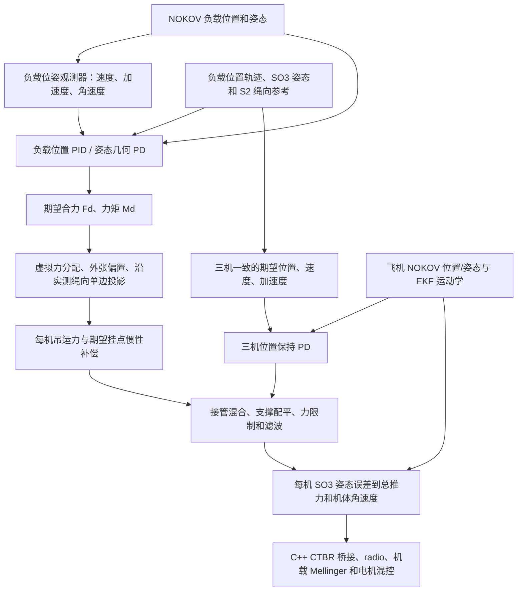

# Crazyswarm CTBR 与三机吊运控制

本仓库在 Crazyswarm 基础上实现了主机端 CTBR（Collective Thrust and Body Rates）控制。控制器从 NOKOV 读取 Crazyflie 的位置和姿态，通过 Crazyswarm server 接收 EKF 运动学状态，并把 CTBR 指令发送回 Crazyflie。多机任务使用同一台 Crazyradio；实际参加任务的飞机由 `crazyflies.yaml` 中的 `ctbr_enabled` 决定。

当前代码包含两类任务：

- 普通 CTBR：`hover`、`circle` 和 `figure_eight_triangle` 轨迹。
- `slung_load`：CF3、CF4、CF5 组成三点吊运系统，负载刚体名称默认为 `load`，控制流程参考 `MATLAB/Multi-UAV-Transportation-Simulation`。

项目使用 ROS Noetic、Python 3、C++ Crazyswarm server 和 NOKOV 动捕。世界坐标采用 z 轴向上；MATLAB 参考代码中的 z 轴向下时，已在 Python 控制器和负载几何中转换。

本页“当前吊运控制器设计”记录 **2026-10-18、尚未增加运输差分积分**的实现基线。
当前默认 `reference_cascade` 保留负载反馈和协同张力分配，同时使用三机位置保持，
已经区别于原始完整吊运几何控制律。逐项公式、保留/修改/新增/未实现内容见
[吊运控制器设计与原始推导对照](docs/slung_controller_design_comparison.md)。

## 目录和职责

主要文件位于 `ros_ws/src/crazyswarm`：

- `config/ctbr_controller.yaml`：全局控制、安全、日志、运输模式和公共轨迹参数。
- `config/ctbr_vehicle.yaml`：每架飞机独立的质量、推力标定、PID、姿态增益和角速度限制。
- `config/slung_payload.yaml`：负载质量、尺寸、绳长、挂点、负载控制器和位姿观测器参数。
- `launch/crazyflies.yaml`：飞机 ID、radio URI、是否参加 CTBR 以及编队相位。
- `launch/hover_swarm.launch`：启动 Crazyswarm server、NOKOV、外部位姿广播和 EKF 日志。
- `launch/ctbr_controller.launch`：加载参数并启动 CTBR 控制器和可选实时绘图。
- `scripts/ctbr_controller.py`：多机同步、状态机、几何 CTBR、吊运接管、安全保护和 CSV 日志。
- `scripts/slung_load_controller.py`：负载位置/姿态外环、绳方向控制和张力分配。
- `scripts/slung_reference.py`：SO(3) 姿态和 S² 绳向的平滑参考及解析导数。
- `scripts/slung_prelift_trajectory.py`：收绳、持续预抬、参考边界和接管偏差衔接。
- `scripts/slung_link_calibration.py`：接管前一次性运行有效绳长校准。
- `scripts/slung_landing.py`：负载下降轨迹和鲁棒接地确认。
- `scripts/slung_transport_guard.py`：机间距/高度等检查及继承支撑力配平。
- `scripts/ctbr_trajectory.py`：五次平滑参考轨迹、圆周轨迹和三机连续八字轨迹。
- `scripts/ctbr_visualization.py`：读取单机或合并 CSV，绘制飞机和负载轨迹、误差、姿态、速度、加速度及 CTBR 输出。
- `scripts/ctbr_logs/`：控制器生成的飞行 CSV；实飞日志默认不提交到版本库。
- `MATLAB/`：MATLAB 几何 CTBR 和三机吊运参考实现。

## 编译和启动

```bash
cd /home/csy/my_project/crazyswarm/ros_ws
catkin_make
source devel/setup.bash
```

首次编译或修改消息、C++ server 后重新执行 `catkin_make`。只修改 Python 或 YAML 时，重启对应的 launch 即可。

先启动 Crazyswarm server、NOKOV 和 EKF 日志：

```bash
roslaunch crazyswarm hover_swarm.launch
```

另开终端加载工作空间后启动 CTBR：

```bash
source /home/csy/my_project/crazyswarm/ros_ws/devel/setup.bash
roslaunch crazyswarm ctbr_controller.launch target_confirmed:=true
```

`target_confirmed:=true` 是启用真实控制输出的人工确认。未确认时节点会拒绝启动，
并不是一个可运行的零推力或 shadow 控制模式。检查定位、电池和 EKF 可使用下文的
只读话题命令。确认启动后，控制器仍会等待全机 NOKOV 状态、EKF 与 NOKOV 位置对齐，
并完成电池电压预检。

当前 `config/slung_payload.yaml` 默认开启首次实飞的短时验证：

```yaml
flight_validation_enabled: true
flight_validation_transport_s: 20.0
```

预抬满足离地间隙后，进入 `TAUT_RAMP` 才开始计时。当前 20 秒包括 5 秒张力渐增和
后续参考抬升；它不是起飞后的第 20 秒，也不是升至 0.60 m 后再等 20 秒。
到时记录 `flight_validation_complete`，先保持协同控制放下负载；实测负载底面间隙
相对起飞前地面基线满足 0.40 s 窗口检查，含 15 mm 高度容差、6 mm 中位数接触余量、
12 mm 波动上限及 0.05 m/s 速度/斜率上限，连续证据不少于 0.30 s 后，先卸载 2 s，
再释放吊运控制。它不是单帧高度阈值判定，也不是到时无条件判接地。
随后三机从各自当前实测位置保持 XY 垂直下降，继续使用预抬的水平 PID/姿态增益和倾角
限幅抵抗暂时尚未松弛的绳张力，进入原起飞高度容差且竖直速度较低后停推，并完成落地确认。
正常运输和预抬继续检查实际机间距；紧急退出分支并非全部采用相同的协同下降路径，
其边界见设计对照文档，不能把计划下降验证推广到任意故障退出。

放载后的 `vehicle_descent` 使用独立降落 Z 积分：限幅 `2.0`、变化率上限 `0.5/s`、
竖直反馈加速度上限 `8 m/s²`，不受 XY 积分门控影响。该修正只在放载后的飞机下降启用，
没有给运输位置保持增加积分。实测落地高度容差仍为 `0.08 m`，因此停推后可能还有短距离
下落；完成停推、确认接地和低冲击触地应分别检查。

终端阶段显示“实飞验证结束/受控降落”；CSV 阶段依次为 `landing`、`landing_settle`、
`landed`，并新增 `flight_validation_enabled`、`flight_validation_elapsed_s`、
`flight_validation_landing_started`、`flight_validation_landing_stage`。最后一项的
`payload_lowering` / `vehicle_descent` 区分负载下降和三机下降。
降落原因沿用原 CSV 的 `emergency_landing_reason` 列，值包含 `flight_validation_complete`，
用来区分计划结束和故障；这个列名不代表计划降落是 EKF 故障。
计时器只触发一次；保护若先触发，保留故障原因。交接当周期会重建下降参考，
不会继续发送上一周期的抬升输出。

修改 Python/YAML 后重启 `ctbr_controller.launch` 即可生效。启动时应看到
`[实飞验证] 已启用`，接管后到时应看到 `flight_validation_complete`。
将 `flight_validation_enabled` 改为 `false` 只取消这条短时验证自动结束条件，
仍受普通任务时长和保护条件约束；`post_handoff_s: 60.0` 只决定离线长时间观察窗口，
不决定实飞自动降落，也不表示实机无限悬停。

默认 `simulate_slung_handoff.py` 也会运行这条短时降落流程；
`--candidate simulation_configs/slung_70hz_candidate.yaml` 则显式关闭实飞计时器，
用于完整接管后 60 秒仿真。两种结果使用不同的成功类别，短时落地不能当作完成 60 秒观察。

电池遥测现在按 2 Hz 重复发送，丢失第一包后仍有后续样本。每架机只需一个新鲜有效电压样本完成预检，推力缩放随后冻结。EKF/NOKOV 的位置误差须连续 1 秒不超过 0.05 m；速度滤波器重新预热不重置位置对齐计时，但起飞放行时 EKF 速度/加速度仍须有效。两项预检超时均为 10 秒，失败后保持零输出并锁定中止，检查后重启控制器才能重试。

若报电池样本数为 0 或 EKF 状态不更新，先检查相应飞机的话题，例如 CF3：

```bash
rostopic hz /cf3/battery
rostopic echo -n 1 /cf3/battery
rostopic hz /cf3/ekf_kinematics
```

电池应持续约 2 Hz；EKF 配置周期为 20 ms，即目标 50 Hz，实收会受无线电链路影响。修改 `hover_swarm.launch` 的日志周期后需要重启 server 所在的 launch，再重启控制器；只重启 `ctbr_controller.launch` 不会改变已启动的飞控日志周期。

运输姿态/角速度增益和负载 Path 发布间隔在启动时读取并校验，控制循环不再重复查询
这些 ROS 参数。修改对应 YAML 后重启控制器生效。延迟诊断新增消息 `CTBRTiming`，
首次使用需要编译工作空间并重新加载 `devel/setup.bash`，再重启 server 和控制器。
`/cf3/ctbr_timing`（CF4/CF5 同理）是主机诊断话题，不增加无线电日志包：

```bash
rostopic echo -n 5 /cf3/ctbr_timing
```

`command_age_s` 是命令发布戳到 C++ 回调入口的时间；`send_duration_s` 是
`sendSetpoint()` 调用耗时，包含 radio 锁、USB、传输及 ACK 等待，不能当作飞机执行
指令的单向延迟。报告只覆盖正常接受的命令和首个解锁零包；拒绝命令、watchdog 零包
与发送异常不在该话题中，应结合 rosout 查看。

CSV 末尾新增 `controller_compute_wall_s`（当前单机几何计算）、
`previous_vehicle_cycle_wall_s`、`previous_fleet_cycle_wall_s`（上一个完整周期，包含日志
写入/flush）、各自的周期开始控制时间，以及 `bridge_latest_*`（最近异步发送报告）。
`bridge_latest_command_seq` 保留原命令序号，纳秒时间戳用于关联；
`bridge_latest_matches_published_stamp` 仅表示戳相同，不保证粗粒度/暂停时钟下的命令唯一。
报告可能属于上一条指令，缺失值记 NaN。仿真没有真实 radio，bridge 字段应为 NaN。

## 飞机配置

### 一次性有效绳长校准

`config/slung_payload.yaml` 的 `link_lengths_m` 保留为启动名义值。当前默认启用
`link_calibration_enabled: true`：TAKEUP 轨迹结束后，只在三机及负载位姿新鲜、EKF
运动学有效、机间距满足保护且端点相对速度不超过 0.08 m/s 时采样。无需先通过
旧绳长门槛，否则“真实绳长大于名义值”时无法进入校准。

要求完整稳定窗口 `link_calibration_window_s: 3.0`，至少 100 个独立负载时间戳，
相邻有效样本间隔不超过 0.10 s。距离 P90−P10 不超过 20 mm、漂移不超过 3 mm/s。
每根绳去掉两端各 10% 的极值后取均值。仅当至少一根平均距离超过名义值与现有
TAKEUP 容差，才采用正向修正；每根最多增加 45 mm。明显松绳的短距离、负向修正、
定位失效及大幅运动都不会被采用。它是有效端点距离的估计，没有张力传感器，
距离平台仍只是绷紧状态的代理条件。

校准仅在接管前完成一次，运行有效长度同时进入吊运模型和几何距离门槛。
预抬已运行时保留当前参考状态；尚未运行时保持旧参考，经过原绷紧确认后，沿
已有的平滑对齐轨迹接到实测锚点。负载离地 0.20 m、低速确认及间距保护仍独立生效。
当前 `takeup_pre_tension_slack_m: 0.0`；若自行配置非零余量，原目标距离门槛仍有效，
校准不会替用户跳过它。

启动会打印名义绳长；成功时打印“有效绳长校准完成”、有效值、窗口时长和样本数。
CSV 增加每架 `link_length_nominal_m`、`link_length_effective_m`、`link_length_measured_m`，
以及 `link_calibration_*` 状态/原因/波动。未达到条件时继续原流程和超时保护，
不是过 3 s 就无条件改参数。

校准不写回 YAML，也不修改名义 ROS 参数；下一次重启重新采样。
修改本功能参数后重启控制器即可。仿真通过可选的
`slung_payload.simulation.physical_link_lengths_m` 固定真实绳长，单独测试控制器名义值偏差；
不填写时物理模型沿用启动绳长，校准不会更改 MuJoCo 中的真实绳长。

在 `ros_ws/src/crazyswarm/launch/crazyflies.yaml` 中配置每架飞机：

```yaml
crazyflies:
  - channel: 80
    id: 3
    uri: "radio://0/80/2M/E7E7E7E703"
    ctbr_enabled: true
    initialPosition: [1.5, 1.5, 0.0]
    type: default
    orbit_phase_rad: 0.0
    orbit_yaw_mode: face_partner
```

`id` 和 `uri` 必须唯一，所有飞机可以共用一个 radio/channel。`ctbr_enabled: true` 的条目才会参加 CTBR，且数量必须等于 `ctbr_controller.takeoff_vehicle_count`。

`initialPosition` 只是 Crazyswarm 的初始猜测或仿真参数，真实飞行位置和姿态来自 NOKOV；它不会替代动捕状态。`type` 是 Crazyswarm 通用机型字段，不是 CTBR 的 PID 参数来源。

吊运模式要求启用且按顺序包含 CF3、CF4、CF5：

- CF3：负载 +x 棱中点，前方。
- CF4：负载 -x/+y 挂点，左下方。
- CF5：负载 -x/-y 挂点，右下方。

每架飞机的 `payload_attachment_index` 在 `ctbr_vehicle.yaml` 中与上述顺序对应。

## 参数配置

### 全局控制器和轨迹

`ctbr_controller.yaml` 的 `ctbr_controller` 区域控制频率、状态超时、EKF 对齐、推力上限、安全保护、日志目录以及：

```yaml
transport_mode: slung_load       # 普通任务 formation，或吊运 slung_load
payload_rigid_body: "load"
payload_mocap_topic: "/load/mocap_state"
```

`ctbr_trajectory` 区域是所有参考轨迹的唯一参数来源。当前支持：

- `hover`：起飞后按 MATLAB 风格定高悬停，结束后降落。
- `circle`：单机或普通多机圆周轨迹；圆心、半径、圈数和角速度均从 YAML 读取。
- `figure_eight_triangle`：三机保持等边三角形编队，整体连续绕八字，交叉点不中停。

修改 `trajectory_mode`、`circle_center_xy`、`circle_radius_m`、`formation_side_length_m`、`figure_eight_radius_m` 或时间参数后，控制器会从 YAML 生成新参考轨迹；离线绘图读取 CSV 中实际记录的 `target_*`，因此显示的曲线与本次运行所用参数一致，代码中没有另一套固定轨迹数值。

### 各机参数

`ctbr_vehicle.yaml` 以 `ctbr_controller_cf3`、`ctbr_controller_cf4`、`ctbr_controller_cf5` 等参数块区分飞机。
质量、推力映射参考、命令推力上限、独立 PID、运输姿态增益和角速度限制从对应 ID 的参数块读取。
推力曲线指数属于 Crazyswarm server 的全局桥接参数，不能与逐机参数混淆。新增飞机时，需要同时添加：

1. `crazyflies.yaml` 中的飞机条目；
2. `ctbr_vehicle.yaml` 中同名的 `ctbr_controller_cf<ID>` 参数块；
3. 普通多机模式下相应的 `takeoff_vehicle_count` 和轨迹相位。

### 负载参数和状态估计

`slung_payload.yaml` 的 `rigid_body` 默认为 `load`。NOKOV 刚体原点定义为负载上表面中心，控制器根据 `size_m[2]` 沿负载自身 z 轴向下换算为几何中心；三个 `attachment_points_m` 均为负载上表面挂点，坐标按负载自身坐标系给出。

吊运模式默认 `state_observer_enabled: true`：

- 负载位置和姿态使用 NOKOV；
- 负载速度、加速度和机体角速度由 `PayloadStateObserver` 根据连续位姿/姿态样本估计，并受 `observer_*` 参数限幅；
- `MocapState` 中的原始 twist 和 acceleration 只写入 CSV 诊断，不直接进入负载控制器。

`ramp_position_hold_gain_scale` 当前为 `2.0`，稳态
`transport_position_hold_gain_scale` 为 `1.5`，在参考抬升期间平滑衔接。
保持参考从接管实测构型出发，随后随负载姿态和静力平衡绳向一起变化，
不是一直冻结在初始倾斜构型。保持项目前为 PD。

`transport_force_mode: reference_cascade` 是当前默认模式，实际绳向反馈倍率强制为零。
配置中的 `transport_link_gain_scale: 0.4` 和 `transport_link_steady_gain_scale: 0.4`
只供 `coupled` 对照模式使用；不能仅看这两个非零配置判断绳向环正在工作。

飞机本身在普通 CTBR 和吊运飞机外环中仍使用经过位置一致性检查的 Crazyflie EKF 速度/加速度。NOKOV 只负责飞机的实时位置/姿态；EKF 与 NOKOV 位置持续失配或状态超时会触发保持、受控降落或全局中止。

## 当前吊运控制器设计

以下内容对应 2026-10-18 的当前代码，供提交运输差分积分改动之前保存设计基线。
当前运行的是**负载几何外环、三绳张力分配、三机平衡参考与位置保持、CTBR 姿态/角速度接口**
组成的串级系统。负载反馈没有被删除；同时，这套 `reference_cascade` 也不是原笔记完整控制律的逐式复现。

### 控制层次与数据流



这些参数控制不同层次，不应相互替代：

| 参数 | 当前值 | 含义 |
|---|---|---|
| `ctbr_controller.transport_mode` | `slung_load` | 选择三机吊运任务，而非普通编队任务 |
| `slung_payload.transport_force_mode` | `reference_cascade` | 选择主机端每机吊运力构造；另有 `coupled` 对照分支 |
| `ctbr_trajectory.trajectory_mode` | `hover` | 当前主任务为定点悬停；普通圆周支持不代表吊运圆周已接通 |
| `attitude_bandwidth_hz` | `[1.0, 1.0, 0.45]` | 按负载惯量生成负载姿态反馈增益 |
| 各机 `transport_attitude_gain` / `transport_rate_gain` | `[12,12,6]` / `[0.25,0.25,0.125]` | 主机将飞机姿态误差转换为机体角速度命令 |
| 固件 `stabilizer.controller` | `2`，Mellinger | 实机机载控制器，在 `hover_swarm.launch` 选择 |
| `simulation.onboard_controller` | `mellinger` | 仅选择离线动力学中的机载环模型，不会替实机切换固件参数 |

主机控制为 70 Hz，实机 EKF 日志目标为 50 Hz、电池为 2 Hz；外部 pose 广播还有独立限流。
离线模型中的 Mellinger 以 500 Hz 运行。这些频率分别属于不同环节，70 Hz 不代表整个系统所有环路都以70 Hz运行。
飞机位置/姿态来自NOKOV，平移控制速度/加速度来自固件EKF速度的主机滤波和差分；
运输阻尼使用的飞机机体角速度来自服务端对NOKOV姿态的差分滤波，当前没有直接订阅机载陀螺仪角速度。

### 几何和状态定义

定义 $e_3=[0,0,1]^T$，世界 z 向上，物理重力为 $-ge_3$。
$R_0,R_i$ 将各自机体系向量转换到世界系；负载/飞机角速度 $\Omega_0,\Omega_i$ 使用对应机体系坐标，
下文绳角速度 $\omega_i$ 则在世界系表达。
$\rho_i$ 是负载几何中心到挂点的负载体系向量；模型将几何中心视为质心。
实际质心偏移尚未被单独标定建模。

绳向从飞机指向负载挂点：

$$
r_i=x_0+R_0\rho_i-x_i,\qquad
d_i=\|r_i\|,\qquad q_i=r_i/d_i.
$$

$$
\dot q_i=\frac{(I-q_iq_i^T)
\left(v_0+(R_0\Omega_0)\times(R_0\rho_i)-v_i\right)}{d_i},
\qquad \omega_i=q_i\times\dot q_i.
$$

这里的 $x_i$ 是飞机动捕刚体原点，当前模型把该受控点用于绳端几何；
没有自动加入飞机挂点相对动捕原点的机体固定偏移。负载上表面原点先转换为几何中心：
$x_0=x_{\mathrm{top}}-R_0[0,0,h/2]^T$。
负载间隙使用有姿态的箱体下边界计算，不能直接用动捕 z 或减去固定整箱高度代替。
该几何函数默认世界地面 z 为0；实际地面零位有偏时，还需区分起飞前记录的地面基线。

当前名义绳长 $l_i$ 为0.850 m；一次性校准后模型可使用运行有效长度。
上述实时绳向归一化使用实测端点距离 $d_i$，不是直接除以配置的 $l_i$。
参考构型还会冻结接管时距离 $d_{ih}$，它与名义/校准有效绳长是不同变量。
`link_length_measured_m` 是校准路径更新的缓存，不能当成吊运全过程每一帧的实时测距。

### 负载几何外环和虚拟力分配

记负载位置/速度误差为 $e_x=x_0-x_{0d}$、$e_v=v_0-v_{0d}$，代码的合力为：

$$
\dot I_x=e_v+c_1e_x,\qquad
a_{0c}=a_{0d}-K_xe_x-K_ve_v-K_II_x,\qquad
F_d=m_0(a_{0c}+ge_3).
$$

$I_x$ 各轴有界，当前上限为0.50。这是已经运行的**负载位置积分**。
负载姿态和角速度误差为：

$$
e_R=\tfrac12(R_{0d}^TR_0-R_0^TR_{0d})^\vee,\qquad
Q=R_0^TR_{0d},\qquad e_\Omega=\Omega_0-Q\Omega_{0d}.
$$

当前负载力矩公式为：

$$
M_d=-K_Re_R-K_\Omega e_\Omega
+\Omega_0\times J_0\Omega_0
-J_0\big(\Omega_0\times Q\Omega_{0d}\big)
+J_0Q\dot\Omega_{0d}.
$$

$J_0$ 根据均匀箱体尺寸、质量计算；$K_R=\operatorname{diag}(J_0)(2\pi f)^2$，
$K_\Omega=2\zeta\operatorname{diag}(J_0)(2\pi f)$，逐轴运算，当前 $\zeta=0.90$。
负载姿态目前没有积分；原笔记中的完整耦合扰动估计器也没有逐项实现。
当前力矩前馈与原笔记的载荷力矩表达式存在差异，不能标记为完全相同，详见对照文档。

将各机虚拟拉力的负载体系表达堆叠为 $z$，使用：

$$
P=\begin{bmatrix}I&I&I\\\hat\rho_1&\hat\rho_2&\hat\rho_3\end{bmatrix},\qquad
z=P^T(PP^T)^{-1}\begin{bmatrix}R_0^TF_d\\M_d\end{bmatrix}+z_{\rm null},
\qquad Pz_{\rm null}=0.
$$

零空间项提供外张偏置。分配得到 $\mu_{id}$ 后，再按照实测绳向和绳子只能拉不能推的条件处理：

$$
T_i=\max(-q_i^T\mu_{id},0),\qquad \mu_i=-T_iq_i.
$$

只有在拉力分支，$\mu_i=q_iq_i^T\mu_{id}$。压缩分支会归零，并将跟踪用期望绳向置为实测绳向。
因此，虚拟分配满足目标合力/力矩，不代表投影后的三根标量张力仍精确实现目标。
外张偏置的零扳手性质也不能无条件延续到投影、单边裁剪之后。这里没有张力传感器或完整可行力矩QP。

### 两种力构造模式

两分支都使用相同负载误差、合力/力矩分配及实测绳向。共同的每机核心力为：

$$
u_i=\mu_i+m_il_i\|\omega_i\|^2q_i+m_ia_i+F_{q,i}.
$$

| 内容 | `coupled` | 当前 `reference_cascade` |
|---|---|---|
| $a_i$ 平移部分 | 负载反馈得到的 $a_{0c}+ge_3$ | 期望轨迹 $a_{0d}+ge_3$ |
| $a_i$ 转动部分 | 测得 $R_0,\Omega_0$ 和请求力矩反算的角加速度 | 期望 $R_{0d},\Omega_{0d},\dot\Omega_{0d}$ |
| 绳向纠正力 $F_{q,i}$ | 使用误差、绳摆阻尼、可配置绳向积分及力限幅 | 强制为0，位置保持负责构型反馈 |
| 实测绳向的张力投影和绳摆向心项 | 保留 | 保留 |
| 原笔记期望绳向角速度/角加速度前馈 | 未完整实现 | 未使用原绳向闭环 |

`coupled` 中 $\alpha_{0c}=J_0^{-1}(M_d-\Omega_0\times J_0\Omega_0)$，
代入 $a_i=a_{0c}+ge_3+R_0\hat\Omega_0^2\rho_i-R_0\hat\rho_i\alpha_{0c}$。
这是工程近似，不是测得真实负载角加速度，也不是原笔记全部自适应闭环。

当前串级模式使用：

$$
a_i=a_{0d}+ge_3+R_{0d}\hat\Omega_{0d}^{\,2}\rho_i
-R_{0d}\hat\rho_i\dot\Omega_{0d},\qquad F_{q,i}=0.
$$

这样将负载反馈保留在张力分配中，飞机的运动惯性补偿使用期望挂点运动。
保留 $m_il_i\|\omega_i\|^2q_i$，没有同时再叠加完整飞机参考的绳向径向加速度，避免重复计算。
这项结构调整在弱机械阻尼/延迟模型中抑制了增长振荡，但不保证不存在稳态构型误差。

### 一致的姿态、绳向和飞机参考

接管时从实测状态冻结 $x_{0h},R_{0h},q_{ih},d_{ih}$。最终目标 $R_{\rm goal}$ 为水平姿态，
悬停航向端点在接管后冻结；这不是对任意时变航向参考的完整实现。
最终 $q_{i\star}$ 由同一个分配器在重力、零目标力矩和 $R_{\rm goal}$ 下计算。
它不是每周期包含负载反馈的 `desired_link_direction`。

采用五次时间参数 $s=10\tau^3-15\tau^4+6\tau^5$、$\tau=\operatorname{clip}(t/12,0,1)$：

$$
R_{\rm ref}=R_{0h}\exp\!\left(s\log(R_{0h}^TR_{\rm goal})\right),\qquad
q_{i,\rm ref}=\operatorname{Slerp}(q_{ih},q_{i\star};s),
$$

$$
x_{i,\rm hold}=x_{0,\rm ref}+R_{\rm ref}\rho_i-d_{ih}q_{i,\rm ref}.
$$

速度/加速度包含旋转导数和 $-d_{ih}\dot q_{i,\rm ref}$、$-d_{ih}\ddot q_{i,\rm ref}$；
保持起始位置、绳长和端点导数连续，避免“负载想变平，飞机却保持原倾斜构型”的冲突。
接管保留的旧PID参考偏差在张力混合期间另行消退；`target_*` 与真正的
`position_hold_position_*` 在这段时间不一定相同，分析应读取后者。

### 位置保持、支撑配平和最终 CTBR

当前飞机保持为 PD：

$$
a_{\rm hold,i}=-\lambda(t)\left(K_{p,i}e_{p,i}+K_{v,i}e_{v,i}\right).
$$

$K_{p,i},K_{v,i}$ 使用各机独立控制的加速度增益，$\lambda$ 从2.0平滑衔接到1.5。
`SlungSupportTrim` 继承预抬实际输出相对吊运模型的竖直差额 $b_i$，再按同一个负载高度误差
有界更新。三机偏置初值可以不同，不能把它称为零和的差分位置误差补偿。

在张力混合系数 $\beta$ 下，未限幅/滤波的合力为：

$$
F_{i,\rm raw}=(1-\beta)F_{i,h}
+\beta\left(u_i+b_ie_3+m_ia_{\rm hold,i}\right).
$$

合力经过竖直/倾角限制及当前5 ms一阶力滤波后，用其方向构造飞机期望姿态 $R_{ic}$。
当前运输模式取 $\Omega_{ic}=0$，主机输出
$\Omega_i^{\rm cmd}=-K_{R,i}e_{R,i}-K_{\Omega,i}\Omega_i$，接管期间还与独立模式命令混合。
总推力按当前机体推力轴投影，再应用阶段下限和命令上限：
$T_i^{\rm cmd}=\operatorname{clip}(\max(F_i^TR_ie_3,T_{\min}),0,T_{\max})$，
当前各机 $T_{\max}=1.0\ \mathrm N$。
符号 $T_i$ 绳张力与 $T_i^{\rm cmd}$ 飞机总推力必须区分。

主机发布总推力N和机体系角速度rad/s，C++桥接转换成legacy rate包，固件Mellinger负责机载环和混控。
主机没有直接输出原笔记的完整飞机力矩 $M_i$、有限时间滑模律，也未在运输分支发送解析 $\Omega_{ic}$ 前馈。
`use_body_rate_feedforward: true` 不能覆盖该分支显式取零的行为。

### 当前积分状态与后续改动边界

| 状态 | 当前实现 | 作用范围 |
|---|---|---|
| 负载位置 $I_x$ | 已有，逐轴限幅0.50 | 负载合力外环 |
| 飞机普通独立位置积分 | 已有；协同阶段冻结 | 独立飞行及对应阶段 |
| 预抬专用 Z 积分 | 已有；8.0 / 0.5 / 12 | 依次为状态限幅、变化率上限、反馈加速度上限 |
| 放载后下降专用 Z 积分 | 已有；2.0 / 0.5 / 8 | 仅负载触地卸载后的 `vehicle_descent` |
| 负载姿态积分/完整扰动力矩估计 | 未实现 | 当前为姿态PD与前馈 |
| 绳向积分 | 参数存在，增益0；串级绳向环也关闭 | 不提供当前构型静差补偿 |
| 运输每机位置保持/零和差分积分 | **实飞代码未实现** | 仅离线实验，后续单独改动 |

下降专用 Z 积分不会使运输保持获得积分。已有 `slung_payload.integral_gain` 调整负载位置环，
也不能直接替代未实现的运输差分保持积分。
离线差分积分候选使用独立世界系力状态、零和约束及力/变化率限制，未写入当前实飞配置；
它不等于原笔记的完整逐项扰动估计器，也不能提前宣称恢复了论文的稳定性保证。

### 时间、验证和已知边界

| 相对TAUT_RAMP起点 | 当前参考与事件 |
|---|---|
| 0–5 s | 从独立输出平滑建立协同力；姿态/绳向过渡已经开始 |
| 0–12 s | 实测姿态和绳向过渡到水平静力平衡目标 |
| 5–17 s | 负载位置参考平滑抬升到几何中心绝对高度0.60 m |
| 20 s | 当前实飞短时验证结束，启动协同下降 |
| 接地确认后 | 先卸载2 s，再转三机独立下降，满足实测条件才停推 |

12 s表示**目标参考到达端点**，不是实际负载已经水平；20 s也不是姿态误差收敛保证。
当前静止参考只有约3秒观测时间。离线60秒悬停需关闭短时验证计时器，不能把默认20秒下降成功替代为60秒保持成功。

2026-10-18最新20秒实飞中，16–20秒平均负载横滚/俯仰约5.0°/15.3°，目标均为0；
机体增长振荡改善，但平衡构型存在厘米级误差。离线给三机设置不同升力系数后，也会出现
平稳而倾斜的结果。名义仿真通过只覆盖模型假设；物理质心、刚体零位、实际挂点、逐机推力
及完整机载EKF/radio仍有未辨识部分。当前代码没有证明实机完全调平。

以上公式的逐项原笔记对照、未实现的期望绳向导数和扰动估计律，以及实验边界，见
[详细设计对照](docs/slung_controller_design_comparison.md)。

## 吊运流程

`transport_mode: slung_load` 时，终端会显示五个主阶段：

1. 起飞前保持/等待全机就绪；
2. 三架飞机独立起飞到 `independent_hover_height_m`；
3. `TAKEUP` 用五次平滑轨迹收绳并连续确认实测绳长，再平滑衔接到实测绷紧构型；随后三机参考以 `prelift_speed_mps` 持续共同上移，通过原有独立 PID 建立拉力。负载底面达到 `prelift_clearance_m` 加停止余量后，参考减速并保持最后发出的目标。当前实测绳长、离地间隙和低竖直速度连续满足确认条件后，才切换协同吊运控制；
4. 内部状态 `tension_ramp` 建立张力；姿态/绳向参考同时向水平平衡构型过渡，
   张力渐增后再抬升负载。当前默认任务是定点悬停；
5. 先协同降负载、确认负载接地并卸载，再释放吊运控制，三机独立下降。

普通任务中的 `circle` 不等于已经接通并验证了完整吊运圆周任务。
当前吊运允许的阶段列表没有覆盖全部圆周阶段，不能仅修改 `trajectory_mode: circle`
就把结果当作完整吊运圆周控制验证。

等待 EKF、NOKOV 和电池预检属于第 1 阶段。接管前若负载位姿、绳长或绳向不满足条件，控制器会在终端输出原因和各架飞机的绳长计算值；负载状态持续失效会进入受控降落。

预抬采用原独立 PID 公式，不增加负载重量前馈。`prelift_clearance_m=0.20` 是负载底面间隙目标；飞机参考的上移范围由 `prelift_max_reference_rise_m` 限制，参考与实测飞机高度的最大差值由 `prelift_max_reference_lead_m` 限制。默认参考速度和加速度均为 `0.05`（m/s、m/s²），上移/超前边界分别为 `1.8/1.6 m`，超时为 `60 s`。这些边界限制期望参考，不意味着飞机必须实际上升到该高度。旧 `prelift_duration_s` 已由持续牵引参数替代。

预抬期间悬停/任务轨迹计时保持；接管和负载参考抬升完成后才推进任务。`TENSION_RAMP` 从最后一帧独立 PID 输出开始混合，并逐渐消退预抬积累的参考高度偏差；用于位置保持的锚点仍是实测飞机构型，避免接管瞬间清掉支撑力或把该偏差重复计入保持反馈。

针对绳索收紧后飞机向负载中心靠拢的问题，预抬阶段使用独立 PID 的 XY 增益倍率
`prelift_independent_position_gain_scale` 和 `prelift_independent_velocity_gain_scale`，
并允许使用 `prelift_max_tilt_deg`。这些倍率和倾角也复用于放载后的独立下降，
不应理解为只影响起飞。参考达到 `prelift_max_reference_lead_m` 时先进入 `lead_hold`
等待负载继续运动，持续 `prelift_lead_hold_s` 仍无进展才进入受控降落。

预抬阶段的 z 积分独立于普通控制的 `independent_integral_gate=0.20` 总位置误差门控。参考固定在 `lead_hold` 时，I 项仍可以根据竖直误差增加拉力；默认积分限幅为 `8.0`，积分变化率上限为 `0.5/s`，预抬 z 反馈加速度上限为 `12 m/s²`。只在负载状态新鲜、飞机速度反馈有效且竖直误差未越过允许超前量加 `0.05 m` 时积分；加速度或投影推力饱和时停止向饱和方向积累，允许反向消退。总推力仍使用各机原有上限。普通独立飞行及 XY 积分继续采用原门控和限幅。

进入 `lead_hold` 时内部参考速度归零。实测飞机高度上升、超前边界恢复至少 `0.02 m` 余量后，参考从静止重新加速；边界附近的小抖动不会冻结等待计时，负载每增加 `0.02 m` 实测间隙才续期。如果等待后仍没有进展或达到总超时/上移边界，受控降落日志会写出真实原因，不再统一标为 EKF 失效。

`scripts/test_slung_prelift_trajectory.py` 验证原 PID 的持续承载和参考边界；完整三维闭环验证可在装有 Udaan/MuJoCo 的 Python 环境运行 `python ros_ws/src/crazyswarm/scripts/test_slung_prelift_mujoco.py`，覆盖收绳、预抬、接管及进入悬停。

`simulate_slung_handoff.py` 默认读取 `slung_payload.yaml` 中的 `simulation` 参数。
`ekf_feedback_mode: sampled_filtered` 将独立的 50 Hz 位置/速度包延迟后送入实飞
`_ekf_state_callback`，按 `ctbr_controller.yaml` 的 5 Hz 二阶滤波器生成速度和加速度，
保留时间戳、滤波预热及过期检查。包内位置/速度仍采用 MuJoCo 真值，因此这是主机反馈
链验证，没有实现完整机载 EKF 或无线电随机丢包。`delayed_truth` 保留原来的理想反馈作对照。

在 Udaan 环境的 `scripts` 目录运行：

```bash
python simulate_slung_handoff.py --output ctbr_logs/ekf_feedback_run
python plot_slung_handoff_trace.py ctbr_logs/ekf_feedback_run/simulation_trace.csv
```

位姿/EKF/指令延迟和采样频率均可在参数文件设置；显式 `--pose-delay`、
`--command-delay` 覆盖对应文件值。输出 `input_parameters.yaml` 的 `simulation_runtime`
记录实际设置。关闭短时验证后，长时间悬停类别要求 `summary.json` 的
`observed_post_handoff_s` 覆盖配置的完整观察窗（当前 60 秒）；提前达到时间上限会报告
`post_handoff_window_incomplete`。默认启用的 20 秒验证+下降属于另一种成功类别。

绳向修正力的变化率限制只使用上一帧 `link_force`，运动学垂直绳补偿独立相加。
CSV 增加 `raw_link_force_*`、`limited_link_force_*`、`kinematic_perpendicular_force_*`、
`link_force_rate_limited`、`link_force_magnitude_limited` 和实际计算用的 `payload_control_dt_s`。
未进入协同控制时，新增力分项为未知值，不能当作零力。
这些是协同分配器内的计算分项；最终 CTBR 输出还经过接管混合、支撑补偿及位置保持，
它们不代表实测绳张力。

`simulation.control_intervals_s: []` 保留固定控制频率；非空列表按秒重复控制周期，
只改变仿真控制回调时刻，位姿、EKF、指令传输和物理积分继续按各自时钟运行。
`simulation_configs/slung_link_force_fix_60.yaml` 使用 2026-10-16 21:38:04 实飞接管段
的 699 个控制周期间隔（约 3.7–32 ms），继承当前控制增益，并仅在仿真中关闭
实飞验证计时器，以完成 `post_handoff_s: 60.0` 的观察窗：

```bash
python simulate_slung_handoff.py --candidate simulation_configs/slung_link_force_fix_60.yaml --output ctbr_logs/link_force_check
python plot_slung_handoff_trace.py ctbr_logs/link_force_check/simulation_trace.csv
```

这是控制周期波动测试，没有完整重现实飞持续的姿态偏差、质心偏差或电机差异；
通过该测试不等同于实飞稳定。当前实飞配置仍启用 `flight_validation_enabled: true`，
验证时长是 20 秒。历史 `slung_70hz_candidate.yaml` 还覆盖保持倍率为 `0.5`，
与当前实飞的 `1.5` 不一致；它不是当前配置的同参验证文件，加载前需查看完整覆盖项。

绳长误差试验可单独设置 `simulation.physical_link_lengths_m`，让 MuJoCo 的物理绳长与
控制器 `link_lengths_m` 不同。`simulation.initial_vehicle_positions_m` 可指定三机
初始世界坐标（3×3）；未设置时沿用原有 TAKEUP 初始化。比较长短绳时应按物理绳长
放置初始位置，避免短绳初始穿越长度约束造成冲击；配对修正控制器绳长时保留同一组
初始物理位置。输出记录实际初始化坐标、初始绳长约束误差，以及每帧
`physical_cable_length_m`、`physical_cable_limit_m` 和负载真实位置，便于核对。
这些字段只用于离线仿真，不会在线更新实飞参数。

## 数据、绘图和 RViz

CSV 保存在：

```text
ros_ws/src/crazyswarm/scripts/ctbr_logs/
```

单机日志命名为 `cf<ID>_ctbr_*.csv`，多机同步日志命名为 `multi_ctbr_*.csv`。多机日志通过 `vehicle_id` 区分飞机，并包含目标、位置误差、姿态误差、EKF 状态、CTBR 输出和负载诊断列。负载列包括：

- `payload_position_*`：换算到几何中心的负载位置；
- `payload_target_*`：负载参考轨迹；
- `payload_prelift_active`：TAKEUP 是否正在执行三机同步竖直预抬轨迹；
- `payload_prelift_stage`：`takeup/aligning/rising/braking/holding/lead_hold/paused/failed/transport`；
- `payload_prelift_reference_rise_m`、`payload_prelift_reference_lead_m`：参考上移量和该机目标高度超前量；
- `payload_prelift_failure_reason`：参考边界或超时触发原因；
- `payload_state_valid`、`payload_state_age_s`：负载位姿样本的实际有效性与接收年龄；导数有效性单独查看 `payload_filter_derivatives_valid`；
- `emergency_landing_reason`：原始受控降落原因，区分预抬边界、负载状态失效和 EKF 失效；
- `prelift_vertical_integral_active`、`prelift_vertical_integral_force_n`：预抬 z 积分启用标志和该积分项产生的期望竖直力；
- `target_velocity_*`、`target_acceleration_*`：实际用于本周期控制的目标速度和加速度；
- `payload_prelift_ready`：负载离地间隙和竖直速度是否已满足接管确认；
- `payload_raw_velocity_*`、`payload_raw_acceleration_*`：动捕消息中的原始诊断值；
- `payload_velocity_*`、`payload_acceleration_*`、`payload_body_rate_*`：位姿观测器实际提供给吊运控制器的值。
- `payload_roll_rad/pitch_rad/yaw_rad` 与 `payload_target_roll_rad/pitch_rad/yaw_rad`：负载实际/目标姿态；
- `payload_transport_force_mode`、`effective_transport_link_gain_scale`：本周期实际力构造模式和绳向倍率；
- `position_hold_position_*`、`position_hold_velocity_*`、`position_hold_acceleration_*`：真正的飞机保持参考；
- `transport_position_hold_force_*`、`transport_support_trim_n`：保持 PD 力和支撑配平力；
- `landing_vertical_integral_active`、`landing_vertical_integral_force_n`：放载后飞机下降 Z 积分状态及其力贡献。

离线绘制指定 CSV：

```bash
python3 ros_ws/src/crazyswarm/scripts/ctbr_visualization.py \
  ros_ws/src/crazyswarm/scripts/ctbr_logs/multi_ctbr_<timestamp>.csv \
  --static --no-show --output /tmp/ctbr.png
```

不指定 CSV 时，脚本默认读取最新日志；实时绘图由 `ctbr_controller.launch` 中的可选节点启动。只看一架飞机时可加 `--vehicle-id 4`。

包含负载数据时会额外打开独立的 XYZ/RPY 实际—目标图；`--output /tmp/ctbr.png`
同时保存 `/tmp/ctbr_payload.png`。旧日志没有姿态/目标列时显示未知，不补造零目标。

控制器发布的 RViz `nav_msgs/Path` 话题为：

- `/cf<ID>/path`：对应飞机的实际 NOKOV 轨迹；
- `/load/path`：负载几何中心的实际轨迹。

默认坐标系是 `world`，发布周期由 `ctbr_controller.path_publish_interval_s` 设置。

## 安全检查

真实飞行前确认：

- NOKOV 能同时识别所有启用的 CF 和 `load` 刚体；
- `load` 原点、尺寸、挂点和 `link_lengths_m` 与实物一致；
- radio URI 唯一，且 `ctbr_enabled` 数量和 `takeoff_vehicle_count` 一致；
- 每个启用 ID 都有对应的 `ctbr_controller_cf<ID>` 参数块；
- 电池电压预检、螺旋桨安装、飞行区域和急停方式均已确认；
- 控制输出启动前，通过 NOKOV/server 和只读 `rostopic` 命令检查状态；
  `target_confirmed:=false` 会拒绝控制节点启动，不是运行中的检查模式。

NOKOV、EKF、CTBR 或负载状态出现持续超时时，控制器优先发送零推力或进入受控降落；不要在飞机已经起飞后直接修改参数文件，修改后应重启相关节点。

## 测试

控制器和轨迹的 ROS 无关单元测试可在脚本目录运行：

```bash
cd ros_ws/src/crazyswarm/scripts
python3 -m pytest \
  test_ctbr_controller_v2.py \
  test_ctbr_trajectory_smoothstep.py \
  test_slung_load_controller.py
```

需要完整检查参数、可视化或飞机配置时，再加入对应的 `test_ctbr_visualization.py`、`test_vehicle_config.py`。完整 Crazyswarm 测试还需要仓库的外部依赖和 ROS 环境。

ROS Noetic 实飞节点通过 `/usr/bin/python3` 运行，Ubuntu 20.04 上为 Python 3.8；
Udaan/Conda 的 Python 版本可能更高。`test_slung_load_controller.py` 会额外调用节点
shebang 指定的解释器，检查吊运首次和后续推力计算，避免新版本仿真通过而实飞接管时报 API 兼容错误。
系统解释器没有 pytest 时，可单独运行该检查：

```bash
/usr/bin/python3 -c 'from test_slung_load_controller import test_vehicle_force_dot_uses_previous_force_and_respects_rate_limit as check; check()'
```

MATLAB 参考实现位于 `MATLAB/Multi-UAV-Transportation-Simulation`；Python 运行时使用 ROS 的 z-up 世界坐标，并对 MATLAB 的 z-down 负载模型进行相应转换。

## Crazyflie Brushless 论文标定仿真

`slung_payload.yaml` 的 `simulation.motor_model: graefe2026` 选择 Gräfe 等人
2026 年论文的逐电机模型：50 ms 转速动态、2900 rad/s 增益、实测三次推力和
气动力矩曲线，以及转子加减速反作用。`onboard_controller: mellinger` 或 `pid`
选择机载控制器，二者使用相同电机模型；`legacy_quadratic` 保留旧的平方推力模型作对照。
飞机和负载质量采用项目配置。默认运行的是当前 20 秒接管验证及下降；
60 秒悬停观察需要另外关闭 `flight_validation_enabled`，并实际覆盖 `post_handoff_s`。

```bash
cd ros_ws/src/crazyswarm/scripts
python simulate_slung_handoff.py --output ctbr_logs/graefe2026_run
python plot_slung_handoff_trace.py ctbr_logs/graefe2026_run/simulation_trace.csv
```

当前 `max_total_thrust_newton: 1.176798` 在主机映射中对应混控前总油门 **60000**；
混控后单个电机仍可达到 **65535**，不能将两者看成同一个上限。
论文不提供完整的电压推力标定，本次没有虚构带载压降模型。
模型公式、PWM 含义、电压与负载关系、单电机阶跃绘图方法见
工作区中的 `../simulate_uav/udaan/docs/graefe2026_calibration.md`。
该文件位于本仓库外；当前控制链和两模式的自包含说明见本页及
[设计对照文档](docs/slung_controller_design_comparison.md)。
