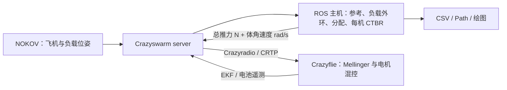

# Crazyflie 三机吊运与 SE(3) Velocity-free 控制

基于 Crazyswarm 的 ROS Noetic 主机控制项目，面向 **NOKOV 动捕下 CF3、CF4、CF5 通过三根绳索协同搬运刚体负载**。主机生成负载和飞机参考，计算每架飞机的总推力及机体系角速度（CTBR），经 Crazyswarm server / Crazyradio 发送；飞机固件完成速率控制与电机混控。

当前开发重点是把 MATLAB 的六维 SE(3) velocity-free 负载外环接入实际吊运流程，并通过同一套主机控制代码进行离线验证。项目也保留独立飞行、普通编队和旧负载观测器分支。

当前默认组合为：

```text
velocity_free_beta → 六维负载合力/力矩 → 张力分配
                  → reference_cascade → 每机 native_position_pid
                  → feedforward_pi 姿态命令 → CTBR → 机载 Mellinger
```

六维外环已接入代码；当前仍有合力限幅坐标、辅助增益、异步采样和下游执行差异。新外环尚无完整整机回放及实飞通过记录，详见 [与 MATLAB / 笔记的差异](docs/slung_velocity_free.md#4-与-matlab--笔记的差异)。

## 项目能力与控制分工

- 完整吊运流程：预检、独立起飞、收绳、负载预抬、张力渐增、运输、协同放载、卸载和三机下降。
- 负载轨迹：定点悬停、圆周、双圆八字、固定质心圆锥姿态扫描。
- 负载反馈：位姿驱动的 SE(3) 辅助系统与六维控制律；保留原位姿观测器和位置 PID / 姿态 PD 作对照。
- 三机协调：张力分配、构型参考、运输位置反馈、动态姿态构型补偿和支撑配平。
- 状态与诊断：NOKOV / EKF / 电压预检、绳长统计、机间距与状态失效处理、CSV 和 RViz 路径。
- 离线验证：Udaan / MuJoCo 调用实际主机控制器与任务状态机，支持延迟、初态和候选参数覆盖。



| 数据 | 当前来源与坐标 |
|---|---|
| 飞机位置、姿态 | NOKOV；世界系 z 向上，旋转矩阵将体系向量变换到世界系 |
| 飞机平移速度、加速度 | 机载 EKF 位置/速度日志，经主机速度过滤及差分得到加速度 |
| 主机可用的飞机角速度反馈 | 动捕姿态差分与过滤；不是机载陀螺仪遥测 |
| 负载几何中心位姿 | NOKOV `load` 上表面原点，经负载尺寸和姿态转换 |
| β 模式的负载运动反馈 | 位姿和参考驱动的辅助量 β；顺序为体系角速度、体系线速度；加速度为不可用的零占位 |
| 绳索速度 | 负载 β 重建挂点速度，再减去各机独立 EKF 速度 |

因此 velocity-free 指负载反馈不用测得的速度、角速度或加速度；飞机仍使用自身 EKF，机载内环仍使用自身传感器。

## 当前配置

以下数值来自当前仓库 YAML，是本实验装置的设置。修改配置后，实际运行以加载值及每次仿真的参数快照为准。

| 项目 | 当前值 |
|---|---|
| 机队 | CF3 / CF4 / CF5，同一 radio、80 信道，固定挂点顺序 |
| 主机任务 | `ctbr_controller.transport_mode: slung_load` |
| 负载反馈与外环 | `state_feedback_mode: velocity_free_beta`，六维 SE(3) 控制律 |
| 吊运力构造 | `transport_force_mode: reference_cascade` |
| 飞机运输位置反馈 | `transport_feedback_controller: native_position_pid` |
| 飞机运输姿态命令 | `feedforward_pi`，`log_difference` 参考前馈 |
| 负载质量 / 尺寸 | 0.023 kg / `[0.08, 0.06, 0.05]` m |
| 负载对角惯量 | `[3.4132e-5, 3.0394e-5, 4.0119e-5]` kg·m² |
| 名义绳长，CF3 / CF4 / CF5 | `[0.865, 0.863, 0.860]` m；可在接管前校准一次运行有效值 |
| 负载轨迹 / 几何中心目标高度 | `hover` / 0.60 m |
| 预抬门槛 | 负载最低点离地间隙 0.20 m |
| 辅助系统 κ / 六维反馈增益 | 平移 12、旋转 20 s⁻¹；`kX=1`、`kXtilde=16` |
| 动态构型补偿 | 已启用，允许张力渐增完成后在抬升期间更新 |
| 主机 / EKF 遥测 / 电池遥测 | 70 Hz / 50 Hz / 2 Hz |
| 实飞计划降落 | 进入 `TAUT_RAMP` 后 60 s |
| 仿真采样与窗口 | 位姿 100 Hz、Mellinger 500 Hz；`post_handoff_s: 100.0` |

### 参数入口

| 文件 | 配置内容 |
|---|---|
| [crazyflies.yaml](ros_ws/src/crazyswarm/launch/crazyflies.yaml) | 飞机 ID、URI、信道、`ctbr_enabled` 与挂点对应顺序 |
| [hover_swarm.launch](ros_ws/src/crazyswarm/launch/hover_swarm.launch) | NOKOV 网络、固件参数、外部位姿广播、遥测周期和 CTBR 桥接 |
| [ctbr_controller.yaml](ros_ws/src/crazyswarm/config/ctbr_controller.yaml) | 主机频率、预检、反馈质量、普通飞机轨迹和可视化 |
| [ctbr_vehicle.yaml](ros_ws/src/crazyswarm/config/ctbr_vehicle.yaml) | `ctbr_controller_cf<ID>`：各机质量、推力标定、位置与姿态控制 |
| [slung_payload.yaml](ros_ws/src/crazyswarm/config/slung_payload.yaml) | 负载质量、惯量、挂点、绳长、外环、负载参考和任务时限 |
| [slung_simulation.yaml](ros_ws/src/crazyswarm/config/slung_simulation.yaml) | 仅离线使用：电机模型、采样、延迟、物理参数与观察窗口 |

实飞 launch 不加载 `slung_simulation.yaml`。离线回放以实飞控制配置为基线，另外加载仿真物理和传感器参数。

负载 `inertia_diag_kgm2` 必须显式填写；修改质量或尺寸不会自动重算惯量。`attachment_points_m` 以负载几何中心为原点，每行依次对应 CF3 / CF4 / CF5。当前飞机端点使用动捕刚体原点，没有自动加入飞机挂点偏移。

### 模式选择的含义

| 配置 | 选择 | 影响 |
|---|---|---|
| `state_feedback_mode` | `velocity_free_beta` / `pose_observer` | **同时切换负载反馈源和外环**：前者为 SE(3) 辅助系统与六维控制律，后者为原观测器与 PID/PD |
| `transport_force_mode` | `reference_cascade` / `coupled` | 前者以参考挂点加速度支撑飞机、绳向反馈倍率为零；后者保留耦合绳向控制 |
| `transport_feedback_controller` | `native_position_pid` / `differential_integral` | 选择飞机运输位置反馈；两个积分方案不叠加 |
| 每机 `transport_attitude_mode` | `feedforward_pi` / `feedforward_p` / `rate_damping` | 选择运输姿态 PI、P 或旧阻尼分支；与负载控制模式分别设置 |

β 分支使用 `Upsilon-kX*PsiE-kXtilde*PsiT` 加重力补偿生成负载广义力，关闭旧负载位置积分和可选负载姿态积分。飞机运输积分、动态构型 trim 和支撑 trim 仍按各自门控工作。`W/d` 从实飞负载刚度派生，旧的 `velocity_free_attitude_weights` YAML 键不再生效。

三机 `feedforward_pi` 需同时使用 `omega_c_method: log_difference` 和 `use_body_rate_feedforward: true`。姿态 I 的限值单位是附加角速度，与位置积分和负载构型 trim 分开。切换参数需要重启控制节点。

## 环境与编译

| 用途 | 本项目使用的环境 |
|---|---|
| 实飞主机 | Ubuntu / ROS Noetic / 系统 Python 3.8，C++ Crazyswarm server |
| 定位与无线 | NOKOV SDK、动捕网络、Crazyradio USB 与飞机固件 |
| 无刷飞机 ARM | 能导入支持当前飞机 ARM 接口的 `cflib` 和 PyYAML 的 Python 环境 |
| 离线回放 | Python ≥3.10、本项目修改版 Udaan、MuJoCo、NumPy、SciPy、Matplotlib、PyYAML、pytest |

本仓库保留了上游 Crazyswarm 的目录和示例。上游安装说明位于 [docs/installation.rst](docs/installation.rst)；其中旧 Python 和环境示例不能直接代替本项目的 ROS Noetic / Udaan 环境。

在准备好 ROS、catkin 依赖及子模块后，从仓库根目录编译：

```bash
source /opt/ros/noetic/setup.bash
cd ros_ws
catkin_make -DPYTHON_EXECUTABLE=/usr/bin/python3 -DLIBMOTIONCAPTURE_ENABLE_NOKOV=ON
source devel/setup.bash
```

新克隆的仓库可先执行 `git submodule update --init --recursive`。NOKOV 后端需要 `ros_ws/src/crazyswarm/externalDependencies/libmotioncapture/deps/nokov_sdk/` 中对应平台的头文件和库；底层子模块中的本地修改也需要随项目版本保存。

实飞 Python 依赖应安装到 ROS 节点实际使用的系统解释器。修改消息或 C++ server 后重新编译；Python / YAML 修改后重启相应节点。server 参数与主机控制器参数分属两个进程，仅重启控制器不会更新 server 的遥测周期或桥接配置。

## 离线运行

回放复用本仓库的控制器和任务状态机，替换 ROS I/O，并由 MuJoCo 提供物理状态。脚本还导入本仓库的测试辅助模块，因此运行回放也需要 pytest。

吊运物理模型来自**仓库外的修改版 Udaan**，脚本按以下相邻目录查找：

```text
workspace/
├── crazyswarm/                  # 本仓库：主机控制、ROS、测试与回放入口
└── simulate_uav/
    └── udaan/                  # 修改版模型：含 crazyswarm_slung 模块
```

仅安装上游同名 Udaan 包不一定包含所需模型。在 Python ≥3.10 的独立环境中，从仓库根目录安装已有本地模型：

```bash
python -m pip install -e ../simulate_uav/udaan
python -m pip install pyyaml pytest
```

以下命令均在 `ros_ws/src/crazyswarm/scripts` 目录执行；不需要启动 ROS server，也不连接 radio 或发送 ARM。

```bash
cd ros_ws/src/crazyswarm/scripts

# 按当前 YAML 运行：β + 六维外环、hover、接管 60 s 后计划放载。
python simulate_slung_handoff.py --output ctbr_logs/se3_hover

# 查看接管、负载运动与控制输出。
python plot_slung_handoff_trace.py ctbr_logs/se3_hover/simulation_trace.csv \
  --save ctbr_logs/se3_hover/handoff.png --no-show
```

对照旧负载外环、动态参考及较大延迟：

```bash
python simulate_slung_handoff.py \
  --candidate simulation_configs/velocity_free_baseline.yaml \
  --output ctbr_logs/pose_observer_hover

python simulate_slung_handoff.py \
  --candidate simulation_configs/velocity_free_cone.yaml \
  --output ctbr_logs/se3_cone

python simulate_slung_handoff.py --pose-delay 0.02 --command-delay 0.01 \
  --output ctbr_logs/se3_delay

python plot_slung_circle_trace.py ctbr_logs/se3_cone/simulation_trace.csv \
  --save ctbr_logs/se3_cone/trajectory.png --no-show
```

`velocity_free_baseline.yaml` 现在切换的是反馈源和负载控制律，不能再解释为“只比较观测器”。`velocity_free_cone.yaml` 明确覆盖为 **10°、两圈、100 s 接管窗口**；它不等于实飞 YAML 中预设的 15° 圆锥参数。

需要实时窗口和视频时可增加 `--render --record ctbr_logs/se3_hover.mp4`。`--simulation-config` 可指定另一份离线配置，`--candidate` 可覆盖控制参数根和独立的 `slung_simulation` 根；覆盖只作用于本次回放，不回写实飞 YAML。

| 输出 | 用途 |
|---|---|
| `input_parameters.yaml` | 本次控制配置、仿真配置与实际模型设置快照 |
| `simulation_trace.csv` | 模型真值、负载目标、飞机指令及任务进度 |
| `multi_ctbr_*.csv` | 实际主机代码生成的诊断日志 |
| `summary.json` | 成功/结束原因、限幅与跟踪误差 |

默认物理模型使用 Graefe 电机模型和 500 Hz Mellinger，EKF 遥测模式为 `sampled_filtered`。它没有模拟完整固件 EKF。修改输入后需要重新运行，旧输出不会自动更新；运行结果应连同参数快照查看。

## 实飞启动与任务时钟

启动前在 `crazyflies.yaml` 核对 ID、URI、信道和启用条目，在 `ctbr_vehicle.yaml` 核对对应每机参数；吊运模式要求 CF3 / CF4 / CF5。NOKOV 的服务器地址、刚体名及桥接参数在 `hover_swarm.launch` 中配置，负载刚体当前为 `load`。

从仓库根目录，在第一个终端执行：

```bash
source /opt/ros/noetic/setup.bash
source ros_ws/devel/setup.bash
roslaunch crazyswarm hover_swarm.launch
```

该 launch 通过 `cf_arm_wrapper.sh` 先对配置中的无刷飞机发送 ARM，再启动 server，同时启动手柄节点和 RViz。它是硬件启动入口。wrapper 使用 `PYTHON` 选择 ARM 脚本解释器，使用 `CFLIB_PATH` 指向可选的 cflib 源码目录；这与 ROS 控制节点的系统解释器分别配置。server 退出后 wrapper 会尝试 DISARM。

另开终端，同样从仓库根目录执行：

```bash
source /opt/ros/noetic/setup.bash
source ros_ws/devel/setup.bash
roslaunch crazyswarm ctbr_controller.launch \
  target_confirmed:=true enable_realtime_visualization:=false
```

`target_confirmed:=true` 允许控制节点输出，预检通过后会自动执行配置任务；默认 `false` 会拒绝启动控制输出。需要 CSV 实时绘图时，将 `enable_realtime_visualization` 设为 `true`。

任务顺序为：

```text
预检 → 独立起飞 → TAKEUP / 预抬 → TAUT_RAMP → 参考抬升 / 运输
     → 协同下降负载 → 确认触地 → 卸载 → 三机独立下降停推
```

| 时间或高度参数 | 含义 |
|---|---|
| `prelift_clearance_m: 0.20` | 旋转负载最低点的离地门槛 |
| `target_payload_height_m: 0.60` | 运输阶段负载几何中心的最终目标高度 |
| `flight_validation_transport_s: 60.0` | 从进入 `TAUT_RAMP` 开始计时，到时启动计划放载 |
| `tension_ramp_s: 5.0` / `reference_lift_s: 12.0` | 先建立张力，再抬升负载参考；60 s 窗口中参考抬升完成后的时间约为 43 s |
| `slung_simulation.post_handoff_s: 100.0` | 离线观察窗口；不会把已启用的 60 s 实飞任务期限改成 100 s |

任务时钟不等待实测调平后才开始。延长悬停需修改 `flight_validation_transport_s`，延长离线总时长还需检查 `slung_simulation.time_limit_s`。正常结束先放下负载并确认触地，再卸载支撑；持续状态异常使用相应受控退出流程。

## 轨迹与构型补偿

负载轨迹在 `slung_payload.trajectory.mode` 中选择；普通飞机 `ctbr_trajectory.trajectory_mode` 在吊运任务中保持 `hover`。

| 负载模式 | 路径与朝向 |
|---|---|
| `hover`，当前默认 | 固定位置，目标水平、零航向 |
| `circle` | 单圆，负载朝向圆心 |
| `figure_eight` | 两个精确相切圆，负载沿运行切线朝向 |
| `attitude_cone` | 质心固定，自身 +Z 绕世界 +Z 扫描，姿态参考起止闭合 |

实飞文件已预设圆锥半角 15°、两圈、每圈 30 s，但当前没有启用。若切到 `attitude_cone`，还需延长任务窗口，例如设 `flight_validation_transport_s: 100.0`，覆盖参考建立、两圈扫描和恢复水平。轨迹的 `settle_s` 是参考等待时间，不代表实测误差已经收敛。圆周/圆锥的 `center_xy` 含义不同，省略与填 `null` 也不同，ROS1 参数不能包含 `null`。

当前动态构型 trim 和抬升期间更新均已启用：张力渐增完成且协同混合达到 100% 后，按负载姿态误差缓慢修正三机参考构型，仍受反馈健康、阶段和限幅门控。它不改变负载目标姿态，也不替代六维负载外环。换绳后的自动有效值校准与 `link_length_report_enabled` 统计分别管理；后者只报告实测距离，不自动写回配置。

轨迹与补偿的详细配置见 [圆周](docs/slung_payload_circle.md)、[八字](docs/slung_payload_figure_eight.md)、[圆锥姿态](docs/slung_payload_attitude_cone.md)、[动态构型补偿](docs/slung_dynamic_attitude_trim.md) 和 [有效绳长统计](docs/slung_link_length_measurement.md)。

## 日志与排查

默认日志目录为 `ros_ws/src/crazyswarm/scripts/ctbr_logs/`。多机日志使用 `multi_ctbr_*.csv`，以 `vehicle_id` 区分飞机；单机日志为 `cf<ID>_ctbr_*.csv`。

从仓库根目录绘制实飞日志，将下面文件名换成实际生成的 CSV：

```bash
python3 ros_ws/src/crazyswarm/scripts/ctbr_visualization.py \
  ros_ws/src/crazyswarm/scripts/ctbr_logs/multi_ctbr_YYYYMMDD_HHMMSS.csv \
  --static --no-show --output /tmp/ctbr.png
```

有负载数据时另存 `/tmp/ctbr_payload.png`；只看一架飞机可增加 `--vehicle-id 5`。

| 需要确认的状态 | 日志字段或话题 |
|---|---|
| 负载反馈模式 | `payload_state_feedback_mode` |
| β 与参考新鲜度 | `payload_beta_omega_body_*`、`payload_beta_velocity_body_*`、`payload_beta_reference_active` |
| 输出是否复用旧状态 | `payload_control_reused`、`payload_control_sample_time_s`、`payload_source_observer_status` |
| 交给分配器的负载力/力矩 | `payload_desired_force_*`、`payload_desired_moment_*` |
| 飞机平移反馈是否有效 | `ekf_status`、`ekf_state_age_s`、`mocap_sample_age_s` |
| 飞机运输积分与配平 | `transport_full_pid_*`、`transport_attitude_trim_*`、`transport_support_trim_n` |
| 降落阶段及原因 | `flight_validation_landing_stage`、`emergency_landing_reason` |
| RViz 路径 | `/cf<ID>/path`、`/load/path`，坐标系 `world` |

`emergency_landing_reason` 也记录计划结束，`flight_validation_complete` 表示任务时间到。β 模式的 `payload_acceleration_available=0`，不能把对应零占位当作测量加速度。六维 `Upsilon/PsiE/PsiT/u_c` 中间量目前还没有接入 CSV，最终力/力矩列不能替代它们做逐项公式核对。

| 现象 | 检查入口 |
|---|---|
| `cannot marshal None` | YAML 是否包含 `null` 或空值 |
| 无刷飞机 ARM 失败 | wrapper 的解释器、cflib、飞机 URI 与无线连接 |
| 电池样本为零或过期 | `/cf<ID>/battery`；目标日志频率 2 Hz |
| EKF 对齐失败 | `/cf<ID>/ekf_kinematics`、NOKOV/EKF 位置差和连续对齐时间 |
| TAKEUP / 预抬不接管 | 有效绳长、最低点离地间隙、β 竖直速度和状态质量 |
| β 连续拒帧 | `beta_limit`、位姿跳变、源时间间隔及 `auxiliary_stale` 状态 |
| 仿真提前结束 | `summary.json` 的结束原因、任务期限和保护触发情况 |

server 启动后可只读检查遥测：

```bash
rostopic hz /cf3/battery
rostopic hz /cf3/ekf_kinematics
rostopic echo -n 5 /cf3/ctbr_timing
```

`ctbr_timing` 是主机桥接的发送链路诊断，不能直接当作飞机执行指令的单向延迟。

## 测试与验证范围

六维外环移植后的相关 Python 回归记录为 **98 项通过、1 项跳过**，包括辅助系统、负载核心、旧姿态前馈、积分、惯量和控制快照。它是专项记录，不是全仓库或所有 MuJoCo 测试通过的声明，也没有直接调用 MATLAB 运行相同轨迹。

[历史 β 验证记录](docs/slung_velocity_free_verification.md) 中的五组悬停、圆锥、噪声/延迟回放，使用的是此前“β 替换原 PID/PD 速度反馈”的实现。此前八字、圆锥和动态 trim 文档中的整机结果也对应各自参数快照，不能作为当前六维外环的验证结果。

当前还需完成六维外环的整机回放与实飞验证；合力限幅坐标顺序、辅助带宽、异步时序和日志缺项见 [剩余差异](docs/slung_velocity_free.md#4-与-matlab--笔记的差异)。历史 MuJoCo 故障注入测试的已知失败及基线复现情况见上述验证记录。

在 scripts 目录运行相关回归：

```bash
python -m pytest -q \
  test_slung_velocity_free.py test_slung_load_controller.py \
  test_slung_attitude_feedforward.py test_slung_attitude_integral_core.py \
  test_slung_reference_cascade.py test_slung_payload_inertia.py \
  test_slung_payload_control_snapshot.py
```

需要完整测试时，在具备相应 ROS / MuJoCo / 修改版 Udaan 依赖的环境中执行 `python -m pytest -q`。ROS 节点使用系统 Python 3.8，离线环境的测试通过不能替代部署解释器的兼容性检查。

## 代码与文档导航

| 位置 | 职责 |
|---|---|
| [ctbr_controller.py](ros_ws/src/crazyswarm/scripts/ctbr_controller.py) / [ctbr_fleet_node.py](ros_ws/src/crazyswarm/scripts/ctbr_fleet_node.py) | ROS 启动入口、机群同步与控制调度 |
| [slung_velocity_free.py](ros_ws/src/crazyswarm/scripts/slung_velocity_free.py) | 负载 SE(3) 辅助系统、β、源时间与质量处理 |
| [slung_load_controller.py](ros_ws/src/crazyswarm/scripts/slung_load_controller.py) | 六维负载外环、旧 PID/PD 分支、张力分配及每机基础力 |
| [ctbr_payload_parameters.py](ros_ws/src/crazyswarm/scripts/ctbr_payload_parameters.py) | 参数校验、SE(3) 权重与限幅预算派生 |
| [ctbr_payload_reference.py](ros_ws/src/crazyswarm/scripts/ctbr_payload_reference.py) / [ctbr_payload_mission.py](ros_ws/src/crazyswarm/scripts/ctbr_payload_mission.py) | 负载与三机参考、接管、任务退出和协同降落 |
| [ctbr_independent_controller.py](ros_ws/src/crazyswarm/scripts/ctbr_independent_controller.py) | 独立飞行、预抬及放载后的下降 |
| [ctbr_transport_vehicle_controller.py](ros_ws/src/crazyswarm/scripts/ctbr_transport_vehicle_controller.py) / [ctbr_geometric_controller.py](ros_ws/src/crazyswarm/scripts/ctbr_geometric_controller.py) | 飞机运输反馈、合力到姿态与 CTBR 命令 |
| [simulate_slung_handoff.py](ros_ws/src/crazyswarm/scripts/simulate_slung_handoff.py) | 复用主机代码的离线整机回放入口 |
| [crazyflie-firmware](crazyflie-firmware) | 固件子模块；机载控制及电机混控 |
| [MATLAB/Multi-UAV-Transportation-Simulation](MATLAB/Multi-UAV-Transportation-Simulation) | 仓库内较早的几何吊运参考代码 |

六维外环对照使用的 `Multi-UAV-Transportation-Simulation-vel-free` 是工作区中另行下载的 MATLAB 目录，未包含在本仓库内。来源文件和 SHA256 记录在 [Velocity-free 说明](docs/slung_velocity_free.md#1-对照资料)，不要与上表的旧 MATLAB 目录混用。

| 文档 | 用途 |
|---|---|
| [Velocity-free 说明](docs/slung_velocity_free.md) | 当前负载 β 反馈、六维外环使用范围和剩余实现差异 |
| [负载观测与诊断](docs/slung_payload_observer.md) | 旧 `pose_observer`、状态质量与控制快照 |
| [控制器模块与参数入口](docs/ctbr_controller_modules.md) | 主机模块划分及参数根 |
| [控制器公式说明](docs/slung_controller_formulas.md) | 坐标、分配、飞机控制和补偿推导；负载旧 PID/PD 公式适用于旧模式 |
| [设计推导对照](docs/slung_controller_design_comparison.md) | 原几何设计与工程实现、历史实验 |

专题文档可能包含历史参数和模式；当前默认值以本 README 的配置表及 YAML 为准，六维负载分支以 Velocity-free 说明和源码为准。

## 数据、版本与许可

飞行 CSV、仿真快照、图片、视频和 ROS bag 属于运行数据，默认输出目录由 [.gitignore](.gitignore) 排除。复现实验需同时保存实际代码版本、参数快照和日志，不能只保留结果图。

底层库以子模块管理，父仓库只记录提交指针；子模块内部改动需要在相应仓库保存。项目基于 USC-ACTLab/Crazyswarm，仓库许可为 [MIT License](LICENSE)，各子模块遵循各自许可证。
