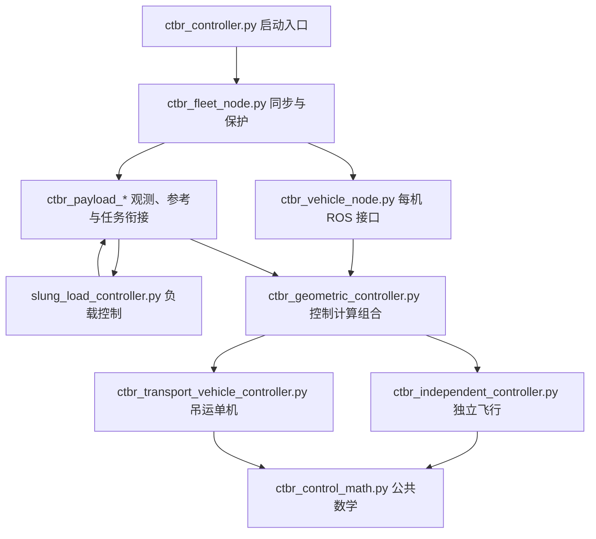

# CTBR 控制器模块与参数入口

本次拆分调整文件职责，保留当前公式、增益、几何、模式选择、预检与降落流程。
`roslaunch crazyswarm ctbr_controller.launch` 的启动方式不变；`ctbr_controller.py`
作为启动入口重导出原公开类和函数，原仿真仍调用同一套节点/控制计算。

## 三部分控制公式

| 控制职责 | 文件 | 主要内容 |
|---|---|---|
| 单机独立飞行 | `scripts/ctbr_independent_controller.py` | 独立起飞、TAKEUP/预抬、放载后降落的位置 PID；独立 Z 积分及防饱和；独立姿态角速度命令 |
| 负载 | `scripts/slung_load_controller.py` | 负载位置 PID、姿态几何 PD、张力/力矩分配、绳索反馈，保留 `reference_cascade/coupled` 对照 |
| 吊运时的单机 | `scripts/ctbr_transport_vehicle_controller.py` | 运输位置保持/native PID、运输积分、接管混合、合力/角速度滤波与运输姿态命令 |

三部分共同使用 `ctbr_control_math.py` 的坐标变换、SO(3) 误差、力限幅和解析前馈。
`ctbr_geometric_controller.py` 的 `GeometricCtbrController` 组合独立/运输计算，
保留原 `ControllerConfig`、`compute(state,target,dt)`、重置函数和诊断输出。
所有控制公式模块不依赖 ROS，可以直接在离线测试中导入。

独立与运输两部分共用同一个控制器状态对象。进入接管时不会因为换文件而重建控制器，
原独立积分的保持、运输专用积分、姿态历史和接管混合继续按原逻辑管理。
原对照分支按用户要求保留；机载仿真固定的 Mellinger 仍位于 Udaan 的
`udaan/control/crazyflie_mellinger.py`，与上述主机三部分不同。



## ROS 接口、任务和日志

`ctbr_controller.py` 从约 6619 行缩为约 105 行，不再定义大型控制类。
配套模块按以下职责组织，避免把 ROS 调度与控制公式混写：

| 模块 | 职责 |
|---|---|
| `ctbr_vehicle_node.py` | 单机参数初始化、任务时钟、控制 tick、Path 和 CTBR 发布 |
| `ctbr_vehicle_state.py` | 动捕、EKF、电压、桥接时序订阅和缓存 |
| `ctbr_vehicle_preflight.py` | 起飞前电压与 EKF 连续对齐准入 |
| `ctbr_fleet_node.py` | 多机同步、全局中止、数值异常恢复和统一 tick |
| `ctbr_payload_parameters.py` | 负载配置读取、有效性检查和运行状态初始化 |
| `ctbr_payload_state.py` | 负载观测、反馈新鲜度、Path、地面基线 |
| `ctbr_payload_takeup.py` | 收绳、有效绳长校准、预抬和接管前确认 |
| `ctbr_payload_reference.py` | 负载悬停/圆周/八字/圆锥姿态参考、三机构型、控制覆盖和完整构型前馈 |
| `slung_attitude_cone_reference.py` | 固定质心的 SO(3) 圆锥姿态及重力平衡绳向的解析导数 |
| `ctbr_payload_control.py` | 慢姿态 trim、运输积分门控、完整参考桥接 |
| `ctbr_payload_mission.py` | 接管生命周期、协同降落、接地/卸载、安全和故障回退 |
| `ctbr_csv_logger.py` / `ctbr_vehicle_logging.py` | CSV 字段/文件及每机控制、负载、积分、时序诊断 |
| `ctbr_parameters.py` | 全局、轨迹、每机参数命名空间路由 |
| `ctbr_state_feedback.py` | 二阶速度过滤、EKF 选择与短暂保持 |

这些类通过正常 Python 导入与继承组合，没有运行时 `exec` 或修改函数全局变量的转发。
原 ROS 订阅、锁、计时、日志刷新和异常处理的执行顺序保持原样。
安装规则也包含新模块和所需辅助文件，部署时无需手工复制模块。

## 实飞参数与仿真参数分开

所有文件位于 `ros_ws/src/crazyswarm/config`：

| 参数文件 | 内容 | 读取者 |
|---|---|---|
| `ctbr_controller.yaml` | 主机控制频率、反馈过滤、全局轨迹和可视化 | 实飞 ROS 与仿真共同读取 |
| `ctbr_vehicle.yaml` | 每机质量、推力映射和主机控制增益 | 实飞 ROS 与仿真共同读取 |
| `slung_payload.yaml` | 实物负载质量/几何、负载增益、任务参考和实飞降落窗口 | 实飞 ROS 与仿真共同读取 |
| `slung_simulation.yaml` | 离线电机物理、惯量、Mellinger 模型增益、采样、延迟、噪声、初态和 `post_handoff_s` | 只有仿真显式读取 |

实飞两个 launch 均不加载 `slung_simulation.yaml`。`slung_payload` 中不再有
`simulation` 块和 `post_handoff_s`；物理仿真参数也不会写入 ROS 参数服务器。
仿真使用实飞控制增益作为基线，物理/传感器假设从独立文件读取，因此不会复制两份增益而意外失配。

```yaml
# config/slung_simulation.yaml
slung_simulation:
  post_handoff_s: 100.0
  motor_model: graefe2026
  mellinger_rate_hz: 500.0
  pose_delay_s: 0.01
  ekf_delay_s: 0.02
  command_delay_s: 0.005
```

`flight_validation_transport_s` 仍在实飞负载文件中，决定接管后的计划降落；
`slung_simulation.post_handoff_s` 是离线观察窗口，两者不是同一时钟配置。
当前两者均为 100 s，覆盖当前圆锥姿态或切换后的完整八字任务。

## 运行与覆盖

在原 udaan 环境和 scripts 目录：

```bash
python simulate_slung_handoff.py --output ctbr_logs/module_check
python plot_slung_circle_trace.py ctbr_logs/module_check/simulation_trace.csv
```

自定义独立仿真参数文件：

```bash
python simulate_slung_handoff.py --simulation-config ../config/slung_simulation.yaml --output ctbr_logs/module_check
```

候选文件中，主机增益和离线参数分别覆盖自己的根：

```yaml
ctbr_controller_cf5:
  transport_attitude_gain: [8.0, 8.0, 6.0]
slung_payload:
  flight_validation_enabled: false
  trajectory:
    mode: hover
slung_simulation:
  post_handoff_s: 60.0
  pose_delay_s: 0.02
  command_delay_s: 0.01
```

传入 `--candidate 文件.yaml` 只影响该次回放，不回写实飞文件。
输出 `input_parameters.yaml` 中 `slung_simulation` 保持独立，
`simulation_runtime` 记录实际解析结果和模型信息。旧候选中的
`slung_payload.simulation` / `slung_payload.post_handoff_s` 会提示迁移到新根。
