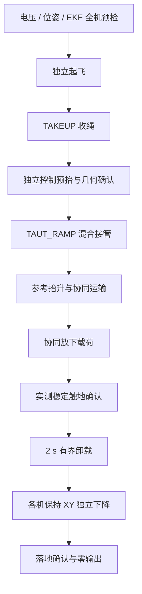

# 当前三机吊运控制器与《几何控制协同搬运》设计笔记的对照

本文说明原始几何控制推导如何对应到当前 Crazyflie/NOKOV/CTBR 实现，以及为了完成实际起飞、接管、运输和降落增加了哪些控制与调度逻辑。当前实现以 2026-10-19 正式接入运输差分保持力积分后的配置和源码为准；第 10 节保留 2026-10-18 无运输积分基线及其离线试验作为历史证据。

当前运行配置选择 **`reference_cascade`**：保留载荷位置 PID、载荷姿态几何 PD 和载荷六维力/力矩分配，采用一致的载荷姿态/绳向几何参考、各机位置保持 PD、零和差分保持力积分，以及接管竖直残差补偿。飞机普通位置积分在协同阶段仍冻结。2026-10-20 新增可选的 `native_position_pid`，使用同一单机位置 PID 公式和运输专用积分状态替换保持反馈，详见第14节。源码同时保留 `coupled` 分支用于对照，该分支不注入新增差分积分。两个分支都属于基于原始几何框架的工程实现；当前程序没有完整实现原笔记中的多通道自适应扰动估计，也没有在主机输出原笔记的 UAV 姿态力矩控制律。

本文的原始对照材料为本地文件 `/home/csy/my_project/几何控制协同搬运/几何控制协同搬运.md`，共 932 行，题为《Geometric Control of Quadrotor UAVs Transporting a Cable-Suspended Rigid Body》，标注 Taeyoung Lee、TCST 2018。该笔记位于 `crazyswarm` Git 仓库外，因此这里直接给出所需公式，并用笔记章节名定位，不依赖 GitHub 上不可用的上级目录链接。下文“原笔记”专指这份本地推导；其公式、后续工程修改与原论文的完整证明应分别核对。

主要实现入口：

- [slung_load_controller.py](../ros_ws/src/crazyswarm/scripts/slung_load_controller.py)：载荷外环、分配、绳向状态及每机三维力。
- [ctbr_controller.py](../ros_ws/src/crazyswarm/scripts/ctbr_controller.py)：状态来源、全机调度、参考、位置保持、力到 CTBR、预检与日志。
- [slung_transport_integral.py](../ros_ws/src/crazyswarm/scripts/slung_transport_integral.py)：三机世界系差分保持力积分，共同缩放保持零和及每机向量范数约束。
- [slung_reference.py](../ros_ws/src/crazyswarm/scripts/slung_reference.py)：$SO(3)$ 姿态与 $S^2$ 绳向参考及解析导数。
- [slung_payload.yaml](../ros_ws/src/crazyswarm/config/slung_payload.yaml)、[ctbr_vehicle.yaml](../ros_ws/src/crazyswarm/config/ctbr_vehicle.yaml)、[ctbr_controller.yaml](../ros_ws/src/crazyswarm/config/ctbr_controller.yaml)：负载、各机与全局配置。

## 1. 坐标、对象与作用力

### 1.1 先统一坐标约定

| 对象 | 原笔记 | 当前 ROS/NOKOV 实现 |
| --- | --- | --- |
| 惯性系第三轴 | $e_3$ 向下，重力为 $+g e_3$ | 右手世界系 $z$ 向上，记 $e_z=[0,0,1]^T$，物理重力为 $-g e_z$ |
| 载荷姿态 | $R_0$，载荷机体系到世界系 | 同样为 body-to-world 的 $R_0$ |
| UAV 姿态 | 机体第三轴向下，实际推力 $-f_iR_ie_3$ | 当前机体第三轴为推力方向，实际推力 $+f_iR_ie_z$ |
| 绳向 | $q_i$ 从 UAV 指向载荷挂点 | 定义不变；正常悬吊时 $q_{iz}<0$ |
| 载荷角速度 | $\Omega_0$ 在载荷机体系表达 | 定义不变，满足 $\dot R_0=R_0\widehat\Omega_0$ |
| 绳角速度 | $\omega_i$ 在世界系表达 | $\omega_{\mathrm{link},i}=q_i\times\dot q_i$ 在世界系表达 |
| 载荷力矩 | 在载荷机体系表达 | 分配器右端的 $M_d$ 也在载荷机体系表达 |
| UAV 输出 | 最终为 $f_i,M_i$ | 主机输出 collective thrust 与 body-rate，机载控制器实现角速度跟踪和混控 |

$\widehat a b=a\times b$，$\vee$ 为其逆映射。变换坐标时，向量、旋转矩阵、角速度、挂点和叉乘关系必须一致变换，不能只对某个公式的重力项改号。代码中旧 MATLAB 挂点转为 ROS 上表面挂点的辅助函数，是具体几何数据转换；它不能替代对整套控制律的坐标约定说明。

为避免混淆，本文在当前实现公式中始终使用 $e_z$。例如原笔记中的 $\ddot x_0-ge_3$ 对应当前向上坐标的 $\ddot x_0+g e_z$。

### 1.2 挂点、几何中心与实测绳向

设 $\rho_i$ 是载荷几何中心到第 $i$ 个挂点的载荷机体系向量，$x_{a_i}$ 是其世界位置。原笔记的几何关系继续使用：

$$
x_{a_i}=x_0+R_0\rho_i,\qquad
x_i=x_0+R_0\rho_i-L_iq_i.
$$

当前配置的载荷尺寸为 $[0.08,0.06,0.05]\ \mathrm m$、质量 $m_0=0.023\ \mathrm{kg}$，顺序固定为 CF3、CF4、CF5，对应挂点：

$$
\rho_3=\begin{bmatrix}0.040\\0\\0.025\end{bmatrix},\quad
\rho_4=\begin{bmatrix}-0.040\\0.030\\0.025\end{bmatrix},\quad
\rho_5=\begin{bmatrix}-0.040\\-0.030\\0.025\end{bmatrix}\ \mathrm m.
$$

YAML 中每行为一个挂点；控制核心内部每列对应一架飞机。这个转置关系影响分配器堆叠顺序，必须与 CF3/4/5 一致。

NOKOV 的 `load` 原点位于上表面中心，控制器需要的是长方体几何中心，并以均匀长方体假设将其当作质心。实际载荷的质心尚未由该转换或当前日志唯一辨识；若实体质心偏离几何中心，挂点力臂和惯量模型会有误差。当前原点转换为：

$$
x_0=x_{\mathrm{top}}+R_0\begin{bmatrix}0\\0\\-h/2\end{bmatrix}.
$$

这是随载荷姿态旋转的偏置，载荷倾斜时不能仅减去世界系高度 $h/2$。最低点离地间隙按有向长方体计算：

$$
c=x_{0z}-\frac12\sum_{j=1}^{3}|R_{0,3j}|s_j-z_{\mathrm{ground}}.
$$

`payload_ground_clearance` 辅助函数默认取世界地面 $z_{\mathrm{ground}}=0$；实际下降/触地逻辑另记录起飞前实测的负载地面几何中心高度与最低点间隙基线，以其作为本次落地参考。这两个量不能与实体绝对地面或动捕原点偏差混为一谈。

控制器以当前飞机位置和载荷挂点重新计算绳向，而不是始终强制 $\|x_{a_i}-x_i\|=L_i$：

$$
d_i=\|x_{a_i}-x_i\|,\qquad q_i=\frac{x_{a_i}-x_i}{d_i},
$$

$$
\dot q_i=\frac{I-q_iq_i^T}{d_i}
\left[v_0+(R_0\Omega_0)\times(R_0\rho_i)-v_i\right],\qquad
\omega_{\mathrm{link},i}=q_i\times\dot q_i.
$$

这里 $q_i^T\dot q_i=0$，$q_i^T\omega_{\mathrm{link},i}=0$。归一化几何和 $S^2$ 切平面投影保留了原笔记的几何结构；在松绳阶段，它们只是两个实测点的方向，不能据此认定绳索已经有张力。因此实际接管还需要独立的距离、方向、离地间隙和时间确认。

## 2. 保留的载荷几何控制骨架

原笔记“载荷控制器”和“每架 UAV 的理想三维力”的主链为：

$$
(x_{0d},R_{0d})\longrightarrow(F_d,M_d)
\longrightarrow\mu_{id}\longrightarrow(q_{id},\mu_i)
\longrightarrow u_i\longrightarrow(f_i,R_{ic}).
$$

当前仍使用这条链中的载荷反馈、分配和作用力投影；`reference_cascade` 额外通过几何参考和各机位置保持来形成飞机间的相对构型。

### 2.1 载荷位置 PID

记 $e_x=x_0-x_{0d}$，$e_v=v_0-v_{0d}$。当前载荷积分器是有界 C1 形式：

$$
\dot\eta_x=e_v+c_1e_x,\qquad
\eta_x\leftarrow\operatorname{clip}(\eta_x,-\eta_{\max},\eta_{\max}),
$$

$$
a_{0c}=a_{0d}-K_xe_x-K_ve_v-K_I\eta_x,\qquad
F_d=m_0(a_{0c}+g e_z).
$$

向量增益均逐轴作用。当前 $K_x=[3,3,3.75]$、$K_v=[3.12,3.12,3.12]$、$K_I=[1.6,1.6,1.6]$、$c_1=0.5$，积分状态上限 $[0.5,0.5,0.5]$。

这保留了原笔记“用积分补偿固定扰动力”的思想。若定义 $\bar\Delta_{\mathrm{eq}}=m_0K_I\eta_x$，可将它理解为聚合平动扰动力的有界积分补偿；它没有逐项维护原笔记的 $\bar\Delta_{x_0}$、$\bar\Delta_{R_0}$、各机 $\bar\Delta_{x_i}$ 及其耦合自适应更新律。

### 2.2 载荷 $SO(3)$ 姿态 PD 与当前前馈

姿态误差和角速度坐标变换保持原定义：

$$
Q=R_0^TR_{0d},\qquad
e_R=\frac12(R_{0d}^TR_0-R_0^TR_{0d})^\vee,\qquad
e_\Omega=\Omega_0-Q\Omega_{0d}.
$$

当前代码的力矩公式为：

$$
M_d=-K_Re_R-K_\Omega e_\Omega
+\Omega_0\times(J_0\Omega_0)
-J_0\left(\Omega_0\times Q\Omega_{0d}\right)
+J_0Q\dot\Omega_{0d}.
$$

随后计算用于 `coupled` 挂点补偿的命令角加速度：

$$
\dot\Omega_{0c}=J_0^{-1}\left[M_d-\Omega_0\times(J_0\Omega_0)\right].
$$

惯量 $J_0$ 由均匀长方体近似计算。例如 $J_{xx}=m_0(s_y^2+s_z^2)/12$。姿态增益由惯量、带宽和阻尼比生成；当前带宽为 $[1,1,0.45]\ \mathrm{Hz}$、阻尼比 $0.90$，yaw 通道开启。该负载姿态带宽与各机 `transport_attitude_gain` 是两组不同的参数。

原笔记“载荷控制器”给出的名义前馈是：

$$
M_{d,\mathrm{note}}=-K_Re_R-K_\Omega e_\Omega
+v\times(J_0v)+J_0Q\dot\Omega_{0d},\qquad v=Q\Omega_{0d},
$$

并附加载荷/飞机扰动力矩估计。它与当前代码的测量角速度陀螺项及参考坐标导数补偿**一般不相等**。在 $e_\Omega=0$ 时两种名义前馈一致；静态参考 $\Omega_{0d}=0$ 时，当前代码仍保留 $\Omega_0\times J_0\Omega_0$，原笔记该式的 $v\times J_0v$ 为零。当前使用标准的测量陀螺耦合抵消形式，不能把两式说成简单重排。

### 2.3 六维载荷力/力矩分配

原笔记的固定分配矩阵继续使用：

$$
\mathcal P=
\begin{bmatrix}
I&I&I\\
\widehat\rho_3&\widehat\rho_4&\widehat\rho_5
\end{bmatrix}\in\mathbb R^{6\times9},\qquad
z=\begin{bmatrix}R_0^T\mu_{3d}\\R_0^T\mu_{4d}\\R_0^T\mu_{5d}\end{bmatrix}.
$$

$$
\mathcal Pz=\begin{bmatrix}R_0^TF_d\\M_d\end{bmatrix},\qquad
z=\mathcal P^T(\mathcal P\mathcal P^T)^{-1}
\begin{bmatrix}R_0^TF_d\\M_d\end{bmatrix}+z_{\mathrm{null}}.
$$

前三个分量表示载荷机体系合力，后三个表示载荷机体系合力矩；求解后各块再乘 $R_0$ 返回世界系。代码使用条件数/容差检查后求线性方程，没有直接显式求逆。

与原笔记的最小范数解相比，代码增加了 `outward_bias`：将水平外张力投影进 $\ker\mathcal P$，得到 $\mathcal Pz_{\mathrm{null}}=0$ 的内部力。当前比例为 $0.25$、配置上限 $0.15\ \mathrm N$，用于形成更分散的静态绳向。它在虚拟分配层保持原合力/力矩；实际绳向投影、单向张力和执行器饱和之后，不能继续假设实现的广义力恰好等于 $(F_d,M_d)$。

### 2.4 请求力、实测绳向与单向张力

分配器得到的是可在三维中任意指向的请求力 $\mu_{id}$；实际绳索只能沿当前实测 $q_i$ 拉载荷。原笔记先取：

$$
\mu_i=q_iq_i^T\mu_{id},\qquad q_{id}=-\frac{\mu_{id}}{\|\mu_{id}\|}.
$$

当前进一步执行单向约束：

$$
T_i^{\mathrm{signed}}=-q_i^T\mu_{id},\qquad
T_i=\max(0,T_i^{\mathrm{signed}}),\qquad
\mu_i=-T_iq_i.
$$

当请求相当于压绳时，代码令有效 $q_{id}=q_i$；`raw_desired_link_direction` 仍记录分配器原始方向，`desired_tension_signed` 仍记录带符号请求。不能把 `desired_tension` 当成实测张力传感器数据，也不能把 `desired_tension_vector` 当成经过当前绳向投影后真正作用于载荷的力。

当 $T_i^{\mathrm{signed}}>0$ 时，上式等于原笔记的 $q_iq_i^T\mu_{id}$；被截断为零时则不再等于无约束分配。因此“$\operatorname{rank}\mathcal P=6$”只说明该几何允许三维虚拟力分配，不保证某个瞬间的实测绳向、张力方向和推力余量能实现全部六维请求。当前没有以 $T_i\ge0$、推力上限和绳锥约束重新求解的完整优化分配器。

## 3. 两个每机三维力分支的准确区别

### 3.1 原笔记的理想沿绳/垂绳分解

原笔记定义的重力补偿挂点加速度，在当前坐标下写成：

$$
a_i=\ddot x_0+g e_z
+R_0\widehat\Omega_0^2\rho_i
-R_0\widehat\rho_i\dot\Omega_0.
$$

沿绳分量为：

$$
u_i^\parallel=\mu_i+m_iL_i\|\omega_i\|^2q_i+m_iq_iq_i^Ta_i.
$$

完整绳向跟踪中，原笔记还定义：

$$
\omega_{id}=q_{id}\times\dot q_{id},\quad
e_{q_i}=q_{id}\times q_i,\quad
e_{\omega_i}=\omega_i+\widehat q_i^2\omega_{id},
$$

$$
u_i^\perp=m_iL_i\widehat q_i
\left[-k_qe_{q_i}-k_\omega e_{\omega_i}
-(q_i\cdot\omega_{id})\dot q_i
-\widehat q_i^2\dot\omega_{id}\right]
-m_i\widehat q_i^2a_i-\bar\Delta_{x_i}^{\perp}.
$$

这里包含移动绳向参考的角速度/角加速度前馈，以及垂绳扰动估计。原笔记中的跟踪误差、$S^2$ 势函数及后续稳定性分析围绕这些完整项展开。

### 3.2 `coupled`：保留耦合补偿的工程近似

当前 `coupled` 不直接使用未知的真实 $\ddot x_0,\dot\Omega_0$，而是构造：

$$
a_{i,c}=a_{0c}+g e_z
+R_0\widehat\Omega_0^2\rho_i
-R_0\widehat\rho_i\dot\Omega_{0c}.
$$

绳向校正采用：

$$
c_i=-\lambda_q\left(k_qe_{q_i}+k_\omega\omega_{\mathrm{link},i}+k_{Iq}\eta_{q_i}\right),
\qquad \dot\eta_{q_i}=e_{q_i},
$$

$$
F_{q_i}=\operatorname{limit}_{\mathrm{norm,rate}}
\left(m_iL_i\,q_i\times c_i\right).
$$

因此控制核心的输出可合并为：

$$
F_{i,\mathrm{core}}=-T_iq_i+m_ia_{i,c}
+m_iL_i\|\omega_{\mathrm{link},i}\|^2q_i+F_{q_i}.
$$

其中使用 $q_iq_i^Ta_i-\widehat q_i^2a_i=a_i$ 合并沿绳和垂绳的运动学补偿。当前 `link_kq=40`、`link_komega=20`、`link_integral_gain=0`；方向校正力幅值上限 $0.40\ \mathrm N$、变化率上限 $20\ \mathrm{N/s}$，其限幅历史只保存方向校正力，运动学补偿不进入该历史。

这是原笔记几何结构的近似实现：代码没有从 $\mu_{id}(t)$ 生成 $\dot q_{id},\omega_{id},\dot\omega_{id}$ 并代入完整绳向前馈，阻尼项使用的是 $\omega_{\mathrm{link},i}$；也没有实现 $\bar\Delta_{x_i}^{\perp}$。`link_gain_scale` 还会随接管/运输阶段变化并接受限幅。不能仅因变量名和沿绳/垂绳形式相同，就称其为 Lee 2018 全控制律复现。

### 3.3 `reference_cascade`：当前启用的参考串级

该模式仍用载荷误差生成 $F_d,M_d,\mu_{id},T_i$，但飞机自身惯性支撑使用**期望挂点运动**：

$$
a_{a_i,d}=a_{0d}+g e_z
+R_{0d}\widehat{\Omega}_{0d}^{2}\rho_i
-R_{0d}\widehat\rho_i\dot\Omega_{0d}.
$$

它把核心的有效绳向校正倍率强制设为 $\lambda_q=0$，由各机位置保持提供构型恢复与阻尼。YAML 中仍保留 `transport_link_gain_scale=0.4` 与 `transport_link_steady_gain_scale=0.4`，但该模式下它们不会使绳向反馈生效；运行日志的 `effective_transport_link_gain_scale` 应为零。

在参考串级中，完整接管后、力/倾角限幅和滤波前，每机实际组合为：

$$
\boxed{
F_{i,\mathrm{raw}}=-T_iq_i+m_ia_{a_i,d}
+m_iL_i\|\omega_{\mathrm{link},i}\|^2q_i
+F_{i,\mathrm{hold}}+b_{z,i}e_z+w(t)b_{d,i}
}
$$

$$
F_{i,\mathrm{hold}}=m_i s_h
\left[-K_{p,i}^{\mathrm{ind}}(x_i-x_{i,h})
-K_{v,i}^{\mathrm{ind}}(v_i-v_{i,h})\right].
$$

保持加速度还接受每轴反馈上限。$x_{i,h},v_{i,h}$ 为实际 `position_hold_position/velocity`，$s_h$ 是保持倍率，$b_{z,i}$ 为接管竖直 trim。保持反馈仍为 **PD**；新增的独立世界系力偏置 $b_{d,i}$ 按三机去均值保持误差学习，不复用普通位置积分。$w(t)$ 在空中为 1，确认负载触地后才沿已有卸载曲线消退，见第 7、8 节。

这里使用各机 `independent_position_gain`/`independent_velocity_gain`，单位分别为 $\mathrm{s^{-2}}$、$\mathrm{s^{-1}}$；先得到加速度再乘质量，不能与普通位置环直接以力为输出的增益混用。CF3 的两组增益分别为 $[3,3,4]$、$[3.12,3.12,3.60]$，CF4/CF5 为 $[4,4,4]$、$[3.6,3.6,3.6]$。三机质量依次为 43.4、44.0、42.4 g。

这一分支避免将载荷位置/姿态反馈产生的命令加速度再次作为各机自身惯性补偿，同时把构型跟踪交给飞机位置环。它是控制结构的变化，不能套用原笔记中“沿绳/垂绳闭环误差动力学已经按完整前馈解耦”的结论。

### 3.4 张力渐增时实际还存在混合

前一节框中公式对应 `transport_blend=1`。在 `TAUT_RAMP` 中，设五次混合系数为 $\beta\in[0,1]$，则送入后处理前的力是：

$$
F_{i,\mathrm{raw}}=(1-\beta)F_{i,\mathrm{handoff}}
+\beta\left(F_{i,\mathrm{core}}+b_{z,i}e_z+F_{i,\mathrm{hold}}+w(t)b_{d,i}\right).
$$

$F_{i,\mathrm{handoff}}$ 是接管前实际支持负载的独立 PID 输出，来自锁定的 `handoff_force`。它包含已经积累的独立控制补偿，因而不是简单的飞机自重。核心力中已有载荷张力，trim 也只继承模型差额，不能再额外叠加一遍完整载荷重量。

力导数同时包含 $\dot\beta$、保持倍率导数、trim 导数和差分偏置的学习/卸载导数。随后还要经过竖直力上限、倾角对应的水平力上限、可配置力滤波以及当前推力轴投影，因此控制核心 `output["force"]`、`raw_desired_force`、滤波后的 `desired_force`、发送的 collective thrust 和物理电机升力是不同层次。

## 4. 几何参考使载荷调平与各机位置保持一致

### 4.1 只改变载荷姿态参考还不够

从接管实测姿态 $R_h$ 切换到水平目标 $R_*$ 时，挂点位置随之移动。如果飞机位置保持仍锁在旧挂点构型，负载姿态环和各机保持环会对同一个绳长约束提出不一致的要求。当前在 `transport_attitude_reference_enabled` 和 `transport_equilibrium_reference_enabled` 都开启时，同步生成姿态、挂点与静态平衡绳向参考。

五次时间参数为：

$$
\tau=\operatorname{clip}(t/T,0,1),\qquad
s(\tau)=10\tau^3-15\tau^4+6\tau^5.
$$

它在两端具有零一阶、二阶导数。当前 $T=12\ \mathrm s$，从 `TAUT_RAMP` 开始计时。

载荷姿态沿 $SO(3)$ 的短测地线变化：

$$
\phi=\log(R_h^TR_*)^\vee,\qquad
R_d=R_h\exp(s\widehat\phi),\quad
\Omega_d=\dot s\phi,\quad\dot\Omega_d=\ddot s\phi.
$$

挂点相对初始姿态的偏移及导数为：

$$
\Delta r_i=(R_d-R_h)\rho_i,\quad
\Delta\dot r_i=R_d\widehat\Omega_d\rho_i,\quad
\Delta\ddot r_i=R_d(\widehat{\dot\Omega}_d+\widehat{\Omega}_d^{2})\rho_i.
$$

### 4.2 静态平衡绳向与 $S^2$ 插值

目标 $q_{i,*}$ 由水平目标姿态下的静态分配求得：$F_*=[0,0,m_0g]^T$、$M_*=0$，并使用同一内部外张力。它是**静态构型目标**；当前载荷外环每周期产生的动态 $q_{id}$ 仍用于请求力诊断，两者不是同一变量。

设 $q_{i,h}$ 为接管时绳向，选短弧旋转轴 $a_i$ 和夹角 $\theta_i$，则：

$$
q_{i,r}=\exp(s\theta_i\widehat a_i)q_{i,h},\qquad
\dot q_{i,r}=\dot s\theta_i(a_i\times q_{i,r}),
$$

$$
\ddot q_{i,r}=\ddot s\theta_i(a_i\times q_{i,r})
+(\dot s\theta_i)^2a_i\times(a_i\times q_{i,r}).
$$

同向时保持不动；精确反向的非唯一短弧由确定性规则选轴。正常向下悬吊绳通常远离该反向情形。

设 $d_{i,h}$ 为接管实测距离，飞机物理保持参考为：

$$
x_{i,h}^{\mathrm{ref}}=x_{i,h}^{\mathrm{meas}}
+(x_{0d}-x_{0,h})+(R_d-R_h)\rho_i
-d_{i,h}(q_{i,r}-q_{i,h}).
$$

速度、加速度使用同式的解析导数。这样既考虑挂点随姿态移动，又让绳向向静态平衡构型变化，并保留接管时的实测距离。`slung_reference.py` 生成的 $\dot q_{i,r},\ddot q_{i,r}$ 用来构造飞机几何位置参考；这不代表控制核心已经实现原笔记动态 $q_{id}$ 的完整绳向前馈。

另外，接管前 PID 的命令参考与实测锚点之间可能有持续支撑负载所需的偏差。`handoff_references` 对该偏差进行混合，避免切换时位置/速度/加速度突变。日志中的普通 `target position` 与实际 `position_hold_position` 因而可能不同；计算保持误差或讨论构型静差时应使用后者。

### 4.3 当前时间轴

| 从接管起计时 | 当前行为 |
| --- | --- |
| $0\sim5$ s | `TAUT_RAMP`：负载平动参考固定，独立支持力向协同力平滑混合 |
| $0\sim12$ s | 同时完成载荷姿态、挂点及静态平衡绳向的五次过渡 |
| $5\sim17$ s | 负载参考以 12 s 五次曲线抬升到几何中心目标高度 $0.60$ m |
| 保持倍率 | ramp 为 $2.0$；参考抬升期间平滑消退至稳态 $1.5$ |
| $17\sim60$ s | 两类参考完成且状态、张力及上一周期主机限幅门控通过时，学习差分保持力偏置 |
| $60$ s | 当前实飞验证计时到达，开始协同放下载荷，冻结已学差分偏置 |

`flight_validation_transport_s=60` 从进入 `TAUT_RAMP` 开始计时，包括前 17 s 的参考建立过程，后续最多 43 s 可用于差分积分学习；门控失效时实际学习时间更短。它不是到达最终目标后再悬停 60 s，也不保证实飞 60 s 内调平。`post_handoff_s=60` 的离线回放观察窗口保持不变，与实飞验证计时参数分开。2026-10-18 的 20 s 基线只在参考完成后留下约 3 s，其实飞和离线结果保留在第 10 节。

## 5. 从三维力到 CTBR：保留几何映射，改变最终接口

当前先限制和滤波 $F_i$，再令：

$$
b_{3c}=\frac{F_i}{\|F_i\|},\qquad
R_{ic}=[b_{1c},b_{2c},b_{3c}],\qquad
f_i=\operatorname{clip}(F_i^TR_ie_z,0,f_{i,\max}).
$$

$b_{1c},b_{2c}$ 由期望航向与 $b_{3c}$ 正交化得到，并对接近共线、力范数过小等情形提供数值回退。原笔记的 $b_{3c}=-u/\|u\|$ 和 $f=-u^TR_ie_3$ 的负号来自其机体第三轴约定；当前第三轴沿推力方向，因此这里为正。

普通 CTBR 模式支持由 $\dot F_i$ 解析计算 $\Omega_{ic}$，也保留旋转矩阵对数差分方式。**当前独立吊运和协同运输分支都将 `computed_body_rate` 置零**，运输分支采用：

$$
\Omega_i^{\mathrm{cmd}}=-K_{R_i}^{\mathrm{transport}}e_{R_i}
-K_{\Omega_i}^{\mathrm{transport}}\Omega_i.
$$

当前三机均使用 $K_{R_i}^{\mathrm{transport}}=[12,12,6]$、$K_{\Omega_i}^{\mathrm{transport}}=[0.25,0.25,0.125]$；body-rate 上限 $[3,3,2]\ \mathrm{rad/s}$，每机命令推力上限 $1.0\ \mathrm N$。当前运输力滤波时间常数为 $0.005\ \mathrm s$，body-rate 滤波时间常数为零。

原笔记还讨论了三种相关但不同的姿态层：角速度 PI+前馈、2014 型几何力矩控制，以及 2018 型有限时间滑模力矩控制。当前主机不会发送 $M_i$，没有实现滑模面 $s_i$、逐元素分数幂 $S(r,\cdot)$ 或有限时间力矩反馈。实际角速度响应由所选机载控制器、电机、混控、延迟与饱和共同决定。仿真中的 Mellinger、500 Hz 机载更新和电机模型用于模拟该接口，不能替代主机完整力矩控制律的实现。

## 6. 新增的状态估计、预检与飞行阶段

### 6.1 状态来源的变化

原笔记以完整状态可用为前提展开推导；当前需要区分各数据链路：

| 控制量 | 当前来源 | 关键处理 |
| --- | --- | --- |
| 飞机位置、姿态 | NOKOV | 唯一位姿来源；检查消息有效性、年龄、时间戳及工作空间 |
| 飞机平移速度、加速度 | 固件 EKF 的位置/速度日志 | 使用 5 Hz 因果二阶速度滤波，滤后差分产生加速度；当前为纯 EKF 运动学 |
| 飞机 body-rate | NOKOV 姿态的服务端差分/滤波，`mocap_state.twist.angular` | 以机体系角速度进入运输阻尼项；并非固件 EKF 平移包中的陀螺值 |
| 负载位置、姿态 | NOKOV | 上表面原点转换为几何中心；姿态反馈使用接收到的旋转矩阵 |
| 负载速度、加速度、body-rate | `PayloadStateObserver` | 只读取负载位姿/姿态，以因果平动 $\alpha$-$\beta$-$\gamma$ 和 $SO(3)$ 观测得到 |
| 负载原始 NOKOV twist/acceleration | CSV 诊断 | 当前负载观测器不消费这些字段；飞机平移控制也不在 EKF 失效时回退为 NOKOV 差分，飞机 angular twist 的用途见上行 |

负载平动预测及修正为：

$$
\hat x^-=\hat x+\Delta t\hat v+\tfrac12\Delta t^2\hat a,\quad
\hat v^-=\hat v+\Delta t\hat a,\quad r=x_{\mathrm{meas}}-\hat x^-,
$$

$$
\hat x^+=\hat x^-+\alpha r,\quad
\hat v^+=\hat v^-+\beta r/\Delta t,\quad
\hat a^+=\hat a+\gamma r/\Delta t^2.
$$

当前 $\alpha=0.35,\beta=0.20,\gamma=0.02$；姿态修正增益 $0.35$、body-rate 修正增益 $0.30$。观测器至少需要 3 个独立样本，间隔超过 $0.05$ s 重置，并对速度、加速度和角速度限幅。这是状态导数观测器，不是原笔记的外部扰动力自适应估计器。

起飞前要求 EKF/NOKOV 位置差小于 $0.05$ m 连续 1 s，并要求滤波导数就绪。飞行中位置差阈值为 $0.30$ m，新鲜 EKF 数据年龄上限 $0.15$ s，可短时保持最后有效运动学 $0.10$ s，持续失效 $0.35$ s 后转受控降落。飞行中不通过重置 EKF 来掩盖失效。

### 6.2 电压预检与推力映射

启动时锁定每机新鲜电压采样，当前最低起飞电压 $3.8$ V。以各机配置计算：

$$
s_{\mathrm{raw},i}=\left(\frac{V_{\mathrm{ref},i}}{V_i}\right)^{p_i},
$$

当前 $V_{\mathrm{ref}}=4.20$ V、$p=1$，允许尺度范围 $[0.90,1.12]$。采样通过后本次运行冻结尺度；三机全部通过电压/位姿/EKF 预检才共同释放起飞。该比例是命令映射补偿，不是在线辨识出的实际升力效率，更不等于实际电机推力已经精确校准。

### 6.3 松绳起飞、收绳与预抬

实际程序增加了原笔记理想绷紧模型以外的飞行阶段：



当前独立起飞目标高度 $0.50$ m、时间 5 s，TAKEUP 名义时长 8 s。目标由当前负载几何、静态平衡绳向及 $0.12$ m 水平外张余量产生，外张后重新计算垂直分量以保留目标绳距。

接管条件包括：实测绳距满足目标与名义长度容差 $0.030$ m、相对目标绳向误差不超过 $10^\circ$、连续确认 $0.50$ s；名义飞机位置偏差阈值 $0.15$ m 保留为诊断，已不单独阻塞接管。预抬还要求负载最低点离地 $0.20$ m、低竖直速度等连续条件成立。其参考上移速度上限 $0.05$ m/s、加速度上限 $0.05$ m/s²，并设置参考总上移、参考相对实测超前和 60 s 超时边界。

预抬通过独立 PID 自身建立真实支撑力：位置增益逐轴乘 $[4,4,1]$、速度增益乘 $[2,2,1]$，加强 XY 抗绳索向内拉的能力，并开放单独的 z 积分门控和限幅。预抬 z 积分状态上限 8、变化率上限 0.5/s，反馈加速度上限 12 m/s²，倾角上限 $12^\circ$，仍受单机 1.0 N 总推力限制及防积分饱和逻辑约束。

### 6.4 一次性有效绳长校准

当前名义 `link_lengths_m=[0.850,0.850,0.850]` m；旧 `link_length_m=0.830` 仅为没有三根长度配置时的兼容回退。`SlungLinkCalibrator` 在收绳后符合条件的稳定独立样本窗口内，允许一次正向有效长度修正：

$$
L_{i,\mathrm{eff}}=\max(L_{i,\mathrm{nom}},\widehat d_i).
$$

当前窗口 3 s、至少 100 个独立时间戳，限制 P90-P10 距离波动、漂移和相对速度；最大增加 $0.045$ m。它不缩短绳长，不把明显松绳距离当真值，应用一次后冻结本次运行有效值，也不回写 YAML。稳定几何平台只是绷紧状态的代理证据，校准器没有张力传感器，因此它不是物理绳长/弹性的完整在线辨识。

### 6.5 接管支撑残差 trim

`SlungSupportTrim` 继承的是接管前支持力与核心模型支持力之间的**正向竖直差额**：

$$
b_{z,i}(0)=\operatorname{clip}\left(
\max(F_{i,h,z}-F_{i,\mathrm{core},z},0),0,b_{i,\max}\right).
$$

普通上限为 $0.25$ N。若实际接管差额超过普通上限，则可在当时可用竖直推力余量内扩大该机本次上限，以避免支持力突降；日志记录请求残差、实际上限和初始化是否被截断。

接管后用同一个负载高度误差调整三机各自的标量 trim：

$$
\dot b_{z,i}=\operatorname{clip}\left(0.20(z_{0d}-z_0),-0.03,0.03\right)\ \mathrm{N/s},
\qquad 0\le b_{z,i}\le b_{i,\max}.
$$

推力饱和时禁止继续增加，实际导数按限幅后的变化计算。三个初始化残差和上限可以不同，但后续误差信号来自共同载荷高度；这不是以每机位置误差学习的三维差动构型积分。

## 7. 积分状态矩阵：哪些正在起作用

| 积分/补偿 | 当前存在 | 在协同运输时是否生效 | 状态与含义 |
| --- | --- | --- | --- |
| 载荷平动 C1 积分 $\eta_x$ | 是 | 是 | 有界三维积分，进入载荷请求力 $F_d$ |
| 载荷姿态积分/扰动力矩估计 | 否 | 否 | 当前姿态环为几何 PD+前馈；没有 $\bar\Delta_{R_0}$ 状态 |
| 绳向积分 $\eta_{q_i}$ | 代码有状态 | 当前无力输出作用 | `link_integral_gain=0`；且 `reference_cascade` 有效绳向倍率为零 |
| 飞机普通位置积分 | 是 | 冻结 | 协同模式不更新；接管后完整力覆盖普通 PID，已有支撑差额另由 handoff/trim 处理 |
| 独立起飞/TAKEUP 位置积分 | 是 | 阶段结束后冻结 | $e_v+0.5e_x$，普通误差门控和逐轴限幅 |
| 预抬单独 z 积分 | 是 | 仅预抬阶段 | 扩大 z 上限和单独变化率/饱和检查，XY 继续原门控 |
| `SlungSupportTrim` | 是 | 是 | 继承各机竖直差额，以共同载荷高度有界慢调 |
| 运输零和差分保持力积分 $b_{d,i}$ | **2026-10-19 接入** | **仅 `reference_cascade`，按条件学习** | 独立世界系三维力状态，以去机群均值的位置误差补偿相对构型静差 |
| 主机普通姿态积分 | 是 | 当前运输不更新 | 普通 CTBR 有界 PI；吊运独立/运输分支分别使用其专用姿态反馈 |
| 载荷触地/卸载后各机下降 z 积分 | 是 | 仅该下降阶段 | 单独 z 门控，上限 2、变化率 0.5/s、反馈加速度上限 8 m/s² |

积分“有状态”“配置了非零 Ki”和“当前模式在实际输出中使用它”是三个问题。阅读日志时应同时检查阶段、模式、有效增益、参考和饱和状态。

### 7.1 2026-10-19 正式接入的差分保持力积分

当前配置 `transport_hold_integral_enabled=true`，增益 `transport_hold_integral_gain_npm_s=0.05`，单位为 $\mathrm{N/(m\,s)}$；每机力范数上限 `transport_hold_integral_force_limit_n=0.04` N，学习变化率范数上限 `transport_hold_integral_rate_limit_nps=0.002` N/s。0.04 N为2026-10-20针对实飞0.03 N持续触边所做的下一轮预算对照；早期0.02增益/0.03 N上限的试验见历史章节。状态以 CF3/CF4/CF5 为行、世界系 XYZ 为列，以真正的保持参考计算：

$$
e_i=x_i-x_{i,h},\qquad
\widetilde e_i=e_i-\frac13\sum_j e_j,\qquad
\dot b_{d,i}^{\mathrm{request}}=-0.02\widetilde e_i.
$$

每个坐标轴分别减去机群均值，共同位置误差不驱动该积分。先对请求变化率使用整组三机共同缩放，再积分和共同投影到每机力范数边界；最后对投影产生的实际增量重新施加共同变化率限制。这样从零状态开始保持：

$$
\sum_i b_{d,i}=0,\quad \sum_i\dot b_{d,i}=0,\quad
\|b_{d,i}\|\le0.03\ \mathrm N,\quad
\|\dot b_{d,i}\|\le0.002\ \mathrm{N/s}.
$$

这些是三维向量范数约束，导数由实际受限状态增量计算；不会逐机独立截断而破坏零和。它不修改公共支撑 trim，也不学习公共位置误差；后续各机限幅、推力轴投影和物理升力效率差异不保证实际电机合力增量仍零和。
共同缩放在达到力上限时会联动其他行的更新，某机的实际更新可暂时与其局部积分请求反向；这些约束不提供逐机误差单调下降的保证。

学习仅在 `reference_cascade` 且两类参考均已完成时开放，最早时间为 $\max(12,5+12)=17$ s。还要求有效飞机/负载动捕状态、有效 EKF 和滤波导数、三绳的控制器带符号张力均为正，以及上一周期主机的力、保持反馈、body-rate 和 collective 均未限幅；故障或负载下降阶段不学习。同一 fleet 控制 tick 最多积分一次，重复构造目标不能重复积累。条件失效时冻结已学偏置并返回零学习导数，保持支撑连续，不把冻结当作清零。

计划下降保留已学偏置；确认实际负载触地后，沿已有 2 s 五次 smoothstep 卸载到零，再复位状态。独立控制阶段不注入该补偿。日志中的输出力及导数包含卸载和接管混合，以上学习变化率上限不约束触地卸载的衰减速度。新增状态与协同期间冻结的普通位置积分分别管理，也不构成原笔记的完整自适应扰动估计器。

## 8. 放载、卸载与三机下降

原笔记的绷紧绳索模型没有覆盖地面接触及释放，当前为计划验证结束增加了如下退出链路。

1. 计划验证时间到达或有效负载状态下指定的掉高分支触发时，从**当前实测负载位置、速度、加速度**生成C2连续下降参考。横向终点保持当前 x/y，下降到起飞前采集的地面基线。先有限次检查单条五次曲线；不可行时用加速度消退、速度制动、静止到静止下降的分段参考，避免延长总时长却增加初始加速度引起的漂移。逐段检查三维速度、加速度范数与地面约束；默认界为 $0.12$ m/s、$0.15$ m/s²，实测起始导数已超界时沿用其初始范数作为暂时上限，不再额外放宽。
2. 载荷下降期间维持协同控制和各机位置保持，冻结并保留已学差分力偏置。飞机参考保持切入下降时实测绳向及距离；距离取实测值与有效名义绳长的较大者，避免名义绳长稍短而把飞机突然向内拉。
3. 由实测独立时间戳构成触地窗口：检查地面基线附近高度、P90-P10 波动、拟合高度斜率及竖直速度中位数。当前窗口 0.40 s、确认 0.30 s，高度容差 0.015 m，接触中位数上界为基线上方 0.006 m。等待超时不会被当成已触地。
4. 实测稳定触地后执行完整 2 s 五次 trim 卸载，差分保持力也沿同一 smoothstep 消退并提供对应导数；结束后复位差分积分、释放协同支持，进入各机独立下降。保持已验证的 XY/姿态控制强度以避免短时仍绷紧的绳索拉拢飞机，独立下降不注入运输差分补偿。
5. 各机下降单独开放有界 z 积分，用来克服推力映射静差造成的离地悬停；它与运输差分保持力积分分别管理。

2026-10-18 的下降专项验证表明，旧普通独立积分上限 $0.20$ 时，单机 $+7.5\%$ 或 $+10\%$ 物理推力误差可形成离地约 0.18 m 或 0.26 m 的静平衡；下降 z 积分使当时所测名义、卸载后 $+7.5\%$、$+10\%$ 三个案例都完成实际物理接地和零输出。该证据针对当时条件下的下降完成性，不能替代第 13 节长时间扰动回归。现有飞机落地容差仍可能允许触地前几厘米停推，离线模型也记录了后续无动力下落，因此不能把“最终接地完成”自动解释为已验证柔和着陆。

## 9. 实际保护、日志与仿真验证增加了什么

### 9.1 保护来自实测物理构型

当前运输保护检查三机实测间距、基于相对速度的最近接近预测、负载掉高和持续横向速率饱和。实测最小间距小于 $0.30$ m 立即触发受控下降；预测窗 $0.35$ s；预测靠近、负载高度误差超过 $0.08$ m、速率饱和等各自需要连续确认，当前为 2.20 s。预抬阶段也检查实际间距，避免危险构型进入接管。

负载短时丢帧可保持最后完整协同输出 $0.20$ s，持续无效超过 $0.50$ s 进入受控退出。原笔记的连续时间模型没有这些保持、超时和混合切换逻辑。

当前故障退出与计划退出并不完全统一，需要记录以下实现边界：

| 入口条件 | 当前路径/边界 |
| --- | --- |
| 实飞验证到时 | 转 `payload_lowering`，执行上一节的负载下降、接地、卸载、飞机下降 |
| 有效协同状态下的指定 `height_drop` 分支 | 可以保留协同支持进入负载下降 |
| 已在 `payload_lowering` 时出现相关保护且负载状态有效 | 可以保留负载下降；`payload_payload_aware_emergency` 置位后，当前 `_check_payload_physical_safety` 会提前返回，不能称为仍完整重复执行全部物理保护 |
| 更早发生的机间距故障，或不满足上述条件的退出 | 仍可走带支撑残差消退的独立紧急下降，不等价于保持绳向的协同下降 |

这些是当前基线的已知边界，并非本文新增的修复。正常下降成功、某个故障分支通过和任意故障都安全退出是不同验证命题；后续控制改动不能据此假定全状态机已经覆盖。

### 9.2 日志应能区分控制链每一层

CSV 记录飞机/负载实测状态、EKF 健康、原始与滤波导数、参考、阶段、CTBR 命令、电池和调度时序，并增加了以下用于核对公式的诊断：

- `payload_transport_force_mode`、配置与有效绳向倍率、保持倍率、`transport_blend`。
- 载荷期望位置/速度/加速度、期望姿态/body-rate/body-rate-dot、姿态参考进度。
- 实测绳向、有效/原始期望绳向、带符号张力、非负张力、方向误差。
- 原始/受限绳向校正力、运动学补偿、幅值和变化率限幅标记。
- trim 请求、实际值、上限、初始化截断，以及预抬/下降 z 积分状态。
- `transport_hold_integral_bias_*`、`transport_hold_integral_error_*` 来自 target，分别是原始已学差分偏置和去机群均值后的保持误差；`transport_hold_integral_enabled`、`transport_hold_integral_learning`、`transport_hold_integral_freeze_reason` 也来自 target，说明本 tick 的启用、学习和冻结原因。
- `transport_hold_integral_force_*`、`transport_hold_integral_force_dot_*` 来自 command，记录 $\beta$ 作用于卸载后偏置的力及其导数；它们与 target 中尚未卸载的原始 bias 不同，独立控制时为零。这是限幅、滤波和推力轴投影之前的注入贡献，不能独立归因于最终物理升力。
- `force_limit_active`、`hold_feedback_limit_active`、`body_rate_limit_active`、`collective_limit_active` 是新增的主机限幅诊断；下一 tick 据此冻结差分学习，它们不代表逐电机真实饱和测量。
- 实测/预测间距、有效绳长校准状态、触地/卸载状态和完整任务计时。

评估静差时应同步比较真实反馈源、实际保持参考、命令力和物理升力。`desired_tension`、机载 EKF 速度、NOKOV 差分速度和仿真 truth 各自代表不同信号。

### 9.3 仿真通过真实控制接口复现

[simulate_slung_handoff.py](../ros_ws/src/crazyswarm/scripts/simulate_slung_handoff.py) 使用实际 Python 控制器和调度路径；[slung_simulated_telemetry.py](../ros_ws/src/crazyswarm/scripts/slung_simulated_telemetry.py) 管理采样、延迟与滤波输入。当前配置提供 Mellinger/其他机载模型、Graefe 2026 电机动态、逐电机转速到推力/反扭矩、机体惯量、混控饱和、绳索和地面接触等环节。

当前默认离线参数包括 70 Hz 主机 tick、100 Hz 位姿/10 ms 延迟、50 Hz EKF 包/20 ms 延迟、5 ms 命令延迟。`sampled_filtered` 让样本进入实机 `_ekf_state_callback` 的过滤路径；它不是完整固件 EKF 内部状态的仿真。固定周期、实测周期序列、姿态噪声、物理负载转动阻尼、绳长与电机效率都可以作为独立变量对照。

物理回放中还必须说明初态：多项接管/静态调平试验从已在空中的 TAKEUP 锚点启动，覆盖后续接管、运输或下降，不能据此声称复现了飞机从地面独立起飞的全过程。

当前 `slung_payload.yaml` 的物理负载转动阻尼为 $0.001$；第 10 节调平假设试验特意设为零，并加入测量噪声、延迟和电机效率偏置。对不同试验的“稳定”结果，应同时保留这些条件及最终质量判据。

## 10. 2026-10-18 无运输积分基线与离线差动试验（历史）

本节记录正式接入前的无运输差分积分生产基线及离线 wrapper 对照，不将这些历史结果作为 2026-10-19 接入后的回归结果或实飞调平证据。

### 10.1 实飞状态与模型假设应分开

本地 `multi_ctbr_20261018_230530.csv` 的实飞协同窗口为 **20.012562 s**。姿态参考在接管后约 12.017 s 到达水平；16–20 s 动捕姿态均值为 roll $4.974^\circ$、pitch $15.273^\circ$、yaw $-0.131^\circ$，目标三轴均为零。该段机体横向角速度较小，飞机保持飞行，但负载持续倾斜仍未消除。这里的实际姿态是控制器使用的动捕姿态；实体水平面与刚体坐标系仍需独立核对。

12–20 s 的实际保持误差显示 CF4/CF5 高于保持参考约 5 cm，CF3 低约 1 cm，且三机有不同的 XY 静差。主机命令未触及 1.0 N 总推力上限；CSV 没有逐电机转速/饱和标记，不能把主机余量直接解释为实际电机余量。本次日志的俯仰请求力矩与沿实测绳向投影的请求张力力矩已较接近，不能继续套用其他轮次明显投影失配的解释；请求张力也不是真实测量张力。

退出阶段确认了负载触地和完整卸载，CF3/CF4 最终为 landed/零推力；CF5 日志末帧仍为 landing、高约 0.122 m，不能声称三机均已落地。后续诊断中 CF5 的 z 积分约 0.974，未达到当前上限 2，因此也不能直接归因为新积分上限饱和。

推力映射差异、载荷刚体坐标偏置、质心偏移、绳长/挂点几何和张力辨识均是待分别检验的机制；当前仿真没有完成对真实飞机参数的唯一辨识。

本地 `ros_ws/src/crazyswarm/scripts/ctbr_logs/leveling_static_20261018/` 保存冻结源码、参数、物理模型、真实状态 trace 和分析。该目录的报告属于本地实验产物；下面列出关键数值，使本文件在只上传文档和源码时也能独立阅读。

冻结试验使用 2026-10-18 参考串级、12 s 完整姿态/绳向参考、保持倍率 2.0/1.5、负载姿态带宽 $[1,1,0.45]$ Hz，60 s 接管后窗口、实测控制时序、采样/滤波 EKF、延迟、姿态噪声和零物理负载转动阻尼。物理电机效率 $[1,1.05,1.10]$ 是对三机差异的**假设注入**，不是辨识得到的实机系数。

### 10.2 七个离线案例的实际结果

| 案例 | 50–60 s 真值 roll/pitch 均值（度） | 最终载荷 XYZ 误差范数（m） | 原判据结果 |
| --- | --- | --- | --- |
| 名义效率 $[1,1,1]$，无差动 I | $-1.122,-3.178$ | 0.0434 | pass |
| 效率 $[1,1.05,1.10]$ 从开始即存在 | $-6.476,+20.631$ | 0.1609 | hover_position_error |
| 同一效率偏差从接管时施加 | $-6.491,+20.550$ | 0.1608 | hover_position_error |
| 名义效率，离线差动 $K_I=0.02$ | $-0.379,-0.118$ | 0.0611 | pass |
| 偏置效率，离线差动 $K_I=0.02$ | $-1.106,+2.970$ | 0.1409 | hover_position_error |
| 偏置效率，离线差动 $K_I=0.05$ | $-0.629,+1.253$ | 0.1405 | hover_position_error |
| 偏置效率，无差动 I，仅 roll/pitch 带宽升至 2 Hz | $-5.147,+14.820$ | 0.1457 | hover_position_error |

这些结果支持“持续每机保持误差可伴随载荷持续倾斜”的机制。加入差动补偿后构型/姿态误差下降，但带偏置模型的完整位置判据依旧失败，不能写成“差动 I 已解决运输误差”或“七个案例全部通过”。名义案例加 I 后姿态更平，但最终平动误差也没有因此必然更小。

### 10.3 当时仅供离线试验的差动 I 定义与局限

离线 runner 以三机实际保持参考计算：

$$
e_i=x_i-x_{i,h},\qquad
\widetilde e_i=e_i-\frac13\sum_j e_j,\qquad
\dot b_i=-K_I\widetilde e_i.
$$

对整组三机统一缩放，保持：

$$
\sum_i b_i=0,\quad \sum_i\dot b_i=0,\quad
\|b_i\|\le0.03\ \mathrm N,\quad
\|\dot b_i\|\le0.002\ \mathrm{N/s}.
$$

该批试验的补偿及其真实有界导数只由离线 wrapper 加到 `desired_force_override` 与 `desired_force_dot_override`，当时的接管混合负责把它们送入各机力输出。它不修改公共载荷支持 trim，并在该力命令注入层保持三机增量零和；后续各机限幅、推力轴投影和不同物理升力效率不保证实际合力增量仍零和。其设计目标是构型差动误差，不能据此声称公共推力映射误差或公共负载位置偏差也已校正。

学习起点为两类参考都完成：

$$
t_{\mathrm{learn}}\ge\max(12,5+12)=17\ \mathrm s.
$$

当时的 20 s 实飞窗口只会留下约 3 s 学习时间。该偏置模型在 20 s 时，未加 I 的真实 pitch 为 $20.36^\circ$，$K_I=0.02$ 时仍为 $17.77^\circ$，$K_I=0.05$ 时仍为 $17.18^\circ$。$K_I=0.02$ 首次连续 2 s 满足 roll/pitch 均小于 $5^\circ$ 的起点约为接管后 43.16 s；$K_I=0.05$ 约为 30.67 s。因此这批 60 s 后段调平改善不能外推为当时的 20 s 窗口已经能调平，也不保证当前 60 s 实飞窗口内能调平。

**2026-10-18 的生产基线尚未接入上述运输差动 I。** 当时的离线 wrapper 检查了部分有效性和上一周期饱和条件，但该批静态试验没有注入所有失效路径。2026-10-19 已将差分积分正式接入生产控制器，增加阶段/健康/正张力/上一周期主机限幅门控、同 tick 幂等、冻结支撑和触地后卸载复位；现行定义见第 7.1、8、9.2 节。历史离线结果应继续与本轮实现验证分开记录。

## 11. 为什么不能直接继承原笔记的稳定性结论

原笔记“积分作用来构造扰动估计”采用多通道更新，概念上包括：

$$
\dot{\bar\Delta}_{x_0}=\frac{h_{x_0}}{m_0}(e_v+c_xe_x),\qquad
\dot{\bar\Delta}_{R_0}=h_{R_0}(e_\Omega+c_Re_R),
$$

$$
\dot{\bar\Delta}_{x_i}
=h_{x_i}q_iq_i^T\left[\frac{e_v+c_xe_x}{m_0}
-R_0\widehat\rho_i(e_\Omega+c_Re_R)\right]
+\frac{h_{x_i}}{m_iL_i}\widehat q_i(e_{\omega_i}+c_qe_{q_i}).
$$

原笔记随后构造跟踪能量、交叉项及扰动估计误差能量，通过相消及正定矩阵条件得到 $\dot V$ 的界。这依赖相应控制项和估计更新真的存在，并受其定义的误差域、参考/扰动有界、增益条件、绳索模型和实际姿态实现约束。

当前与这套证明有以下实质差别：

- 用有界载荷 C1 积分、竖直 trim 和零和差分保持力积分补偿不同误差；没有完整多通道自适应扰动估计状态或对应的自适应参数投影算子。代码中的 $q_iq_i^T$ 是几何投影，逐轴 `clip` 及共同力范数缩放是工程限幅，均不能被称为完整自适应投影更新的实现。
- `coupled` 缺少移动 $q_{id}$ 的完整角速度/角加速度前馈；`reference_cascade` 进一步关闭方向反馈并加入各机保持环，改变了原误差动力学。
- 载荷力矩前馈采用不同的陀螺耦合抵消形式；当前名义姿态环可以单独推导，但不是原笔记该式的逐项复制。
- 单向张力截断、外张内部力、力和倾角限幅、滤波、70 Hz 离散采样、位姿/EKF 延迟、丢帧保持与阶段切换均进入实际闭环。
- 主机 CTBR 接口依赖机载速率环，且运输分支没有非零 $\Omega_{ic}$ 前馈；当前没有原笔记有限时间滑模力矩控制器。
- 松绳、预抬、负载接地、卸载和飞机落地属于额外的混合动力学阶段，超出了原笔记恒长绷紧绳索连续模型。

所以当前能够成立的描述是：**沿用几何建模、载荷误差与 wrench 分配的结构，采用可复现的工程实现与分阶段证据进行验证。** 当前文档不把原笔记的 Lyapunov/有限时间结论当作新参考串级和整段真实飞行的证明。

## 12. 原笔记到当前源码的索引

| 原笔记章节/概念 | 当前实现位置 | 对应状态 |
| --- | --- | --- |
| “多四旋翼—刚体载荷—无质量缆绳模型” | `slung_load_controller.py` 的 `mocap_top_surface_to_center`、`compute` | 保留挂点/绳向几何，增加上表面原点换算 |
| “运动方程（T. Lee）”中的 $SO(3),S^2$ | `PayloadStateObserver`、`SlungLoadController.compute`、`slung_reference.py` | 保留几何表示；完整约束动力学在物理仿真层求解 |
| “运动方程（Sun）”的 load-cable/UAV 分解 | 载荷核心、飞机 CTBR、物理回放的分层接口 | 用于理解力/张力关系；当前没有 NMPC 的 $\ddot\omega_i$ 输入优化 |
| “载荷控制器”位置反馈 | `SlungLoadController.compute` 的 `position_integral`、`desired_force` | C1 有界 PID，完整扰动估计未实现 |
| “载荷控制器”姿态反馈 | 同函数 `e_r`、`e_omega`、`desired_moment` | 几何误差不变，前馈形式有实质差别 |
| $\mathcal P$、最小范数解 | `_allocation_matrix`、`_internal_bias`、`equilibrium_link_units` | 保留六维分配，增加零空间外张偏置 |
| $\mu_{id}\to\mu_i,q_{id}$ | `signed_tension`、`desired_tension`、`allocated_qid` | 增加单向张力约束与请求/有效方向分别记录 |
| 沿绳/垂绳控制 | `SlungLoadController.compute` 的 `u_parallel`、`u_perp` | `coupled` 为近似；当前参考串级禁用方向反馈 |
| 动态绳向参考前馈 | 原笔记 $\omega_{id},\dot\omega_{id}$ | 核心未完整实现；`slung_reference.py` 的导数用于另一条几何位置参考链 |
| UAV 推力/期望姿态 | `GeometricCtbrController.compute`（`ctbr_controller.py`） | 保留力投影与几何姿态构造，改为 z-up |
| UAV PI/力矩/有限时间滑模 | 同函数 `body_rate_command`，机载接口 | 运输仅为姿态误差+测量速率反馈的 CTBR，没有主机完整力矩控制 |
| 原笔记未覆盖的独立收绳/预抬 | [slung_prelift_trajectory.py](../ros_ws/src/crazyswarm/scripts/slung_prelift_trajectory.py)、fleet tick | 新增几何门控、有界预抬和连续接管 |
| 原笔记未覆盖的一次绳长校准 | [slung_link_calibration.py](../ros_ws/src/crazyswarm/scripts/slung_link_calibration.py) | 稳定几何窗口的一次正向有效值修正 |
| 原笔记未覆盖的支撑残差/实测保护 | [slung_transport_guard.py](../ros_ws/src/crazyswarm/scripts/slung_transport_guard.py) | 有界竖直 trim、实际与预测间距/掉高/速率保护 |
| 原笔记未覆盖的运输差分保持力积分 | [slung_transport_integral.py](../ros_ws/src/crazyswarm/scripts/slung_transport_integral.py)、fleet tick | 仅参考串级使用，去机群均值、共同范数限制、健康门控、冻结及触地后卸载 |
| 原笔记未覆盖的地面接触/释放 | [slung_landing.py](../ros_ws/src/crazyswarm/scripts/slung_landing.py)、fleet landing stage | 连续下降、窗口触地确认、卸载、各机下降 |
| 原笔记连续模型到执行链验证 | `simulate_slung_handoff.py`、`slung_simulated_telemetry.py`、`test_slung_*` | 控制核心、时序、参考、故障、触地/卸载与下降的分层验证 |

各模块的回归测试与离线物理试验覆盖不同范围。源码测试可以检查公式、参考连续性和状态机行为；电机模型回放可以检验特定假设下的物理响应；真实飞行日志则反映实际硬件表现。三者需要以相同的模式、参数、反馈源、误差定义与通过判据互相核对。

## 13. 2026-10-19 正式接入后的验证

本轮直接运行生产 `MultiCtbrControllerNode`、`GeometricCtbrController` 和新增差分积分模块，未用 wrapper 修改控制方法或力输出。MuJoCo 使用现有 Udaan 物理模型，从空中 TAKEUP 初态运行到完整接管后 60 s；实测 tick 序列、50 Hz 采样/主机滤波 EKF、20 ms 位姿/EKF 延迟、10 ms 指令延迟、姿态噪声及零负载机械转动阻尼保持相同。三机物理效率偏差仍是人为假设，不是实机辨识结果。

| 模型与差分积分 | 50–60 s 真值 roll/pitch 均值（度） | 三机差分保持误差 RMS（mm） | 最终负载位置误差（m） | 完整悬停判据 |
| --- | --- | --- | --- | --- |
| 名义效率，关闭 | −1.122 / −3.178 | 37.55 | 0.0434 | 通过 |
| 名义效率，开启 | −0.379 / −0.118 | 3.02 | 0.0611 | 通过 |
| 效率 `[1,1.05,1.10]`，关闭 | −6.476 / +20.631 | 40.52 | 0.1609 | `hover_position_error` |
| 效率 `[1,1.05,1.10]`，开启 | −1.106 / +2.970 | 4.91 | 0.1409 | `hover_position_error` |

开启时最早学习时间约 17.014 s，所测偏置最大范数为 0.028572 N，学习变化率最大范数为 0.001667 N/s，三机偏置和范数不超过约 `1.1e-16 N`。有偏差模型中，横滚/俯仰同时小于 5°并连续保持 2 s 的区间从约 43.16 s 开始，约 45.17 s 确认；60 s 内仍没有同时小于 2°并持续 2 s。因此当前建议 60 s 观察，不把姿态参考 12 s 完成或验证计时结束等同于实物已经调平。

这组改动主要减小相对构型误差。三机共同高度误差仍保留：开启时 50–60 s 的平均保持高度误差约为名义 0.063 m、偏差模型 0.144 m。零和差分积分不应承担公共推力映射或公共位置误差补偿。

相同扰动条件下的四组 60 s 后计划下降（两种效率、积分开/关）都因实际负载未接地触发 `touchdown_timeout`。开启时最终底面间隙约 0.062/0.122 m，关闭时约 0.051/0.103 m；不能把它们记录为完整降落成功，也不能用历史短时、不同推力映射的落地案例代替本轮证据。触地后的积分卸载和独立下降隔离已由生命周期回归检查，但这四组物理重放没有走到卸载阶段。
额外只把 bridge 推力缩放改为 `[1,1,1]` 的名义组保留初始倾斜、扰动和完整 60 s 运输，同样在真实间隙约 0.018 m 时触地超时；该补充组也没有物理覆盖卸载过程。所有正常负载下降阶段均未学习，原始差分偏置保持不变，故障退出时补偿清零。

回归命令 `python -m pytest -q ros_ws/src/crazyswarm/scripts/test_*.py` 得到 527 passed、1 skipped；跳过项因该 Python 环境未安装 MuJoCo，物理回放另在 Udaan 环境执行。另以 `/usr/bin/python3`（3.8）检查了真实 manager、差分力注入和 CSV 写出。完整本地产物位于 `scripts/ctbr_logs/transport_integral_20261019/`；该目录按仓库规则不提交，本节保留可随源码审阅的结果和局限。

## 14. 可选的完整位置 PID反馈（2026-10-20）

`slung_payload.transport_feedback_controller` 在启动时选择飞机保持反馈，默认仍为
`differential_integral`。改为 `native_position_pid` 时，必须同时使用 `reference_cascade`；
不支持的组合在初始化时拒绝。模式只替换飞机的保持反馈，保留负载反馈、六维张力分配、
实测绳向投影、期望挂点运动惯性补偿、接管混合、支撑配平及三维力到 CTBR 的几何映射。
它不等于将负载当作三架独立飞机控制，也不是恢复原笔记全部耦合/自适应控制律。

### 14.1 与单机控制器共用的公式

`native_position_pid.py` 的纯函数被普通单机模式与运输 PID 共用。设
$e_i=x_i-x_{i,h}$、$e_{vi}=v_i-v_{i,h}$，其中 $x_{i,h}$ 是第4节的物理保持参考，
不是接管前用于建立支撑拉力的虚高参考。位置/速度增益沿用各机
`independent_position_gain` / `independent_velocity_gain`，保持倍率记为 $\lambda$：

$$
a_{i,PD}=\operatorname{clip}(-\lambda K_{pi}e_i-\lambda K_{vi}e_{vi},\pm a_{i,\max}),
$$

$$
\dot I_i=w_v e_{vi}+0.5e_i,\qquad
a_{i,PID}=\operatorname{clip}(-\lambda K_{pi}e_i-\lambda K_{vi}e_{vi}-K_{Ii}I_i,\pm a_{i,\max}).
$$

只有积分学习条件成立且 $\|e_i\|<0.23\ \mathrm m$ 才更新 $I_i$，并对状态分量限幅。
实际运输积分增益为每机 `independent_integral_gain` 乘 `3.0`；状态上限为每机
`independent_integral_limit` 乘 `3.3333333333333335`，不是直接把上限设为这个数字。
缺省可选 independent 参数仍按单机代码回退到公共参数。

$w_v$ 为 `transport_position_pid_integral_velocity_weight`，当前YAML设为0.0，
因此运输I只累计 $0.5e_i$；设1.0恢复原公式。省略参数时回退1.0以兼容历史配置，
允许非负有限标量，拒绝布尔值、负数及非有限值。该权重不缩放PD的速度反馈，
不影响单机普通起飞/预抬的积分公式，也不影响 `differential_integral`。
积分的真实增量和导数使用同一加权输入，力导数继续包含预算、接管和卸载的实际变化。
启动日志与CSV列 `transport_full_pid_integral_velocity_weight` 记录生效值。
同tick缓存判定包含该参数，保持积分只推进一次的规则。

新增积分力先按以下差额构造，再限制范数与每步变化量：

$$
b_i^*=m_i(a_{i,PID}-a_{i,PD}),\quad
\|b_i\|\le0.06\ \mathrm N,\quad
\|b_i(k)-b_i(k-1)\|\le0.004\Delta t\ \mathrm N.
$$

因此 `transport_position_pid_force_limit_n` / `force_rate_limit_nps` 只约束新增 I 力，
不会把完整 PID 或 PD 限制成0.06 N。最终保持反馈为 $m_i a_{i,PD}+w b_i$，只加一次 PD；
$w$ 正常为1，负载稳定接地后的卸载阶段平滑降至0。差分积分在本模式中禁用，
不会将两种 I 同时叠加。运输 PID 不要求三机 $b_i$ 之和为0，能同时补偿共同和相对保持误差；
现有共同支撑配平仍保留，二者的输出和误差应分别观察。

三维合力的惯性/重力前馈继续由协同模型计算，不能再叠加一份完整
$m_i(a_{i,h}+ge_3)$。这次复用的是原控制器的位置反馈公式，避免重复计算绳向径向惯性或自重。

### 14.2 导数、冻结、重置与日志

有限 I 力预算使用真实增量 $\dot b_i=(b_i(k)-b_i(k-1))/\Delta t$；
PD 的导数包括参考速度、加速度及保持倍率的导数，并沿用反馈加速度截断规则。
若接管混合权重为 $\beta$，I 力导数为

$$
\frac{d}{dt}(\beta w b_i)=\dot\beta w b_i+\beta\dot w b_i+\beta w\dot b_i.
$$

保留这些项，避免只改合力却让期望姿态角速度前馈继续使用旧导数。
每个 fleet tick 只推进一次运输积分/力预算；同 tick 重建参考仍重算 PD。
两类参考结束、源时间戳新鲜、完整 EKF 导数有效、正张力且上一周期主机未限幅后才学习。
短时负载丢帧、正常负载下降和验证期限均冻结学习。普通冻结保留已学状态，
受限 I 输出可继续向该固定状态对应的目标力靠近，力变化率预算仍有效。
短时负载丢帧采用更严格的缓存保持：额外冻结已施加 I 预算力及卸载权重，
将相应时间导数置零，直到重新获得负载状态；飞机 PD 仍使用当前飞机状态。
接地卸载衰减 I 力；任务重置/中止或回到非运输模式清除运输 I，普通单机积分独立处理。

CSV 新增 `transport_feedback_controller`、`transport_full_pid_learning`、
`transport_full_pid_freeze_reason`、积分状态/实际增量/上限/增益、位置门控、
状态/反馈/力/变化率限幅标志，以及混合后的 PD、附加 I、总反馈力和 I 力导数。
`transport_hold_integral_*` 只描述差分方案；native 模式中对应学习标志和施加力为0。

### 14.3 当前 pitch 调参顺序和观察时长

`multi_ctbr_20261019_230445.csv` 运行的是差分积分，不是完整 PID。
稳态 hover 的接管后17–30/30–45/45–47秒，pitch RMS约为12.72/9.49/9.73度；
三机补偿力范数最大约0.02371/0.02268/0.02303 N，均未达到0.03 N。
后两个窗口未触发学习变化率限制，也没有记录到主机四类输出限幅，
所以先提高 `transport_hold_integral_gain_npm_s: 0.03 -> 0.05` 比直接提高力上限更有依据。
保留原力上限0.03 N、变化率0.002 N/s、共同支撑配平变化率0.03 N/s，形成单变量对照。
同一记录的固定误差重放中，0.05会触及力上限；该重放不包含新闭环响应，不能当作实飞收敛预测。

普通任务 `ctbr_trajectory.hover_duration_s` 当前为30秒，实测只学习约30秒后便进入下降，
早于接管60秒的验证期限。要看到完整接管60秒，普通 hover 时长应至少43秒，
建议设60秒，验证期限仍设60秒（前17秒建立参考，最多43秒学习）。
`post_handoff_s: 60` 只控制仿真观察窗口。仿真 runner 会额外延长普通 hover，
因此仿真完整60秒不证明实飞的普通任务也会等待60秒。

### 14.4 生产控制律与离线候选的等价性验证

本节为原积分速度权重 $w_v=1$ 的历史候选结果；新增权重设0的验证另见第16节。

逐周期比较覆盖不同接管权重、连续变化的混合权重、移动参考、反馈加速度截断、
速度来源、无效导数、学习冻结和0.06 N/0.004 N/s预算，共63组场景2720个tick。
生产控制律与已选离线候选的合力/推力最大差约 `2.23e-16 N`，合力导数最大差
`5.56e-15 N/s`，普通单机积分保持不变。这些归档对照在本地参考产物缺失时跳过；
另有不依赖日志归档的手算回归，检查 PD 不重复、预算只作用于 I、混合/卸载导数和缓存冻结。

Udaan/MuJoCo 直接加载当前生产 manager 与几何控制器，不安装离线力输出 wrapper，
采用原候选相同的4369个实测控制周期序列、50 Hz EKF采样/滤波、20 ms位姿/EKF延迟、
10 ms指令延迟、姿态噪声及零负载机械转动阻尼，均观察完整接管后60秒。

| 电机物理效率假设 | 50–60 s 真值 roll/pitch 均值（度） | roll/pitch RMS（度） | 全程最小机间距（m） |
|---|---|---|---|
| `[1,1,1]` | −0.0426 / −0.0641 | 0.0718 / 0.0773 | 0.4183 |
| `[1,1.05,1.10]` | −0.1553 / +0.2532 | 0.1675 / 0.2578 | 0.3606 |

两组均通过原完整悬停判据。与原离线候选比较，全部物理真值相同，命令最大差约
`1.16e-14`；运输 CSV 均记录 `native_position_pid`，17秒前新增 I 为0，旧差分 I 力为0。
偏差模型的CF5末段达到0.06 N新增 I 力上限，主机力/角速度/总推力限幅均未触发。
该偏差是人为模型，并未辨识实机效率；这些结果证明代码与仿真候选一致，不保证实机姿态误差。
本组只验证悬停，关闭验证后降落计时，未用它宣称完整降落成功。

Python3.8另运行真实 manager 初始化、三机控制计算、CSV写出及运输状态重置；仅 ROS传输为stub。
本地产物保存在 `scripts/ctbr_logs/native_pid_production_20261020/`，其中
`physical_comparison.json`、`tick_equivalence.json` 和 `python38_smoke.json` 可复核数值。
本轮最终回归 `python -m pytest -q ros_ws/src/crazyswarm/scripts/test_*.py` 为
607 passed、1 skipped；跳过项为基础 Python 环境中的 MuJoCo 检查，物理回放已在 Udaan 环境单独执行。

## 15. 下降规划异常修复与差分补偿预算（2026-10-20）

### 15.1 单条五次曲线为何会失败

`multi_ctbr_20261020_163110.csv` 在接管59.986秒时仍处于有效悬停，随后终端显示
60秒验证完成，再由 `SlungLandingProfile` 抛出不可行异常。原规划器连续继承实测
初始位置、速度和加速度，将终点速度/加速度设为0，但只反复延长单条曲线的时长。
初始加速度非零时，速度中有与 $a_0T$ 成比例的项，因此延长时长不保证减小峰值速度。

真正抛异常的输入未写入CSV，不能恢复其精确数值。异常前约0.329秒的一帧记录可以
复现原问题：初始速度0.01930 m/s、加速度0.08488 m/s²均未超界，原80个时长候选
却全部超过0.12 m/s速度限制；在某固定归一化进度处，任意时长的最低速度仍为0.122404 m/s。
该例属于所选单条多项式族不可行，增加搜索次数不能解决。

原计时回调没有接住这个错误，所有后续CTBR发布停止，桥接0.1秒指令超时后会发送零推力。
因此修复同时覆盖参考生成和错误传播，而不是关闭watchdog或绕过落地确认。

### 15.2 有界分段制动与下降

当前规划器最多尝试3个单条五次候选，逐段用多项式极值检查全程速度/加速度范数和最低高度。
若仍不可行，改为以下C2连续参考：

1. 初始加速度连续消退：$a(t)=a_0(1-t/T_a)$，保留初始 $p,v,a$；
   根据速度余量选择不超过0.1秒的 $T_a$，并检查此段地面约束。
2. 速度制动：$v(u)=v_1(1-3u^2+2u^3)$，$u\in[0,1]$，
   取 $T_b=1.5\|v_1\|/a_{\max}$，使速度单调下降且端点加速度为0。
3. 从制动后位置静止出发，用直线五次时间参数返回原下降起点XY、到达地面Z，
   时长依据位移及解析速度/加速度峰值选择。

这保留原终点XY语义，允许制动期间出现小幅横向位移，再平滑返回。
默认三维速度/加速度界仍为0.12 m/s和0.15 m/s²。若实测初始导数已经超出配置，
沿用其初始范数作为暂时上限，不把初始状态瞬间改成0，也不再额外扩大上限。
初始已处于速度边界且加速度向外、地面边界仍向下运动，或所选制动段缺少高度余量时，
仍会显式报告不可行。参考连续性为C2，没有新增jerk限制；轨迹界不等于物理跟踪保证。

异常前最后1秒的78个独立实测状态在Python3.8下全部构造并通过10001点全程检查，
其中22个使用分段制动；该次构造最大耗时约1.43 ms。它是本机测试结果，不是调度实时性保证。

### 15.3 规划失败和数值错误的退出路径

下降初始化先在局部构造完整profile，再提交开始时间、增益快照和绳向状态，避免半初始化。
构造或评估失败时，记录首次完整起始 $p,v,a$、地面、约束和错误原因；冻结运输学习、
积分力预算及相关导数，保持最近完整有效的协同参考。若该缓存无效，则从有限、已发布的
带支撑控制输出构造短时保持。最多重试3次或0.3秒，成功且评估结果有限后才清除重试窗口。
反复评估失败不能借重新构造profile无限重启重试时钟。

超过预算或缺少可用保持输出时，关闭失败的协同规划器，进入已有的带支撑残差的故障下降，
不再反复调用同一个失败规划器。该退出路径不是正常协同放载成功，仍须观察真实绳向和机间距。

fleet边界接住 `ValueError`、算术错误和线性代数错误；预检未放行或状态不新鲜时，
不会利用旧推力绕过原保护。有效飞行状态下保留已发布的支撑残差并进入故障退出，
继续执行机间距等检查。若独立计算本身也持续失败，有限的上次指令只桥接最多0.3秒，
之后触发原中止逻辑，不能据此宣称任意数值故障都能安全降落。
已发布但随后日志转换失败的飞机会被识别，避免同tick重复积分/发布；恢复路径的
CSV刷新错误也不会再次冒出计时器。记录错误会失去部分诊断，不能将其当作有效CSV证据。

CSV新增 `payload_landing_planning_failure_count`、`payload_landing_planning_retry_count`、
`payload_landing_planning_failure_reason`、`payload_landing_planning_fallback`。
14个针对性回归覆盖实际不可行起点、成功恢复、重试耗尽、非有限评估、缓存缺失、
预检和状态保护、单机计算错误、发布后日志错误及刷新错误。

### 15.4 附加差分力上限从0.03增至0.04 N

最新实飞 `163110` 已使用Ki=0.05，CF3从接管后36.254秒起持续达到0.03 N差分积分力上限；
最后15秒roll/pitch/yaw误差均值为0.976/4.645/2.064度，CF3相对保持高度仍偏低17.51 mm。
学习与EKF有效、四类主机限幅标志均为0。这里限制的是附加补偿，不是总推力达到上限。

下一轮配置将 `transport_hold_integral_force_limit_n` 设为0.04 N，保留Ki=0.05和
0.002 N/s变化率，模式仍为 `differential_integral`。目的为保留有限预算并增加纠偏余量，
不追求任何情况下都不饱和；不要同时提高增益、速率或混用native PID的0.06 N参数。

同一冻结生产源码、4369个实测周期序列、50 Hz滤波EKF、20 ms位姿/EKF延迟、
10 ms命令延迟、相同姿态噪声、零负载机械转动阻尼，均观察完整接管60秒：

| 物理效率假设 | 差分力上限 | 50–60秒roll/pitch均值 | 相对构型向量RMS | CF3末段触界 | 原完整悬停判据 |
|---|---:|---|---:|---:|---|
| `[1,1,1]` | 0.03 N | −0.100° / +0.018° | 0.335 mm | 0% | 通过 |
| `[1,1,1]` | 0.04 N | −0.100° / +0.018° | 0.335 mm | 0% | 通过 |
| `[1,1.05,1.10]` | 0.03 N | −0.629° / +1.253° | 4.204 mm | 100% | 位置误差失败 |
| `[1,1.05,1.10]` | 0.04 N | −0.294° / +0.392° | 0.997 mm | 0% | 位置误差失败 |
| `[1,1.05,1.10]` | 0.05 N | 与0.04 N轨迹完全一致 | 0.997 mm | 0% | 位置误差失败 |

偏差模型0.04 N实际最大补偿约0.03198 N；共同高度误差约0.142 m仍未解决，最终位置误差
约0.141 m，超过原0.10 m判据，故不能把该组说成完整吊运已稳定。效率偏差也不是实机辨识值。
本地完整对照产物位于 `scripts/ctbr_logs/diffi_cap_20261020/`，包含固定源码快照与输入/输出哈希。

### 15.5 本轮验证结果与未覆盖范围

最终回归 `python -m pytest -q ros_ws/src/crazyswarm/scripts/test_*.py` 为
628 passed、1 skipped；跳过项为基础Python环境的MuJoCo检查，物理仿真在Udaan环境单独运行。
Python3.8另验证78个记录起点的全程参考约束，以及真实manager的规划异常、恢复、
分配数值异常和CSV写出：每架机4个周期均获得有限非零控制输出，ROS收发为stub。

最终生产源码不经wrapper改写控制律，直接运行原MuJoCo流程，验证计时均设60秒，
没有强制阶段/接地或放宽成功判据。两组代码和参数在运行前后的哈希一致：

| 案例 | 接管后启动下降 | 规划时长 | 规划失败/重试 | 下降后的完整三机tick数 | 完整验证 |
|---|---:|---:|---:|---:|---|
| 当前生产YAML、名义效率 | 60.000秒 | 9.042秒 | 0 / 0 | 1230 | 通过；确认负载接地，三机最终落地停推 |
| 原压力初态、时序、噪声及零阻尼、名义效率 | 60.014秒 | 11.179秒 | 0 / 0 | 1064 | `touchdown_timeout`，未完成落地 |

压力案例的参考正常创建，之后持续计算控制；未确认负载接地前没有零推力或缺失行，
实际最终负载中心约0.08819 m，仍高于地面约0.063 m，故保留原接地超时错误。
本次修复解决的是规划不可行引发线程退出的路径，未将这个剩余跟踪/接地问题标成通过。
这些CSV证明仿真控制计算持续运行，不证明真实radio传输，也不保证任意故障都能完成实飞降落。
完整产物和可重现入口位于 `scripts/ctbr_logs/landing_fix_20261020/`。

## 16. 运输积分速度权重（2026-10-20）

用户说明起飞前负载摆放位置的地面存在凸起，本轮按动捕准确处理，不修改姿态坐标校准。
仅为native运输积分新增参数：

```yaml
transport_feedback_controller: native_position_pid
transport_position_pid_integral_velocity_weight: 0.0
```

更新律为 $\dot I_i=w_v e_{vi}+0.5e_{pi}$；当前0仅积分位置，设1恢复原公式。
参数省略时默认1以兼容旧配置，要求非负有限标量。PD速度反馈、普通单机积分、
差分积分、位置误差系数0.5、门控、积分状态/附加力/变化率限幅均保留。
积分增量及其导数使用同一权重；日志字段追加在原CSV列末尾，避免移动已有列索引。
同tick缓存也包含权重，参数变化不会使同一个tick重复推进积分。

本轮测试覆盖0/0.5/1等权重、0时保留PD速度反馈、1及省略参数兼容旧公式、
门控/冻结/限幅/去重、有限预算下力导数、参数校验和真实manager→core→CSV传播。
全量回归670 passed、1 skipped；之后新增缺省参数回退回归也通过（manager专测12 passed）。
Python3.8验证三机在0和1下的积分增量及CSV字段；只替换ROS传输，没有实物输出。

### 16.1 60秒速度偏差对照

相同的生产源码快照、原Udaan/MuJoCo、4369个控制周期序列、23 g负载、0.85 m绳长，
采样滤波EKF、姿态噪声及延迟均保留。仅在观测输入的EKF速度包中加入恒定偏差，
不修改位置包、真实物理状态或控制力；偏差量级取194002日志末段EKF均值与位置净变化之差。
此模型不等于完整固件EKF，也不是偏差根因辨识。三组使用相同seed和名义电机效率，
均完成接管后60秒并通过原悬停判据，验证后降落计时关闭。

| 条件 | 50–60秒真值roll/pitch/yaw均值 | roll/pitch RMS | 三机相对构型向量RMS |
|---|---|---|---:|
| 权重1、加入速度偏差 | −0.0533 / −0.7708 / +0.3276° | 0.0808 / 0.7723° | 29.865 mm |
| 权重0、相同速度偏差 | −0.0650 / +0.0820 / +0.0116° | 0.0862 / 0.0923° | 0.124 mm |
| 权重0、无速度偏差 | −0.0145 / −0.0497 / +0.0035° | 0.0583 / 0.0651° | 0.143 mm |

带偏差两组的CF3，权重1时末段X保持误差约−36.89 mm，对应 $-2b_x\approx-36.94$ mm；
权重0时该平衡误差消失。PD力按原公式重建、积分增量按新公式重建均符合日志。
各组0.06 N/0.004 N/s预算保留，末段门控与学习均开启、各类限幅均未触发。
改善发生在末段：接管的相同初始倾斜仍存在，不能写成全60秒姿态均低于1度。
速度偏差仍进入D项，因此这次修改不是对EKF速度本身的修复；实飞效果仍需数据验证。

产物位于 `scripts/ctbr_logs/native_velocity_weight_20261020/`，包括
`comparison.md`、`comparison_summary.json`、配置/源码快照、各组CSV与Python3.8检查结果。
## 17. 共用的姿态到三维构型参考修正（2026-10-20）

当前 `slung_payload.yaml` 开启 `transport_attitude_trim_enabled`，期望负载旋转仍为水平零姿态。该外层不修改负载姿态目标，而是把负载实际与目标之间的固定 SO(3) 误差缓慢变成三机参考构型偏置。设目标坐标系误差为

$$e_R=\log(R_d^T R),\qquad \dot\eta=K_\theta e_R,$$

挂点中心化为 $\bar\rho_i=\rho_i-\frac13\sum_j\rho_j$，三机修正为

$$\delta x_i=-R_d(\eta\times\bar\rho_i).$$

当前挂点顺序 CF3/CF4/CF5 的中心化 x 坐标为 `[+0.0533333,-0.0266667,-0.0266667] m`；因此正 pitch 会抬高 CF3、降低 CF4/CF5。修正的位置、速度和加速度由有界五次段同时产生，保证连续；幅值、速率和加速度分别由 `transport_attitude_trim_limit_m`、`_rate_limit_mps`、`_acceleration_limit_mps2` 约束。学习只在姿态、负载和三机反馈有效、张力有限正值、主机无输出限幅且参考运动结束后进行。

当前配置为增益 `[0.0,0.05,0.0] 1/s`、最大参考偏置 0.010 m、速率 0.001 m/s、加速度 0.001 m/s²、每段 1 s；先只验证 pitch 轴，roll/yaw 轴保持0增益。缺省开关为 false，当前任务显式启用。缓存丢帧和降落阶段冻结学习；降落使用已发布参考到实测绳向参考的 C2 残差桥接，避免重复添加已经存在的构型修正。中止和重置清除状态。CSV 追加 trim 误差、积分、实际偏置、导数、冻结及限幅字段。

该修正是局部构型反馈，不保证任意姿态都可达。三根绳索实际只提供三个标量张力，负载姿态 wrench 经过实际绳向投影后可能无法实现请求力矩；当前参考串级中的绳向纠正仍为0，飞机位置参考承担构型反馈。应同时检查机间距、张力、推力和姿态轴交叉耦合。

### 17.1 首轮仿真对照

在相同接管后60 s、相同0.7 mN·m机体系 pitch 扰动力矩的 MuJoCo 对照中，扰动从接管后参考稳定时刻开始，未修改物理状态、接受判据或无线电接口。启用当前保守 trim 后，末段 pitch 由约3.38°/3.14°降至2.04°/1.82°（native/差分）；三机 trim 最大约5.6/5.4 mm，各力、速率和推力限幅均未触发。native roll/yaw RMS约0.17°/0.29°，差分约0.15°/0.22°。

将 pitch 增益提高到0.20、偏置上限0.015 m、加速度上限0.003 m/s²的快速候选，模型末段 pitch 约0.14°/0.32°，但 native 的 roll/yaw RMS 约0.46°/0.96°，出现明显轴间耦合；因此不把快速候选直接写入实飞参数。首轮生产配置保留0.05增益，需继续以同一流程检查真实日志扰动和无扰动情况。

产物见 `scripts/ctbr_logs/attitude_trim_20261020/`，包括接管后扰动对照、源码快照、trim诊断和下降规划状态。完整测试已通过，Python3.8另验证 native/差分三机参考、CSV和降落首帧 p/v/a 连续性；仿真 ROS 发布仍为 stub。
