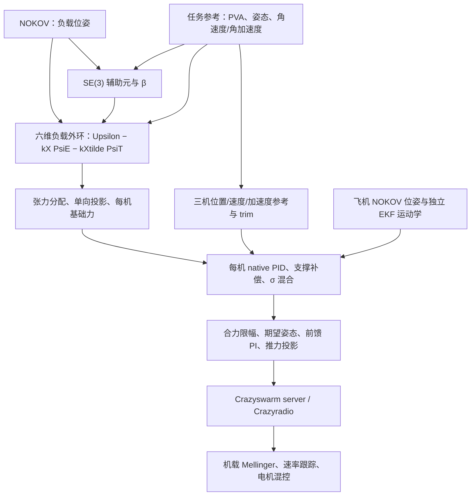

# 协同搬运控制实现：当前代码版

> 本文沿用《协同搬运控制实现.md》的章节顺序与讲解方式，以“公式 → 数据来源 → 代码入口 → 实际作用”说明当前实现。
> 核对日期：2026-11-17；源码基线：`crazyswarm` 提交 `9e633e1`。参数取自该版本 YAML，未启动实飞节点。
> 当前组合：`velocity_free_beta + reference_cascade + native_position_pid + feedforward_pi`，负载轨迹为 `hover`。
> 文中 **β 专指六维 SE(3) 辅助量**；接管混合系数统一记为 **σ**，对应代码 `transport_blend`。

# 一、工程地图

## 1.1 三个控制职责与 ROS 调度

| 职责 | 源码 | 主要入口 |
|---|---|---|
| 独立起飞、收绳预抬、放载后下降 | [ctbr_independent_controller.py](../ros_ws/src/crazyswarm/scripts/ctbr_independent_controller.py) | `IndependentVehicleController._independent_force` |
| 负载六维外环、张力分配、每机基础三维力 | [slung_load_controller.py](../ros_ws/src/crazyswarm/scripts/slung_load_controller.py) | `SlungLoadController.compute`、`_velocity_free_wrench` |
| 吊运时每机位置反馈、力混合、姿态命令 | [ctbr_transport_vehicle_controller.py](../ros_ws/src/crazyswarm/scripts/ctbr_transport_vehicle_controller.py) | `_native_transport_feedback`、`_compose_vehicle_force`、`_transport_body_rate` |
| 独立/运输控制组合、力到 CTBR | [ctbr_geometric_controller.py](../ros_ws/src/crazyswarm/scripts/ctbr_geometric_controller.py) | `GeometricCtbrController.compute` |
| 负载 SE(3) 辅助系统 | [slung_velocity_free.py](../ros_ws/src/crazyswarm/scripts/slung_velocity_free.py) | `VelocityFreePayloadObserver.update`、`se3_step` |
| 机群启动、同步与故障调度 | [ctbr_fleet_node.py](../ros_ws/src/crazyswarm/scripts/ctbr_fleet_node.py) | `MultiCtbrControllerNode` |
| 参考、补偿和任务衔接 | `ctbr_payload_reference.py`、`ctbr_payload_control.py`、`ctbr_payload_mission.py` | 负载参考、三机构型、计划放载与受控退出 |

`ctbr_controller.py` 是 ROS 启动入口；它通过正常导入组合上述模块。状态接收与质量判定在 `ctbr_payload_state.py`、`ctbr_vehicle_state.py`，参数加载在 `ctbr_payload_parameters.py` 等模块。



## 1.2 五个任务阶段

| 阶段 | 主要状态或标记 | 参考与控制 | 结束条件 |
|---|---|---|---|
| 1 起飞前保持 | `waiting_for_ekf`、`waiting_for_fleet`、`pre_takeoff_hold` | 保持起点，等待全机准入 | 电压、EKF/NOKOV 对齐、状态预热及轨迹保持条件满足 |
| 2 独立起飞 | `takeoff`，后续高度过渡 | 独立位置控制；参考高度 0.50 m，起飞段 5 s | 按轨迹与机群调度进入收绳流程；不能仅据阶段名认定真实飞机已经到位 |
| 3 TAKEUP 与预抬 | `takeup`、`payload_prelift_stage` | 收绳参考 8 s；之后用实测离地间隙驱动预抬/停止/对齐 | 绳长及构型检查、预抬确认、负载连续有效；超过预抬边界则受控退出 |
| 4 接管与运输 | `tension_ramp`，之后为任务轨迹阶段 | σ 混合独立力与协同力；负载参考逐步建立 | 当前计划窗口 h60 到期；保护也可提前触发退出 |
| 5 放载与降落 | `payload_validation_landing_stage`，以及每机 `landing` / `landed` | 协同下降负载 → 确认触地 → 卸载 → 飞机独立下降 | 以触地、卸载和各机下降完成为准 |

**阶段标签、参考到位和实测到位是三件不同的事。** 接管依赖实测门控；轨迹进入 `complete` 只表示参考完成；计划放载由任务时钟启动，不等待负载误差严格为零。

当前预抬参数为最低点间隙 0.20 m，另加 0.02 m 停止裕量；竖直速度容差 0.05 m/s，连续确认 0.50 s。它不是把负载几何中心高度写死为 0.22 m：箱体倾斜后的最低点位置仍须由姿态计算。

## 1.3 接管后的时钟

记 $h=t-t_h$，其中 $t_h=\texttt{payload\_transport\_start\_time}$。h0 是 `payload_transport_active` 置为 True、开始 TAUT_RAMP 的那一拍。

| 区间 | 当前事件 | 参数 |
|---|---|---|
| h0–h5 | 力混合 σ 从 0 到 1 | `tension_ramp_s=5` |
| h0–h12 | 负载姿态与平衡绳向过渡 | `transport_attitude_reference_s=12` |
| h5–h17 | 负载几何中心参考抬到 0.60 m；飞机保持倍率 2.0 降至 1.5 | `reference_lift_s=12` |
| h17–h60 | 当前 `hover` 的最终位置参考保持 | `flight_validation_transport_s=60` |
| h60 | 启动计划协同放载 | `flight_validation_enabled=true` |

可选圆周、八字、圆锥的参考起点为

$$
 h_{\rm trajectory}=\max(T_{\rm ramp}+T_{\rm lift},T_R)+T_{\rm settle}=20\ {\rm s}.
$$

当前没有运行这些动态轨迹。若启用预设的 15° 两圈圆锥，h20–25 倾斜、h25–85 扫描、h85–90 回水平，需将任务窗口延长，例如改为 100 s。离线 `post_handoff_s=100` 不会改写实飞 h60 的计划降落条件。

# 二、记号与坐标约定

## 2.1 记号表：先区分负载和飞机

| 数学符号 | 代码字段 | 含义/坐标 |
|---|---|---|
| $p_0,R_0$ | `position`、`rotation` | 负载几何中心世界位置、体系到世界系的旋转 |
| $\widehat p,\widehat R$ | `auxiliary_position/rotation` | 辅助元；不用它替换测量位姿进行几何计算 |
| $\beta=[\beta_\omega;\beta_v]$ | `beta_body` | 六维辅助量，角速度在前、线速度在后，均为负载体系分量 |
| $v_0^{\rm fb},\Omega_0^{\rm fb}$ | 负载 `velocity/body_rate` | β 模式下为 $R_0\beta_v,\beta_\omega$ |
| $p_r,v_r,a_r,R_r,\omega_r,\dot\omega_r$ | `pd/vd/ad/rd/omegad/omegadd` | 负载参考；PVA 在世界系，角速度及其导数在参考体系 |
| $\rho_i,L_i$ | `attachment_points_m`、`link_lengths_m` | 负载体系挂点、运行有效绳长 |
| $d_i$ | 实时端点距离 | $\lVert p_0+R_0\rho_i-p_i\rVert$，不等同于 $L_i$ |
| $d_{ih}$ | 接管冻结端点距离 | 构型过渡采用的实测长度 |
| $q_i,\dot q_i,\omega_i$ | `link_units/link_rates/omega_link` | 世界系绳向、绳向速率、$q_i\times\dot q_i$ |
| $F_d,M_d$ | 负载结果 `desired_force/desired_moment` | 负载世界系请求合力、负载体系请求力矩 |
| $u_i$ | 负载结果 `vehicles[i]['force']` | 分配及挂点补偿得到的每机基础力 |
| $F_i$ | 飞机结果 `desired_force` | 加入飞机反馈、配平、混合并经限幅后的三维力 |
| $R_i,R_{ic}$ | 飞机 `rotation/computed_rotation` | 实测飞机姿态、期望飞机姿态 |
| $\sigma$ | `transport_blend` | 0–1 标量；不是 β，不是绳索角度 |

`desired_force` 在负载结果和飞机结果中重名，阅读时必须看对象。CSV 使用 `payload_desired_force_*` 区分负载请求。

## 2.2 世界系 z-up 与力的方向

$$
e_z=[0,0,1]^T,\qquad g=9.80665\ {\rm m/s^2},\qquad a_g=-ge_z.
$$

世界系正 z 向上。`+g*e_z` 在控制式中是重力补偿，不能称为真实重力加速度。飞机推力沿自身 $+z$ 轴，$R_ie_z$ 是实际推力方向。

绳向 $q_i$ 从飞机指向负载挂点。悬吊时通常 $q_{iz}<0$，正张力作用于负载的力是 $-T_iq_i$。

SE(3) 的六维量采用 **角在前、线在后**：群速度为 $[\omega;v_b]$，广义力为 $[M_b;F_b]$。张力分配器却采用 **力在前、力矩在后** 的右端 $[R_0^TF_d;M_d]$，两者不可原样互换。

## 2.3 上表面原点、质心假设和显式惯量

NOKOV `load` 原点位于上表面中心。设箱体高度为 $h_b$：

$$
p_0=p_{\rm top}+R_0[0,0,-h_b/2]^T.
$$

偏移随负载旋转，不能直接减去世界系 $h_b/2$。实现见 `mocap_top_surface_to_center()`。

代码以转换后的几何中心作为控制中的质心；真实质心偏置仍是模型误差。当前惯量直接读取

$$
J_0=\operatorname{diag}(3.4132,3.0394,4.0119)\times10^{-5}\ {\rm kg\,m^2}.
$$

**当前不按质量和尺寸自动计算长方体惯量。** `inertia_diag_kgm2` 必须显式提供正的有限主惯量，并通过主惯量三角不等式检查。

YAML 挂点每行为一机；核心内部每列为一机：

$$
[\rho_3\ \rho_4\ \rho_5]=
\begin{bmatrix}
0.040&-0.040&-0.040\\
0&0.030&-0.030\\
0.025&0.025&0.025
\end{bmatrix}\ {\rm m}.
$$

# 三、负载状态反馈：当前 SE(3) 辅助系统

## 3.1 输入不是动捕导数

负载回调从 NOKOV 位姿得到 $p_0,R_0$，原 `twist/acceleration` 留在 `raw_*` 诊断字段。当前反馈模式是 `velocity_free_beta`，辅助系统不读取这些原始导数。

这与“用位姿观测真实速度”也不完全相同：β 是由参考与辅助误差共同产生的控制量，有自己的动态、滞后和参考瞬态。

## 3.2 两个位姿误差

$$
X_0=T(R_0,p_0),\quad X_r=T(R_r,p_r),\quad
X_e=X_r^{-1}X_0,\quad \widetilde X=\widehat X^{-1}X_0.
$$

其中 $T(R,p)=\begin{bmatrix}R&p\\0&1\end{bmatrix}$。跟踪误差相对于参考，辅助误差相对于 $\widehat X$：

$$
R_e=R_r^TR_0,\quad p_e=R_r^T(p_0-p_r),\qquad
\widetilde R=\widehat R^TR_0,\quad \widetilde p=\widehat R^T(p_0-\widehat p).
$$

二者采用同一个势函数误差映射：

$$
\Psi(T(R,p))=
\begin{bmatrix}
\frac12\operatorname{vee}(WR-R^TW)\\
\frac d2R^Tp
\end{bmatrix},\qquad
\overline W=\frac12(\operatorname{tr}(W)I-W).
$$

本文记 $\Psi_E=\Psi(X_e)$、$\Psi_T=\Psi(\widetilde X)$。$W,d$ 的派生见 §4.3。

## 3.3 β 的计算

参考群速度是

$$
\xi_r=\begin{bmatrix}\omega_r\\R_r^Tv_r\end{bmatrix}.
$$

辅助系统输出为

$$
\boxed{
\beta=\operatorname{Ad}_{X_e^{-1}}\xi_r+
\operatorname{diag}\left(\kappa_\omega\overline W^{-1},\frac{2\kappa_p}{d}I\right)\Psi_T
}
$$

展开参考变换：

$$
\operatorname{Ad}_{X_e^{-1}}\xi_r=
\begin{bmatrix}
R_0^TR_r\omega_r\\
R_0^T\big[v_r+(R_r\omega_r)\times(p_0-p_r)\big]
\end{bmatrix}.
$$

位置误差与参考角速度之间的叉乘项必须保留。它使平移部分仍是 SE(3) 的 Adjoint 变换，不能直接替换成 $R_0^Tv_r$。

辅助平移修正中的 $d$ 精确抵消：

$$
\frac{2\kappa_p}{d}\frac d2\widetilde R^T\widetilde p
=\kappa_p\widetilde R^T\widetilde p.
$$

所以观测器无需单独存储 $d$；外环仍需要它来计算平移力反馈。当前 $\kappa_p=12$ s⁻¹、$\kappa_\omega=20$ s⁻¹，三个旋转轴共用一个 κ。

名义 10 ms 位姿间隔对应 $\kappa_p\Delta t=0.12$、$\kappa_\omega\Delta t=0.20$。
初始化检查要求 $\max(\kappa_p,\kappa_\omega)\,\texttt{observer\_max\_dt}\le1$，
当前恰为 $20\times0.05=1$。这只是数值配置边界，不能替代闭环稳定性验证。

## 3.4 辅助元传播和初值

$$
\dot{\widehat X}=\widehat X(\operatorname{Ad}_{\widetilde X}\beta)^\wedge,
\qquad
\widehat X_{k+1}=\widehat X_k\exp\left(\Delta t_k(\operatorname{Ad}_{\widetilde X_k}\beta_k)^\wedge\right).
$$

对 $\phi=\omega\Delta t$，指数映射的平移部分使用左 Jacobian：

$$
V(\phi)=I+\frac{1-\cos\theta}{\theta^2}\widehat\phi
+\frac{\theta-\sin\theta}{\theta^3}\widehat\phi^2,\qquad \theta=\lVert \phi\rVert.
$$

因此 $\widehat p^+=\widehat p+\widehat RV(\phi)v\Delta t$，不是独立的 `p += v*dt`。小角度分支用级数，旋转每次投回 SO(3)。

当前首帧初始化为

$$
\widehat R=R_0,\qquad
\widehat p=p_0+R_0\frac{0.001}{\sqrt3}[1,1,1]^T.
$$

1 mm 是偏移范数。初始 β 与传播群速度置零，后续有效样本更新；至少接受三帧才放行。该过程从接管前开始，接管时不另起一份辅助系统。

## 3.5 两个线程、两个参考时刻

`ctbr_payload_reference.py` 把当前目标通过 `set_reference(target, sample_time)` 写入缓存。下一次位姿回调按源时刻年龄对参考作短时外推。

| 环节 | 实际执行 |
|---|---|
| 位姿回调 | 用上一个已接受样本的群速度传播辅助元，再以当前位姿、缓存参考计算 β |
| 主机控制 | 用已接受位姿/辅助位姿快照和当前任务参考计算 $\Psi_E,\Psi_T,\Upsilon$ |
| 参考超过 0.05 s | 该回调的参考群速度前馈置零；不代表控制线程的 $\Upsilon$ 同时置零 |
| 重复、倒序、跳变、β 触界 | 拒绝候选，接受状态与接受时间不推进 |
| 小于 5 ms 的间隔 | 等待累计，不用极小步长推进辅助状态 |

> MATLAB 每物理步同步计算；ROS 辅助历史由先前缓存参考驱动，外环采用当前任务参考。公式结构相同，不等于离散运行轨迹完全一致。

## 3.6 β 提供给下游的字段

$$
v_0^{\rm fb}=R_0\beta_v,\qquad \Omega_0^{\rm fb}=\beta_\omega.
$$

它们供绳速重建、预抬竖速判据、绳长校准、触地确认和 trim 健康门控使用。负载 `acceleration` 显式置零，`acceleration_available=False`；降落规划以零初始加速度近似，不能把这列当作实测静止证据。

## 3.7 旧 `pose_observer` 分支

切回 `pose_observer` 会同时恢复旧负载 PID/PD。平动观测器仍是带采样缩放的 α–β–γ 预测校正，令 $s_t=\min(1,\Delta t/0.01)$：

$$
p^-=p+v\Delta t+\tfrac12a\Delta t^2,\quad v^-=v+a\Delta t,\quad r=p_{\rm meas}-p^-,
$$

$$
p^+=p^-+\alpha s_t r,\quad
v^+=v^-+\beta_o s_t^2r/\Delta t,\quad
a^+=a+\gamma s_t^3r/\Delta t^2.
$$

这里 $\beta_o$ 是观测增益，与六维 β 无关。姿态采用预测旋转后的对数残差校正。旧残差增益仍保存在配置中，但当前 β 分支不使用它们。

# 四、负载协同外环

## 4.1 当前名义控制律

入口为 `SlungLoadController._velocity_free_wrench()`。定义空间惯量和李代数伴随矩阵：

$$
\mathcal I_0=\operatorname{diag}(J_0,m_0I),\qquad
\operatorname{ad}_{[\omega;v]}=
\begin{bmatrix}\widehat\omega&0\\\widehat v&\widehat\omega\end{bmatrix}.
$$

参考群速度导数为

$$
z=\dot\xi_r=
\begin{bmatrix}\dot\omega_r\\-\widehat\omega_rR_r^Tv_r+R_r^Ta_r\end{bmatrix},
\qquad \xi_r^e=\operatorname{Ad}_{X_e^{-1}}\xi_r.
$$

于是

$$
\Upsilon=-\operatorname{ad}_{\xi_r^e}^{T}\mathcal I_0\xi_r^e
+\mathcal I_0\operatorname{Ad}_{X_e^{-1}}z,
$$

$$
\boxed{
 u_c=\Upsilon-k_X\Psi_E-k_{\widetilde X}\Psi_T+
 \begin{bmatrix}0_3\\m_0R_0^Tge_z\end{bmatrix}
}.
$$

| 项 | 数据来源 | 作用 |
|---|---|---|
| $\Upsilon$ | 参考 PVA、角速度/角加速度、当前与参考的位姿误差、惯量 | 参考惯性前馈，包含旋转/平移的坐标耦合 |
| $-k_X\Psi_E$ | 当前测量位姿与参考位姿 | 跟踪势函数反馈 |
| $-k_{\widetilde X}\Psi_T$ | 当前测量位姿与辅助位姿 | 辅助误差反馈，形成动态阻尼作用 |
| $[0;m_0R_0^Tge_z]$ | 当前姿态、质量、重力 | ROS z-up 下的支撑补偿 |

当前不再直接叠加旧的 $-K_ve_v$、$-K_\Omega e_\Omega$。β 通过辅助元演化进入 $\Psi_T$，不是把 β 再塞进一套旧 PD。

## 4.2 输出映射及当前限幅顺序

将 $u_c=[m_b;f_b]$，定义逐分量软限幅 $S_L(x)=L\tanh(x/L)$。当前 Python 实际输出：

$$
\boxed{M_d=S_{M_{\max}}(m_b),\qquad F_d=R_0S_{F_{\max}}(f_b).}
$$

若关闭 yaw 通道，则之后将 $M_{d,z}$ 清零。当前配置开启 yaw。

未限幅时，零参考运动、$\Psi_E=\Psi_T=0$ 应给出 $F_d^{\rm raw}=m_0ge_z$、$M_d^{\rm raw}=0$。经过 $\tanh$ 后支撑力会略有压缩，不能声称限幅后仍精确等于 $m_0g$。

> **当前仍有一项与 MATLAB 不一致：**MATLAB 先取 $R_0f_b$，再在世界系做 $S_{F_{\max}}$；Python 先在体系限幅再旋转。一般 $R_0S(f_b)\ne S(R_0f_b)$，倾斜姿态和较大请求力下会影响力的方向与大小。本文记录现状，不把它写成已经完成的等价转换。

默认预算为

$$
F_{\max}=2\sum_iT_{i,\max}=7.060788\ {\rm N},\qquad
M_{\max}=F_{\max}\max_i\lVert \rho_i\rVert\approx0.394710\ {\rm N\,m}.
$$

这不是每机可用推力；每架飞机的最终命令仍上限 1.00 N。

## 4.3 $W,d$ 与刚度的实际关系

`ctbr_payload_parameters.py` 先以显式惯量和配置带宽 $f=[1.5,1.5,0.7]$ Hz 构造

$$
K_{R,j}=J_{0,j}(2\pi f_j)^2,\qquad b_j^{(0)}=K_{R,j}/k_X.
$$

按 MATLAB 的正定权重构造调整 roll/pitch：

$$
a=\tfrac12(b_1^{(0)}+b_2^{(0)}),\quad
r=b_3^{(0)}/a,\quad \varepsilon=\min(0.4r,0.15),
$$

$$
\overline W=\operatorname{diag}\big(a,a(1+\varepsilon),b_3^{(0)}\big),\quad
W=\operatorname{tr}(\overline W)I-2\overline W,
$$

$$
d=2m_0\operatorname{mean}(\texttt{position\_gain})/k_X.
$$

当前 $k_X=1,k_{\widetilde X}=16$，数值约为

$$
\operatorname{diag}(W)=[1.08651,0.46565,5.26597]\times10^{-3},
$$

$$
\operatorname{diag}(\overline W)=[2.86581,3.17624,0.77608]\times10^{-3},\qquad d=0.1495.
$$

小角度下 $\Psi_\omega\simeq\overline W\delta\theta$。这里的实际旋转刚度是 $k_X\overline W$，经过 roll/pitch 调整，不再逐轴等于最初 $K_R$。

平移的等效刚度是 $k_Xd/2=0.07475$ N/m，三轴统一，旧 `position_gain=[3,3,3.75]` 只通过平均值参与派生。原负载 `velocity_gain/integral_gain/c1` 不再生成新分支的力。

$\kappa_\omega=20$ 与三轴自然频率约 $[9.16,10.22,4.40]$ rad/s 的比值只有 $[2.18,1.96,4.55]$。因此不能用 MATLAB 的“κ 为十倍自然频率”近似，声称 `kXtilde=16` 自动实现三轴阻尼比 0.8。

## 4.4 陀螺项、积分与旧模式

β 分支将负载 `position_integral` 清零，关闭可选负载姿态积分，不补 $\beta_\omega\times J_0\beta_\omega$。请求角加速度为

$$\alpha_{0c}=J_0^{-1}M_d.$$

$\Upsilon$ 使用的是变换后的参考群速度，不能把其中的惯性前馈称为测量陀螺补偿。

旧 `pose_observer` 分支保留：

$$
\dot I_p=e_v+c_1e_p,\quad
F_d=m_0(a_r-K_xe_p-K_ve_v-K_II_p+ge_z),
$$

$$
Q=R_0^TR_r,\quad e_R=\tfrac12(R_r^TR_0-R_0^TR_r)^\vee,\quad e_\Omega=\Omega_0-Q\omega_r,
$$

$$
M_d=\Omega_0\times J_0\Omega_0-J_0(\Omega_0\times Q\omega_r)
+J_0Q\dot\omega_r-K_Re_R-K_\Omega e_\Omega.
$$

即使形式上消去陀螺项后有 $J_0\dot e_\Omega=-K_Re_R-K_\Omega e_\Omega$，$e_R$ 本身仍是 SO(3) 非线性误差。不能据此称整个姿态系统“精确线性”，二阶带宽关系属于小角度解释。

## 4.5 六维请求分配到三根绳

$$
P=\begin{bmatrix}I&I&I\\\widehat\rho_3&\widehat\rho_4&\widehat\rho_5\end{bmatrix}\in\mathbb R^{6\times9},
\qquad b=\begin{bmatrix}R_0^TF_d\\M_d\end{bmatrix}.
$$

$$
z=P^T(PP^T)^{-1}b+z_{\rm null},\qquad \mu_{id}=R_0z_i.
$$

实现用 `np.linalg.solve`，不是显式求逆。若 $\operatorname{cond}(PP^T)>1/\epsilon$，$\epsilon=10^{-9}$，则拒绝计算。挂点共线或重合可能导致秩不足。

三块 $z_i$ 按飞机顺序堆叠；与 MATLAB 按列展开一致。$\mu_{id}$ 是世界系的虚拟三维请求力，还不是实际沿绳张力。

## 4.6 零空间内部力与平衡绳向

候选外张向量为

$$
\mu_i^{\rm cand}=\frac{f_{\rm out}m_0g}{\sqrt3}
\frac{[\rho_{i,x},\rho_{i,y},0]^T}{\lVert [\rho_{i,x},\rho_{i,y},0]\rVert},
\qquad f_{\rm out}=0.25.
$$

**0.25 是无量纲比例**，`outward_bias_max_n=0.15` 才是牛顿预算。核心用 SVD 得到 $\ker P$ 的正交基 $N$：

$$
z_{\rm null}=NN^T\operatorname{stack}(\mu_i^{\rm cand}),\qquad
Pz_{\rm null}=0.
$$

再以共同系数将三机力的 RMS 范数缩放到

$$r^*=\min(f_{\rm out}m_0g/\sqrt3,\ 0.15\ {\rm N}).$$

该内部力用于调整构型，但**不能保证每根实际绳索张力都为正**；后续沿绳投影和单向截断可能破坏虚拟六维力的精确实现。

`equilibrium_link_units()` 令分配器右端仅含重力、力矩为零，得到

$$
\mu_i^{\rm eq}=R_0A_iR_0^Tm_0ge_z+R_0z_{{\rm null},i},\qquad
q_i^*=-\mu_i^{\rm eq}/\lVert \mu_i^{\rm eq}\rVert,
$$

其中 $A_i$ 是 $P^T(PP^T)^{-1}$ 前三列的第 i 个三行块。$q_i^*$ 用于静态构型参考，与每拍动态负载请求得到的 $q_{id}$ 分别管理。

## 4.7 单向张力

$$
T_i^{\rm signed}=-q_i^T\mu_{id},\quad T_i=\max(0,T_i^{\rm signed}),\quad \mu_i=-T_iq_i.
$$

$$
q_{id}=\begin{cases}
-\mu_{id}/\lVert \mu_{id}\rVert,&T_i^{\rm signed}>0,\\
q_i,&T_i^{\rm signed}\le0.
\end{cases}
$$

原始请求方向另存在 `raw_desired_link_direction`。这是“沿实测绳向投影 + 单向裁剪”，不是带 $T_i\ge0$ 和推力约束的 QP。

当前六维负载外环没有旧负载 I 项，因此不能再沿用“分配残差交给负载积分吸收”的说法。下游飞机积分、构型 trim、支撑 trim 有各自作用范围，不能证明它们消除了所有分配误差。

# 五、单机力的构造

## 5.1 实测绳向与绳速

$$
r_i=p_0+R_0\rho_i-p_i,\qquad d_i=\lVert r_i\rVert,\qquad q_i=r_i/d_i,
$$

$$
v_{a_i}=R_0\beta_v+(R_0\beta_\omega)\times(R_0\rho_i),
$$

$$
\dot q_i=\frac{I-q_iq_i^T}{d_i}(v_{a_i}-v_i),\qquad \omega_i=q_i\times\dot q_i.
$$

归一化分母用实时距离 $d_i$，离心力项使用运行绳长 $L_i$。实际代码对极小距离设数值下界；松绳时这些端点仍能定义方向，但方向存在不等于绳索有张力。

## 5.2 沿绳与垂绳两部分

$$
u_i^\parallel=\mu_i+m_iL_i\lVert \omega_i\rVert^2q_i+m_iq_iq_i^Ta_i,
$$

$$
u_i^\perp=f_{q,i}^{\rm lim}-m_i\widehat q_i^{\,2}a_i,
\qquad u_i=u_i^\parallel+u_i^\perp.
$$

其中未限幅的纠正力为

$$
f_{q,i}^{\rm raw}=m_iL_iq_i\times c_i,\quad
c_i=-\gamma(K_qe_{q_i}+K_\omega\omega_i+K_{Iq}I_{q_i}),\quad e_{q_i}=q_{id}\times q_i.
$$

$\gamma$ 是有效绳向倍率；当前 `reference_cascade` 强制 $\gamma=0$。因此当前没有直接绳向纠正力，但 $\mu_i$、离心力和挂点惯性项仍在。

由 $q_iq_i^T-\widehat q_i^2=I$ 可合并为

$$\boxed{u_i=\mu_i+m_iL_i\lVert \omega_i\rVert^2q_i+m_ia_i+f_{q,i}^{\rm lim}.}$$

## 5.3 $a_i$ 的两种来源

| 模式 | β 反馈下的 $a_i$ | 生效范围 |
|---|---|---|
| `reference_cascade` | $a_r+ge_z+R_r\widehat\omega_r^2\rho_i-R_r\widehat\rho_i\dot\omega_r$ | 当前默认；支撑期望挂点运动 |
| `coupled` | $F_d/m_0+R_0\widehat{\beta_\omega}^{\,2}\rho_i-R_0\widehat\rho_iJ_0^{-1}M_d$ | 保留对照；使用本拍负载请求和 β |

`reference_cascade` 通过飞机位置/速度反馈提供构型恢复与运动阻尼。不能仅比较 $K_q$ 与飞机 $K_p$ 的数值，就认定两套闭环有固定倍数的收敛速度差；实际响应还受负载、绳索、姿态环及电机影响。

## 5.4 纠正力限幅与力导数

`_limit_link_force()` 只限制 $f_{q,i}^{\rm raw}$：先约束范数到 0.40 N，再把相邻值的变化量限制在 $20\Delta t$ N。$m_iq_iq_i^Ta_i$ 和 $-m_i\widehat q_i^2a_i$ 不进入纠正力历史。

负载核心输出的每机力导数另算：

$$
\dot u_i^k=\operatorname{clip}_{\pm20\ {\rm N/s}}
\frac{u_i^k-u_i^{k-1}}{\Delta t_c},\qquad \Delta t_c\in[0.001,0.05]\ {\rm s}.
$$

首拍导数为零。该限幅与纠正力变化率限幅是两层不同的操作；后级还会加入支撑配平和参考修正的力导数。

## 5.5 力请求与构型参考两条链

| 链 | 输入 | 输出 |
|---|---|---|
| 负载力链 | 测量位姿、辅助位姿、负载参考 | $F_d,M_d\to\mu_{id}\to u_i$ |
| 三机构型链 | 负载参考、平衡绳向、接管锚点、trim | 飞机位置/速度/加速度参考 |

当前每机 `desired_force_override` 可写成

$$F_i^{\rm base}=u_i+b_{z,i}e_z+F_i^{\rm formation}.$$

这里 $b_{z,i}$ 是支撑残差 trim；$F_i^{\rm formation}$ 为动态参考使用的编队加速度补充，静止参考下为零。

飞机 native PID 再增加 $F_{PD,i}+w_ub_i$，最后按 σ 接管：

$$
F_i^{\rm trans}=F_i^{\rm base}+F_{PD,i}+w_ub_i,
$$

$$\boxed{F_i^{\rm raw}=(1-\sigma)F_i^{\rm ind}+\sigma F_i^{\rm trans}.}$$

`handoff_force` 存在时，$F_i^{\rm ind}$ 使用接管前保存的独立控制输出。否则使用普通位置反馈算出的独立候选力。当前 native 路径不再额外叠加 differential 路径的 $\sigma m_ia_{\rm hold}$，避免重复计算位置反馈。

## 5.6 独立飞行/预抬的力

独立飞行使用加速度增益，而普通 `position_gain` 分支是直接作用于力的另一组参数。独立模式基本形式为

$$
a_i^{\rm fb}=\operatorname{clip}_{\pm a_{\max}}
(-K_{p,i}^{\rm ind}e_{p,i}-K_{v,i}^{\rm ind}e_{v,i}-K_{I,i}^{\rm ind}I_i),
\qquad F_i^{\rm ind}=m_i(a_{i,d}+ge_z+a_i^{\rm fb}).
$$

普通独立积分只在位置误差门内更新；预抬和放载后的下降为 Z 轴设置单独有界积分和反饱和规则。进入协同阶段后，这份独立积分冻结，运输 native PID 使用自己的积分状态，不共享累积器。

# 六、从三维力到 CTBR

## 6.1 每机合力限幅

`ctbr_control_math._limit_force_with_derivative()` 先限制世界系竖直力：

$$F_{i,z}^{\rm lim}=\operatorname{clip}(F_{i,z}^{\rm raw},0,T_{i,\max}^{\rm cmd}),$$

再用 $H=F_{i,z}^{\rm lim}\tan\theta_{\max}$ 限制水平范数：

$$
F_{i,xy}^{\rm lim}=\begin{cases}
F_{i,xy}^{\rm raw},&\lVert F_{i,xy}^{\rm raw}\rVert\le H,\\
\dfrac{H}{\lVert F_{i,xy}^{\rm raw}\rVert}F_{i,xy}^{\rm raw},&\text{否则且非退化}.
\end{cases}
$$

当前稳态飞机倾角上限 10°，预抬/接管初段可达 12°；在参考抬升中逐步过渡。它是飞机推力轴倾角，不是绳角，也不是负载圆锥半角。

函数同时返回力导数。水平限幅支路当前计算缩放系数的导数时将 $H$ 当作局部常数，没有完整计入变化的竖直力及倾角上限。因此该导数不是所有时变限幅条件下的精确链式导数。当前运输前馈采用 §6.3 的姿态差分，不直接依赖该解析导数链。

## 6.2 力滤波与期望姿态

可选运输合力低通为

$$F_f^{k+1}=F_f^k+\frac{\Delta t}{\tau_F+\Delta t}(F^{\rm lim}-F_f^k).$$

当前三机 `transport_force_filter_tau_s=0`，此低通关闭；体角速度输出低通 `transport_body_rate_filter_tau_s` 也为零。不能用历史 5 ms 参数描述当前响应。

由最终合力构造期望姿态：

$$
b_{3c}=F_f/\lVert F_f\rVert,\quad b_{1r}=[\cos\psi_d,\sin\psi_d,0]^T,
$$

$$
b_{1c}=\frac{(I-b_{3c}b_{3c}^T)b_{1r}}{\lVert (I-b_{3c}b_{3c}^T)b_{1r}\rVert},\quad
b_{2c}=b_{3c}\times b_{1c},\quad R_{ic}=\operatorname{proj}_{SO(3)}[b_{1c}\ b_{2c}\ b_{3c}].
$$

力范数或航向投影太小时使用历史方向/固定方向回退，重新正交化。退化帧不用于推断运输姿态前馈。

## 6.3 当前运输前馈：相邻目标姿态差分

`_transport_log_difference()` 在控制时钟上计算

$$
\Omega_{ic}^k=\frac{\operatorname{Log}((R_{ic}^{k-1})^TR_{ic}^{k})^\vee}{\Delta t_R}.
$$

这里的 $R_{ic}$ 是由限幅后的飞机最终合力形成的目标姿态，不是负载 $R_r$，也不是动捕姿态。首次进入、复位、退化、时间间隔不在 $(0,0.10]$ s 时不推断有效前馈；重复时刻不凭空推进历史。

## 6.4 前馈 + 姿态 PI

$$
e_{R,i}=\tfrac12(R_{ic}^TR_i-R_i^TR_{ic})^\vee,\qquad
\Omega_i^{\rm base}=R_i^TR_{ic}\Omega_{ic}-K_{R,i}^{\rm tr}e_{R,i}.
$$

当前 `feedforward_pi` 的运输姿态积分状态 $\nu_i$ 本身以 rad/s 存储：

$$
\dot\nu_i^{\rm req}=\operatorname{clip}(-K_{IR}^{\rm tr}e_{R,i},-\dot\nu_{\max},\dot\nu_{\max}),
$$

$$
\nu_i^+=\operatorname{clip}(\nu_i+\Delta t\dot\nu_i^{\rm req},-\nu_{\max},\nu_{\max}).
$$

全协同 $\sigma=1$ 时，限幅前角速度为 $\Omega_i^{\rm base}+\nu_i$。接管期间，先混合独立姿态律和运输姿态律，再叠加 $\sigma\nu_i$；此时积分学习尚未放开。

| 项 | 当前参数或行为 |
|---|---|
| 运输姿态 P，CF3 / CF4 | `[12,12,6]` s⁻¹ |
| 运输姿态 P，CF5 | `[8,8,6]` s⁻¹ |
| I 学习增益 | `[0.4,0.4,0.2]` |
| I 附加角速度逐轴上限 | `[0.15,0.15,0.10]` rad/s |
| I 变化率逐轴上限 | `[0.02,0.02,0.01]` rad/s² |
| 学习门控 | 协同混合完成、反馈有效、非缓存保持、非降落、未力限幅、姿态误差门及任务门控 |
| 反饱和 | 拒绝进一步加深角速度饱和的积分增量，允许退出饱和方向的增量 |

`feedforward_pi` 不叠加旧 `transport_rate_gain` 阻尼。`feedforward_p` 去掉该 I，`rate_damping` 则恢复 $-K_Re_R-K_\Omega\Omega$ 的旧运输分支。

## 6.5 总推力、速率限制和桥接

$$
T_i^{\rm cmd}=\operatorname{clip}\big(\max(F_f^TR_ie_z,T_{i,\min}),0,1.00\ {\rm N}\big).
$$

投影使用实测推力轴 $R_ie_z$，不是简单发送 $\lVert F_f\rVert$。最小推力由任务阶段设置，不能把 0.30 N 下限无条件延伸到所有降落/停推阶段。

三机角速度命令逐轴限幅为 $[3,3,2]$ rad/s。`/cf<ID>/cmd_ctbr` 经 server 映射为推力 raw 和角速度通道；桥接中的 yaw 符号转换、推力标定与固件内环是另外一层。

当前 `max_total_thrust_newton=1.176798` 是推力映射参考，`max_command_thrust_newton=1.00` 才是主机命令上限。不能用一个参数同时解释标定曲线与命令饱和。

# 七、时间参考：五次曲线与接管连续性

## 7.1 统一五次时间参数

令 $u=\operatorname{clip}((t-t_0)/T,0,1)$：

$$
S(u)=10u^3-15u^4+6u^5,
$$

$$
\dot S=\frac{30u^2(1-u)^2}{T},\qquad
\ddot S=\frac{60u(1-u)(1-2u)}{T^2}.
$$

`slung_load_controller.smoothstep5_profile()` 返回 $S,\dot S,\ddot S$，后两者已经包含时长因子，使用时不能再除一次 $T$。

$$\max\dot S=1.875/T,\qquad \max|\ddot S|=(10/\sqrt3)/T^2.$$

端点一、二阶导数为零，适合静止到静止的参考连接。一般运动初态下的降落曲线另需指定初始速度和加速度，不是任意时候都能直接套 $S$。

## 7.2 四条并行时间线

$$
\sigma(h)=S(h/5),\qquad
p_r(h)=p_{0h}+S((h-5)/12)(p_{\rm goal}-p_{0h}),
$$

$$\lambda(h)=1.5+0.5\big[1-S((h-5)/12)\big].$$

这些式子的自变量都按 §7.1 裁到 $[0,1]$。姿态和绳向的插值参数为 $s_R=S(h/12)$。

```text
h0 ├── σ：独立力 → 协同力 ─── h5
   ├── 负载姿态 / 绳向插值 ───────── h12
   └── h5 ├── 负载参考抬升 ───────────── h17
          └── 保持倍率 λ：2.0 → 1.5 ─── h17
                                               h60：当前 hover 开始放载
```

h5–h12 已经全协同，但参考姿态与构型仍在变化。不能把“混合系数到 1”当作“所有参考已建立”。

## 7.3 测量锚点和旧跟踪偏差

接管时冻结飞机实测位置 $p_{ih}$、负载位置 $p_{0h}$、实测姿态 $R_{0h}$，以及旧控制参考 $p_{ih}^{\rm old}$。定义

$$b_i^{\rm handoff}=p_{ih}^{\rm old}-p_{ih}.$$

首先建立物理构型参考：

$$
p_i^{\rm phys}=p_{ih}+(p_r-p_{0h})+\Delta_i^{\rm geom},
$$

$$
\Delta_i^{\rm geom}=(R_r-R_{0h})\rho_i-d_{ih}(q_i^{\rm ref}-q_{ih}).
$$

对外的位置参考再消退旧偏差：

$$p_{i,d}=p_i^{\rm phys}+(1-\sigma)b_i^{\rm handoff}.$$

其导数必须包括 $-\dot\sigma b_i^{\rm handoff}$、$-\ddot\sigma b_i^{\rm handoff}$，避免位置连续但速度跳变。

**当前 native 保持反馈优先读取 `position_hold_position/velocity/acceleration`。** 这些字段与面向一般轨迹接口的 `position/velocity/acceleration` 分开传递。不能只看 `target['position']` 就重建 native PID 实际用的误差；后续 trim 也会修正保持参考。

## 7.4 姿态插值与绳向插值

令 $\phi=\operatorname{Log}(R_{0h}^TR_{\rm goal})^\vee$：

$$
R_r=R_{0h}\exp(s_R\widehat\phi),\quad
\omega_r=\dot s_R\phi,\quad \dot\omega_r=\ddot s_R\phi.
$$

挂点偏移及导数由同一旋转参考求出，见 `slung_reference.attachment_rotation_reference()`。

绳向采用 $S^2$ 测地线参考，从 $q_{ih}$ 过渡到静态分配给出的 $q_i^*$，输出方向、一阶导、二阶导。单纯插值三维向量再每步归一化，若不相应求导，会使位置与速度参考不自洽。

这里保持接管实测 $d_{ih}$。YAML 的名义 $L_i$、校准后的运行 $L_i$、实时 $d_i$ 与冻结 $d_{ih}$ 各有用途，不能用一列“绳长”代替全部几何量。

# 八、负载轨迹族

## 8.1 当前默认：hover

当前配置 `slung_payload.trajectory.mode=hover`，最终负载几何中心高度 0.60 m，目标姿态水平、零航向。启动阶段仍经过前章的姿态、绳向、抬升参考，而不是第一拍直接跳到终点。

普通飞机 `ctbr_trajectory.trajectory_mode=hover` 与负载轨迹的配置根不同；负载选择圆周或圆锥时，普通飞机模式仍保持 hover，由负载参考统一驱动三机。

## 8.2 单圆：对速度斜坡积分得到相位

`PayloadCircleReference` 使用五次速度斜坡。归一化斜坡的解析积分为

$$A(u)=\int_0^uS(s)\,ds=\tfrac52u^4-3u^5+u^6.$$

加速段的相位和相位速度为

$$\theta=\omega_{\max}T_aA(u),\qquad \dot\theta=\omega_{\max}S(u).$$

中间匀速，末段对称减速。半径为 $r_c$，峰值线速度满足 $v_{\max}=r_c\omega_{\max}$。

以标准圆参数表示位置：

$$
p_r=c+r_c[\cos\theta,\sin\theta,0]^T,
$$

$$
v_r=r_c\dot\theta[-\sin\theta,\cos\theta,0]^T,
$$

$$
a_r=r_c\ddot\theta[-\sin\theta,\cos\theta,0]^T-r_c\dot\theta^2[\cos\theta,\sin\theta,0]^T.
$$

代码采用左端点起步及对应相位偏置，负载 +X 指向圆心。换相位参数不改变这组切向/向心加速度关系。`center_xy` 显式给定时为圆心，省略时按进入点推定，不能填 ROS1 不支持的 `null`。

## 8.3 双圆八字：相切路径与连续航向

`PayloadFigureEightReference` 将两个相切圆作为交替叶瓣，不使用正弦 Lissajous 曲线。两瓣转向相反，`center_xy` 表示交点。每瓣的速度斜坡使交点处速度和加速度平滑归零，再进入下一瓣。

负载朝向采用沿切线的连续展开 yaw。直接每拍用包装到 $[-\pi,\pi]$ 的 `atan2` 差分会产生人为跳变；参考模块直接输出连续 yaw、yaw rate、yaw acceleration。

## 8.4 圆锥：质心固定，姿态闭合

`PayloadConeReference` 使用

$$R_r=R_z(\varphi)R_y(\vartheta)R_z(-\varphi).$$

质心 PVA 为固定位置、零速度、零加速度。进入/退出用五次曲线改变 $\vartheta$；扫描时 $\vartheta=\vartheta_c$ 固定，每圈单独用五次相位从 $2\pi k$ 走到 $2\pi(k+1)$。

> $R_z(-\varphi)$ 用于避免额外强制完整 yaw 绕转，不意味着体 z 角速度分量恒为零，也不意味着欧拉 yaw 恒为零。

代码的体系角速度可写为

$$
a(\varphi)=[-\sin\varphi,\cos\varphi,0]^T,
$$

$$b(\varphi,\vartheta)=[-\cos\varphi\sin\vartheta,-\sin\varphi\sin\vartheta,\cos\vartheta-1]^T,$$

$$\omega_r=\dot\vartheta a+\dot\varphi b,$$

$$
\dot\omega_r=\ddot\vartheta a+\dot\vartheta\dot\varphi\partial_\varphi a
+\ddot\varphi b+\dot\varphi\dot\vartheta\partial_\vartheta b
+\dot\varphi^2\partial_\varphi b.
$$

它们是完整姿态参考导数，欧拉角仅供诊断。当前 YAML 预设 15°、两圈、每圈 30 s，但 hover 模式下不执行；现有离线 `velocity_free_cone.yaml` 另覆盖为 10° 两圈。

## 8.5 编队刚体变换及圆锥绳向

平面轨迹将原相对编队 $r_i=p_i^{\rm base}-p_r$ 随 $Q(t)=R_z(\psi)$ 旋转：

$$
p_{i,d}=p_r+Qr_i,\quad
v_{i,d}=v_r+Q\dot r_i+\dot Qr_i,
$$

$$a_{i,d}=a_r+Q\ddot r_i+2\dot Q\dot r_i+\ddot Qr_i.$$

$2\dot Q\dot r_i$ 是相对编队本身也在过渡时的耦合项，不能只把 PVA 各乘一次旋转。

圆锥参考则按当前 $R_r$ 重新计算重力平衡虚拟绳力

$$\mu_i^{\rm eq}(R_r)=R_rA_iR_r^Tm_0ge_z+R_rz_{{\rm null},i},$$

并解析求导归一化得到 $q_i^{\rm ref},\dot q_i^{\rm ref},\ddot q_i^{\rm ref}$。飞机几何参考为

$$p_{i,d}=p_r+R_r\rho_i-d_{ih}q_i^{\rm ref},$$

速度/加速度包括旋转挂点和绳向的全部导数。这里仍用重力、零负载力矩计算构型；真正动态力矩由第四章的负载外环请求。

## 8.6 编队加速度补充与避免重复离心项

`_apply_circle_formation_feedforward()` 在动态参考阶段加入

$$
F_i^{\rm formation}=m_i\left[a_{i,\rm hold}-a_{a_i}^{\rm ref}
-d_i^{\rm ref}\lVert \dot q_i^{\rm ref}\rVert^2q_i^{\rm ref}\right],
$$

$$a_{a_i}^{\rm ref}=a_r+R_r(\omega_r\times(\omega_r\times\rho_i)+\dot\omega_r\times\rho_i).$$

负载核心已经有挂点加速度支撑和实测绳速离心项，这一补充只加入飞机相对挂点运动中尚未覆盖的参考加速度。参考等待阶段为零。不能把完整飞机参考加速度再乘质量直接叠加一次。

# 九、慢补偿、支撑配平与运输反馈

## 9.1 动态姿态 trim：学习世界系位置端点

当前使用 `SlungDynamicAttitudeReferenceTrim`。状态是三机各自的世界系位移端点 $\delta_i$，不是一个持续旋转的“补偿目标姿态”。

以中心化挂点 $\bar\rho_i=\rho_i-\frac13\sum_j\rho_j$，每个 $T_\eta=1$ s 段开始时：

$$
e_\eta=\operatorname{Log}(R_r^TR_0)^\vee,\qquad
\Delta\delta_i=-R_r[(K_\eta e_\eta T_\eta)\times\bar\rho_i].
$$

计算候选端点 $\delta_i^*=\delta_i+\Delta\delta_i$，共同幅值投影：

$$c_x=\min\left(1,\frac{L_x}{\max_i\lVert \delta_i^*\rVert}\right),\qquad D_i=c_x\delta_i^*-\delta_i.$$

再根据单段速度/加速度预算取共同系数

$$
c_t=\min\left(1,
\frac{L_vT_\eta}{1.875\max_i\lVert D_i\rVert},
\frac{L_aT_\eta^2}{(10/\sqrt3)\max_i\lVert D_i\rVert}\right),
\qquad \delta_i^+=\delta_i+c_tD_i.
$$

零增量按系数 1 处理。段内以五次曲线连接端点，输出位移、速度、加速度，并加到飞机保持参考上。

| 项目 | 当前数值 |
|---|---|
| $K_\eta$ | `[0.05,0.10,0.01]` s⁻¹ |
| 位移预算 $L_x$ | 10 mm |
| 速度预算 $L_v$ | 1.5 mm/s |
| 加速度预算 $L_a$ | **4.6 mm/s²** |
| 单段时长 | 1 s |
| 速度对应单段上限 | 0.800 mm |
| 加速度对应单段上限 | 约 0.797 mm |

这组参数已不同于原文的 2 mm/s²。上述单段上限只是预算，不表示每秒必走那么多，也不预测调平收敛时间。

共同缩放和中心化增量保持 $\sum_i\delta_i=0$，但**参考偏置零和不等于真实负载质心严格不动**。位移影响绳向和张力分布，从而影响姿态；不能把它等同于对负载姿态进行精确、无耦合的反向旋转。

当前允许 h5 后在抬升期间更新，同时要求新鲜负载/飞机反馈、非保护退出、足够张力和执行器余量。负载角速度范数超过 0.50 rad/s 或源姿态跳变过大时暂停学习，恢复等待 0.50 s。冻结会完成当前五次段再保持端点，不立即截断参考导数。

## 9.2 支撑残差 trim：正的竖直力差额

`SlungSupportTrim` 记录预抬已建立的力与新模型力之间的正残差：

$$b_{z,i}^{\rm req}=\max(F_{ih,z}-u_{i,z},0).$$

若给出各机竖直余量 $H_i=\max(T_{i,\max}^{\rm cmd}-u_{i,z},0)$，初始化上限为

$$B_i=\min\big(\max(0.25,b_{z,i}^{\rm req}),H_i\big),\qquad
b_{z,i}=\min(b_{z,i}^{\rm req},B_i).$$

这允许在执行器余量内承接大于普通 0.25 N 上限的初始残差，避免切换瞬间丢掉已有支撑。它没有重新加一次整份负载重量。

后续以负载高度误差 $e_z^+=p_{r,z}-p_{0,z}$ 更新：

$$\dot b_{z,i}^{\rm req}=\operatorname{clip}(0.20e_z^+,-0.03,0.03)\quad[\mathrm{N/s}],$$

$$b_{z,i}^+=\operatorname{clip}(b_{z,i}+\Delta t\dot b_{z,i}^{\rm req},0,B_i).$$

飞机推力饱和时，阻止继续增大支撑的增量。卸载阶段由五次权重平滑减去冻结残差。

## 9.3 native 运输位置 PID：PD 和实际积分力分开算

`_native_transport_feedback()` 使用实际保持参考：

$$e_{p,i}=p_i-p_{i,\rm hold},\qquad e_{v,i}=v_i-v_{i,\rm hold}.$$

PD 加速度为

$$a_{PD,i}=\operatorname{clip}_{\pm a_{\max}}\{\lambda(-K_{p,i}^{\rm ind}e_{p,i}-K_{v,i}^{\rm ind}e_{v,i})\}.$$

运输专用积分按 `native_position_pid.position_integral_step()` 更新：

$$
I_i^+=\operatorname{clip}_{\pm L_I}\left[I_i+\chi_i\Delta t(w_ve_{v,i}+0.5e_{p,i})\right].
$$

$\chi_i$ 包括外部门控和 $\lVert e_{p,i}\rVert<0.23$ m；当前 $w_v=1$。这个权重仅改变 I 的速度项，D 项仍使用 EKF 速度。

完整 PID 与纯 PD 分别裁剪：

$$a_{PID,i}=\operatorname{clip}_{\pm a_{\max}}\{\lambda(-K_pe_p-K_ve_v)-K_I^{\rm tr}I_i^+\},$$

$$b_i^{\rm req}=m_i(a_{PID,i}-a_{PD,i}).$$

用 $\mathcal B_L(x)=x\min(1,L/\lVert x\rVert)$ 表示向量范数限幅：

$$\bar b_i=\mathcal B_{0.06}(b_i^{\rm req}),\qquad
b_i^+=b_i+\mathcal B_{0.004\Delta t}(\bar b_i-b_i).$$

最终增加 $F_{PD,i}=m_ia_{PD,i}$ 和 $w_ub_i^+$。通常 $w_u=1$，卸载时可平滑退去。

| 参数 | 当前作用 |
|---|---|
| `transport_position_pid_integral_gain_scale=3` | $K_I^{\rm tr}=3K_I^{\rm ind}$，当前三机每轴为 2.4 |
| `transport_position_pid_integral_limit_scale=3.333333...` | 独立积分上限 0.20 放大到约 0.667 |
| `transport_position_pid_force_limit_n=0.06` | 每机实际 I 力三维范数上限 |
| `transport_position_pid_force_rate_limit_nps=0.004` | 实际 I 力变化率上限 |
| 相同 tick | 不重复积累积分，也不重复推进力预算 |
| `force_hold` | 冻结输出积分力；当前实现同时禁止新积分学习 |

> 名义 $-m_iK_II_i$ 不一定等于实际 I 力：加速度裁剪、范数预算和速率预算都可能改变它。仅冻结积分学习时，力输出仍可能在预算内接近其候选值；`force_hold` 才明确冻结力。不能把这两种状态混为一谈。

三机 PD 使用各自独立模式增益，CF3 的 $K_p=[3,3,4]$，CF4/CF5 为 $[4,4,4]$，不是普通模式的 `position_gain`。

## 9.4 差分保持力积分：保留但当前不叠加

`SlungDifferentialHoldIntegral` 学习去掉共同分量的位置误差：

$$\widetilde e_i=e_{p,i}-\frac13\sum_je_{p,j},\qquad \dot b_i^{\rm diff}=-k_d\widetilde e_i.$$

全机共同缩放速率、候选力及最终增量，保持 $\sum_i b_i^{\rm diff}=0$。配置为 $k_d=0.05$ N/(m·s)，每机 0.04 N、0.002 N/s。

虽然 `transport_hold_integral_enabled=true`，当前选择 `native_position_pid`，这份差分力不叠加。两条路径的区别是：native 允许三机积分具有共同净力，差分 I 只调相对力分布。

native 的共同竖直 I 与支撑 trim 都可能影响负载高度。二者有各自门控和预算，不能据此推导成完全解耦的两个积分器，分析时需同时看实际力输出。

## 9.5 各类积分的归属

| 状态 | 作用点 | 当前行为 |
|---|---|---|
| 旧负载位置 I / 可选负载姿态 I | $F_d/M_d$ | β 六维外环中关闭 |
| 独立位置 I | 独立/预抬的飞机力 | 协同阶段冻结 |
| native 运输 I | 各机运输力 | 独立状态、受任务与力预算门控 |
| 差分保持 I | 三机零和力 | 当前不与 native 叠加 |
| 动态姿态 trim | 飞机保持参考 PVA | 学习世界系构型偏置 |
| 支撑 trim | 每机世界系竖直力 | 承接残差、慢调和卸载 |
| 运输姿态 I | 每机角速度命令 | `feedforward_pi` 中启用 |

# 十、保护与故障处理

## 10.1 状态质量和控制快照

负载 β 候选必须通过时间单调性、有限值、位姿跳变及运动边界检查。当前边界是世界系线速度每轴 1 m/s、体系角速度每轴 8 rad/s，达到边界也拒绝。

拒绝时保留上一次已接受的位姿、β、辅助元和接受时间，但最新源帧的状态/计数继续作为诊断记录。源时间流真正有超过 0.05 s 的帧间断才重新初始化；连续坏帧不能通过等待自动变为可信初值。

| 参数/字段 | 含义 |
|---|---|
| `mocap_hold_s=0.20` | 短故障期间完整运输覆盖指令的缓存预算 |
| `emergency_land_after_s=0.50` | 持续失效进入受控退出流程的相关配置；具体还受缓存及任务分支判定 |
| `payload_control_reused` | 当前是否复用旧负载控制输出 |
| `payload_control_sample_time_s` | 产生该组输出时使用的接受样本时刻 |
| `payload_source_observer_status` | 最新源帧为何接受、等待或拒绝 |

复用的是运输输出及其反馈快照，不用旧负载位置配上新目标假装计算了新外环；飞机自身反馈与部分后级控制仍可更新。不能把缓存复用理解为“所有电机指令完全不变”。

预抬短间隔等待另有最多 50 ms 的可信状态复用，维持参考及支撑连续性；它不将旧帧变成新的接管证据，也不延长 60 s 的预抬超时。

## 10.2 构型保护：实测越界与预测分开处理

对每对飞机，$r=p_a-p_b$、$\dot r=v_a-v_b$：

$$
t_c=\operatorname{clip}\left(-\frac{r^T\dot r}{\lVert \dot r\rVert^2},0,T_{\rm pred}\right),\qquad
d_{\rm pred}=\min_{a<b}\lVert r+t_c\dot r\rVert.
$$

零相对速度时取 $t_c=0$。当前 `SlungTransportGuard` 的规则：

| 条件 | 当前门限 | 持续性 |
|---|---|---|
| 实测最小机间距 | 小于 0.30 m | 立即触发 |
| 预测最小机间距 | 0.35 s 窗口内小于 0.30 m | 持续 2.20 s |
| 负载高度误差 | 大于 0.08 m | 持续 2.20 s |
| 横向速率饱和 | 调用方传入的持续饱和条件 | 持续 2.20 s |

预测距离、掉高、速率饱和分别维护计时器。触发后走负载感知的受控退出路径，不等于系统保证任何初始状态都能安全落地。

## 10.3 降落参考：初始 PVA 与极值校验

`SlungLandingProfile` 从当前负载位置、反馈速度、初始加速度构建连续参考；β 模式初始加速度为零近似。终点保持初始 XY，Z 到本次地面几何中心基准。

初始时长猜测为

$$T=\max\left(T_{\min},\frac{1.875D}{v_{\max}},\sqrt{\frac{(10/\sqrt3)D}{a_{\max}}}\right).$$

这只是初猜，不是一般非零初速度下的可行性证明。代码求多项式极值检查速度、加速度及高度；最多尝试三次单段曲线，其后采用加速度归零、速度制动、静止到静止下降的分段方案。

当前负载下降配置 $v_{\max}=0.12$ m/s、$a_{\max}=0.15$ m/s²。若初始反馈已经超过配置限值，规划器将相应初始幅值作为不再扩大的上界；不保证从首帧就满足原配置的较低界。

不可能的初态或离地余量不足会报告规划失败，任务层采取支撑保持/重试/退出处理。不能通过无限拉长时长或降低保护条件把不可行曲线当成正常下降。

## 10.4 触地窗口与卸载

`PayloadTouchdownDetector` 的窗口同时检查：

| 检查 | 当前值 |
|---|---|
| 高度采集带 | 距地面基准不超过 ±15 mm |
| 高度 P90−P10 | 不超过 12 mm |
| 高度中位数接触带 | 不高于地面基准 +6 mm |
| 高度拟合斜率绝对值 | 不超过 0.05 m/s |
| 竖直速度中位数绝对值 | 不超过 0.05 m/s |
| 独立样本与窗口跨度 | 至少三点、跨度至少 0.30 s；最大窗口 0.40 s |

重复源时间戳不增加证据，不能用同一帧被主机读取多次来满足确认时长。4 s 超时是诊断/任务处理条件，不会自动判定已触地。

确认后才进入 2 s 卸载，再转三机独立下降。飞行日志中的 `flight_validation_complete` 表示计划期限到达，不是 EKF 异常。

## 10.5 旋转箱体最低点和圆锥下降衔接

箱体尺寸 $s=[l,w,h_b]$，最低点离地间隙为

$$c=p_{0,z}-\frac12\sum_{j=1}^3|R_{0,3j}|s_j-z_{\rm ground}.$$

圆锥降落需要考虑姿态制动和调平过程中扫过的最低角点。`_cone_landing_profile()` 结合姿态轨迹的箱体竖直包络及角速度上界，增加采样点之间的间隙裕量，先等待姿态恢复再执行最终下降。

这检查的是参考几何可行性，不是实物接触力证明；实测触地仍由上一节窗口判定。

# 十一、与原说明和 MATLAB 的对照

## 11.1 原说明中需要更新的认识

| 原说明中的内容 | 当前代码解释 |
|---|---|
| 负载以位置 PID、姿态 PD 为主 | 当前为六维 SE(3) 外环；PID/PD 属于 `pose_observer` 对照 |
| α–β–γ 是当前负载观测器 | 当前为位姿驱动的 SE(3) 辅助系统；旧观测器单独保留 |
| $J_0$ 从箱体尺寸自动计算 | 当前必须配置 `inertia_diag_kgm2` |
| 接管混合量也叫 β | 本文用 σ，避免与六维辅助量 β 混淆 |
| 当前圆锥 h100 结束 | 当前 hover，h60 开始计划放载；圆锥是可选轨迹 |
| 运输姿态使用 P + 速率阻尼 | 当前前馈 + PI；旧 `transport_rate_gain` 不在该分支叠加 |
| trim 加速度上限 2 mm/s² | 当前为 4.6 mm/s² |
| 内部外张比例 0.25 N | 0.25 无量纲，另外的力预算单位才是 N |
| 有内张力即可保证正张力 | 不成立，必须检查实测绳向投影与单向约束 |
| 冻结实际 I 力时仍继续积分学习 | 当前 `force_hold` 也关闭学习；单独冻结学习与冻结力应区分 |
| 外环误差方程精确线性 | SO(3) 位姿误差仍非线性，不能继承这种概括 |

## 11.2 与 MATLAB vel-free 分支仍存在的差异

对照来源为工作区另行下载的 `Multi-UAV-Transportation-Simulation-vel-free`，不是仓库内较早的 `MATLAB/Multi-UAV-Transportation-Simulation`；来源哈希见 [Velocity-free 说明](slung_velocity_free.md)。

| 项目 | MATLAB | 当前 ROS |
|---|---|---|
| 辅助增益 | 默认逐轴约十倍自然频率，再按仿真 dt 截断 | 平移 12、旋转统一 20 s⁻¹ |
| 参考时序 | 同步物理步 | NOKOV 与主机异步，缓存参考有年龄限制 |
| β 超界 | 体系逐轴裁剪后继续传播 | 世界系线速度/体系角速度触界则拒帧 |
| 合力限幅 | 世界系逐分量限幅 | 体系逐分量限幅后旋转 |
| 张力 | 直接沿绳投影 | 增加非负张力截断 |
| 绳速 | 约束模型直接提供 | 负载 β + 飞机 EKF 运动学重建 |
| `coupled` 的角速度 | 另有 β 角速度范数缩放 | 当前只有逐轴拒帧边界 |
| 参数覆盖 | `W/d` 可显式覆盖 | ROS 从实飞刚度派生，未暴露任意覆盖 |
| 流程和内环 | 仿真锁存接管、模型执行 | 实飞多阶段状态机、无线/遥测、机载闭环 |

## 11.3 证明与验证的适用范围

六维虚拟力模型、分配矩阵满秩、参考轨迹连续，都不能单独保证真实吊运系统稳定。实际还存在绳索单向约束、执行器饱和、辅助滞后、采样延迟、任务切换和模型误差。

当前专项 Python 回归记录为 98 项通过、1 项跳过；它验证了部分数值关系与代码路径，没有运行 MATLAB 对同一轨迹做直接数值对照。现有非零参考测试本身也采用 Python 的体系限幅顺序，不能用其通过结果消除 §4.2 的差异。

旧 [β 验证记录](slung_velocity_free_verification.md) 的五组整机回放使用此前“β 代入旧 PID/PD 速度反馈”的版本。该结果不代表当前六维外环已完成同样的悬停、圆锥、延迟/噪声、下降测试；目前尚无新外环的整机回放及实飞通过记录。

# 十二、参数与日志速查

## 12.1 当前默认参数

| 类别 | 配置项 | 当前值/作用 |
|---|---|---|
| 负载 | `mass_kg` / `size_m` | 0.023 kg / `[0.08,0.06,0.05]` m |
| 负载 | `inertia_diag_kgm2` | `[3.4132e-5,3.0394e-5,4.0119e-5]` kg·m² |
| 几何 | `link_lengths_m` | CF3/4/5：`[0.865,0.863,0.860]` m |
| 反馈 | `state_feedback_mode` | `velocity_free_beta` |
| 六维外环 | `velocity_free_kx / velocity_free_kxtilde` | 1 / 16 |
| 辅助元 | `velocity_free_kappa_position_per_s / velocity_free_kappa_attitude_per_s` | 12 / 20 s⁻¹ |
| 初值 | `velocity_free_initial_offset_m` | 0.001 m |
| 质量门控 | `observer_min_dt_s / observer_max_dt / observer_min_samples` | 0.005 s / 0.05 s / 3 |
| 力构造 | `transport_force_mode` | `reference_cascade` |
| 飞机位置 | `transport_feedback_controller` | `native_position_pid` |
| 飞机姿态 | `transport_attitude_mode / omega_c_method` | `feedforward_pi / log_difference` |
| 单机质量 | CF3 / CF4 / CF5 | 0.0434 / 0.0440 / 0.0424 kg |
| 命令限幅 | 每机推力 / 体角速度 | 1.00 N / `[3,3,2]` rad/s |
| 运输滤波 | 合力 τ / 体角速度 τ | 0 / 0 s，关闭 |
| 接管时序 | 张力 / 姿态 / 抬升 | 5 / 12 / 12 s |
| 当前任务 | 负载模式 / 目标高度 / 计划窗口 | hover / 0.60 m / h60 |
| native I | 范数 / 变化率 | 0.06 N / 0.004 N/s |
| 姿态 trim | 幅值 / 速度 / 加速度 | 0.010 m / 0.0015 m/s / 0.0046 m/s² |
| 支撑 trim | 普通预算 / 增益 / 变化率 | 0.25 N / 0.20 N/(m·s) / 0.03 N/s |
| 构型保护 | 最小间距 / 预测窗 / 持续时间 | 0.30 m / 0.35 s / 2.20 s |
| 离线 | `post_handoff_s / time_limit_s` | 100 / 180 s，不改写 h60 计划放载 |

源码参数文件为 [slung_payload.yaml](../ros_ws/src/crazyswarm/config/slung_payload.yaml)、[ctbr_vehicle.yaml](../ros_ws/src/crazyswarm/config/ctbr_vehicle.yaml)、[ctbr_controller.yaml](../ros_ws/src/crazyswarm/config/ctbr_controller.yaml)、[slung_simulation.yaml](../ros_ws/src/crazyswarm/config/slung_simulation.yaml)。最后一份仅供仿真加载。

## 12.2 CSV 应按哪一层读

| 想确认的量 | 日志字段 |
|---|---|
| 负载反馈模式 | `payload_state_feedback_mode` |
| β 的体系角/线分量 | `payload_beta_omega_body_*` / `payload_beta_velocity_body_*` |
| 参考缓存是否新鲜 | `payload_beta_reference_active / payload_beta_reference_age_s` |
| 负载加速度是否可用 | `payload_acceleration_available`，当前 β 模式为 0 |
| 外环最终负载请求 | `payload_desired_force_* / payload_desired_moment_*` |
| 分配后的带符号请求 | `desired_tension_signed_n`，不是张力传感器实测 |
| 原始/实际目标绳向 | `raw_desired_link_direction_* / desired_link_direction_*` |
| 当前是否缓存复用 | `payload_control_reused`，配合控制/源样本时刻 |
| 绳向反馈实际倍率 | `effective_transport_link_gain_scale`，当前为 0 |
| native I 实际力与预算 | `transport_full_pid_*` |
| 运输姿态前馈方法 | `omega_c_method=transport_log_difference` |
| 运输姿态 I | `transport_attitude_integral_rate_* / transport_attitude_integral_applied_rate_*` |
| 动态 trim 的真实补偿 | `transport_attitude_trim_position/velocity/acceleration_*` |
| 放载与退出 | `flight_validation_landing_stage / emergency_landing_reason` |

控制器返回字典已有 `payload_se3_upsilon/psi_error/psi_tilde/control_wrench`，但这些六维中间量尚未完整转发到 CSV。不能把最终的负载力/力矩列当成未限幅 $u_c$。

# 十三、复现与阅读顺序

## 13.1 离线运行

离线回放需要 Python ≥3.10、MuJoCo 和相邻目录中的修改版 Udaan。它替换 ROS I/O，复用当前主机控制器与任务逻辑，不连接无线电。

从 `crazyswarm` 仓库根目录执行安装，然后进入 scripts 目录：

```bash
python -m pip install -e ../simulate_uav/udaan
python -m pip install pyyaml pytest
cd ros_ws/src/crazyswarm/scripts

python simulate_slung_handoff.py --output ctbr_logs/current_se3_hover
python plot_slung_handoff_trace.py ctbr_logs/current_se3_hover/simulation_trace.csv \
  --save ctbr_logs/current_se3_hover/handoff.png --no-show
```

旧外环与运动参考对照：

```bash
python simulate_slung_handoff.py \
  --candidate simulation_configs/velocity_free_baseline.yaml \
  --output ctbr_logs/current_pose_observer

python simulate_slung_handoff.py \
  --candidate simulation_configs/velocity_free_cone.yaml \
  --output ctbr_logs/current_se3_cone
```

baseline 现在同时切换观测器和负载控制律，不是仅比较速度估计器。cone 候选覆盖为 10° 两圈、100 s 计划窗口，不修改实飞 YAML。

每次保留 `input_parameters.yaml`、`simulation_trace.csv`、`multi_ctbr_*.csv`、`summary.json`。仅有一张跟踪图无法确认实际使用哪种控制模式和参数。

## 13.2 专项测试与实飞入口

在 scripts 目录可运行：

```bash
python -m pytest -q \
  test_slung_velocity_free.py test_slung_load_controller.py \
  test_slung_attitude_feedforward.py test_slung_attitude_integral_core.py \
  test_slung_reference_cascade.py test_slung_payload_inertia.py \
  test_slung_payload_control_snapshot.py
```

这些是已有专项检查入口，本次编写文档不等于重新完成上述仿真或实飞验证。部分测试依赖 ROS / 修改版 Udaan / MuJoCo，部署还需核对系统 Python 3.8 的兼容性。

硬件运行使用 `hover_swarm.launch` 与 `ctbr_controller.launch`，具体命令见 [README](../README.md#实飞启动与任务时钟)。前者会通过 wrapper 发送 ARM，后者在 `target_confirmed:=true` 且预检通过后执行任务，不能当作只读展示命令。

## 13.3 推荐沿数据流读代码

1. 从 `ctbr_payload_parameters.py` 看当前参数、模式和 SE(3) 权重如何落到对象。
2. 从 `ctbr_payload_state.py`、`slung_velocity_free.py` 看接受样本与 β 快照。
3. 从 `ctbr_payload_reference.py` 看目标与测量快照如何一起传给负载核心。
4. 从 `slung_load_controller.py` 顺序看六维请求、分配、绳速和基础力。
5. 从 `ctbr_transport_vehicle_controller.py` 看飞机反馈、配平与 σ 混合。
6. 从 `ctbr_geometric_controller.py` 看最终力如何变成 CTBR。
7. 最后对照日志字段和任务退出路径，确认读到的是实际生效分支。

# 附录：公式 → 代码索引

下面行号按本文源码基线生成；后续修改源码时以函数名定位为准。

| 内容 | 源码与入口 |
|---|---|
| 五次曲线及导数 | [slung_load_controller.py L23](../ros_ws/src/crazyswarm/scripts/slung_load_controller.py#L23) · `smoothstep5_profile` |
| 上表面原点转换 | [slung_load_controller.py L494](../ros_ws/src/crazyswarm/scripts/slung_load_controller.py#L494) · `mocap_top_surface_to_center` |
| 箱体最低点 | [slung_load_controller.py L508](../ros_ws/src/crazyswarm/scripts/slung_load_controller.py#L508) · `payload_ground_clearance` |
| SE(3) 指数传播 | [slung_velocity_free.py L16](../ros_ws/src/crazyswarm/scripts/slung_velocity_free.py#L16) · `se3_step` |
| β 更新与拒帧 | [slung_velocity_free.py L130](../ros_ws/src/crazyswarm/scripts/slung_velocity_free.py#L130) · `VelocityFreePayloadObserver.update` |
| 参考缓存及外推 | [slung_velocity_free.py L89](../ros_ws/src/crazyswarm/scripts/slung_velocity_free.py#L89) · `VelocityFreePayloadObserver._reference_twist` |
| 旧 α–β–γ 观测器 | [slung_load_controller.py L362](../ros_ws/src/crazyswarm/scripts/slung_load_controller.py#L362) · `PayloadStateObserver.update` |
| 参数与 SE(3) 权重派生 | [ctbr_payload_parameters.py L38](../ros_ws/src/crazyswarm/scripts/ctbr_payload_parameters.py#L38) · `PayloadParametersMixin._initialize_payload_parameters` |
| 六维负载控制律 | [slung_load_controller.py L937](../ros_ws/src/crazyswarm/scripts/slung_load_controller.py#L937) · `SlungLoadController._velocity_free_wrench` |
| 分配矩阵 | [slung_load_controller.py L929](../ros_ws/src/crazyswarm/scripts/slung_load_controller.py#L929) · `SlungLoadController._allocation_matrix` |
| 零空间内部力 | [slung_load_controller.py L1011](../ros_ws/src/crazyswarm/scripts/slung_load_controller.py#L1011) · `SlungLoadController._internal_bias` |
| 静态平衡绳向 | [slung_load_controller.py L1045](../ros_ws/src/crazyswarm/scripts/slung_load_controller.py#L1045) · `SlungLoadController.equilibrium_link_units` |
| 负载分支、绳速、每机基础力 | [slung_load_controller.py L1149](../ros_ws/src/crazyswarm/scripts/slung_load_controller.py#L1149) · `SlungLoadController.compute` |
| 绳向纠正力限幅 | [slung_load_controller.py L912](../ros_ws/src/crazyswarm/scripts/slung_load_controller.py#L912) · `SlungLoadController._limit_link_force` |
| 独立飞行力及预抬 Z 积分 | [ctbr_independent_controller.py L103](../ros_ws/src/crazyswarm/scripts/ctbr_independent_controller.py#L103) · `IndependentVehicleController._independent_force` |
| native 积分更新 | [native_position_pid.py L21](../ros_ws/src/crazyswarm/scripts/native_position_pid.py#L21) · `position_integral_step` |
| native 裁剪加速度与导数 | [native_position_pid.py L34](../ros_ws/src/crazyswarm/scripts/native_position_pid.py#L34) · `position_pid_feedback` |
| native 运输反馈与力预算 | [ctbr_transport_vehicle_controller.py L134](../ros_ws/src/crazyswarm/scripts/ctbr_transport_vehicle_controller.py#L134) · `TransportVehicleController._native_transport_feedback` |
| 运输合力及 σ 混合 | [ctbr_transport_vehicle_controller.py L247](../ros_ws/src/crazyswarm/scripts/ctbr_transport_vehicle_controller.py#L247) · `TransportVehicleController._compose_vehicle_force` |
| 每机合力限幅 | [ctbr_control_math.py L83](../ros_ws/src/crazyswarm/scripts/ctbr_control_math.py#L83) · `_limit_force_with_derivative` |
| 目标姿态差分前馈 | [ctbr_transport_vehicle_controller.py L100](../ros_ws/src/crazyswarm/scripts/ctbr_transport_vehicle_controller.py#L100) · `TransportVehicleController._transport_log_difference` |
| 运输姿态 P/前馈 | [ctbr_transport_vehicle_controller.py L464](../ros_ws/src/crazyswarm/scripts/ctbr_transport_vehicle_controller.py#L464) · `TransportVehicleController._transport_body_rate` |
| 运输姿态 I | [ctbr_transport_vehicle_controller.py L43](../ros_ws/src/crazyswarm/scripts/ctbr_transport_vehicle_controller.py#L43) · `TransportVehicleController._transport_attitude_i` |
| 力到姿态与推力投影 | [ctbr_geometric_controller.py L106](../ros_ws/src/crazyswarm/scripts/ctbr_geometric_controller.py#L106) · `GeometricCtbrController.compute` |
| 接管偏差平滑消退 | [slung_prelift_trajectory.py L17](../ros_ws/src/crazyswarm/scripts/slung_prelift_trajectory.py#L17) · `handoff_references` |
| 负载姿态及挂点参考 | [slung_reference.py L76](../ros_ws/src/crazyswarm/scripts/slung_reference.py#L76) · `attachment_rotation_reference` |
| S² 绳向参考 | [slung_reference.py L146](../ros_ws/src/crazyswarm/scripts/slung_reference.py#L146) · `cable_direction_reference` |
| 负载任务参考 | [ctbr_payload_reference.py L27](../ros_ws/src/crazyswarm/scripts/ctbr_payload_reference.py#L27) · `PayloadReferenceMixin._payload_reference_profile` |
| 单圆相位 | [slung_circle_reference.py L95](../ros_ws/src/crazyswarm/scripts/slung_circle_reference.py#L95) · `_speed_ramp_phase` |
| 单圆 | [slung_circle_reference.py L164](../ros_ws/src/crazyswarm/scripts/slung_circle_reference.py#L164) · `PayloadCircleReference.evaluate` |
| 双圆八字 | [slung_circle_reference.py L236](../ros_ws/src/crazyswarm/scripts/slung_circle_reference.py#L236) · `PayloadFigureEightReference.evaluate` |
| 圆锥姿态及导数 | [slung_attitude_cone_reference.py L66](../ros_ws/src/crazyswarm/scripts/slung_attitude_cone_reference.py#L66) · `PayloadConeReference.evaluate` |
| 圆锥重力平衡绳向 | [slung_attitude_cone_reference.py L129](../ros_ws/src/crazyswarm/scripts/slung_attitude_cone_reference.py#L129) · `equilibrium_cable_reference` |
| 编队刚体 PVA | [slung_circle_reference.py L351](../ros_ws/src/crazyswarm/scripts/slung_circle_reference.py#L351) · `rotate_vehicle_references` |
| 编队加速度补充 | [ctbr_payload_reference.py L806](../ros_ws/src/crazyswarm/scripts/ctbr_payload_reference.py#L806) · `PayloadReferenceMixin._apply_circle_formation_feedforward` |
| 动态姿态 trim 端点 | [slung_attitude_trim.py L278](../ros_ws/src/crazyswarm/scripts/slung_attitude_trim.py#L278) · `SlungDynamicAttitudeReferenceTrim._next_segment` |
| 支撑残差承接 | [slung_transport_guard.py L84](../ros_ws/src/crazyswarm/scripts/slung_transport_guard.py#L84) · `SlungSupportTrim.initialize` |
| 支撑慢积分 | [slung_transport_guard.py L105](../ros_ws/src/crazyswarm/scripts/slung_transport_guard.py#L105) · `SlungSupportTrim.update` |
| 差分保持力积分 | [slung_transport_integral.py L43](../ros_ws/src/crazyswarm/scripts/slung_transport_integral.py#L43) · `SlungDifferentialHoldIntegral.update` |
| 构型保护 | [slung_transport_guard.py L30](../ros_ws/src/crazyswarm/scripts/slung_transport_guard.py#L30) · `SlungTransportGuard.check` |
| 降落曲线及约束 | [slung_landing.py L31](../ros_ws/src/crazyswarm/scripts/slung_landing.py#L31) · `SlungLandingProfile.__init__` |
| 触地判定 | [slung_landing.py L251](../ros_ws/src/crazyswarm/scripts/slung_landing.py#L251) · `PayloadTouchdownDetector.update` |
| 圆锥降落衔接 | [ctbr_payload_reference.py L135](../ros_ws/src/crazyswarm/scripts/ctbr_payload_reference.py#L135) · `PayloadReferenceMixin._cone_landing_profile` |
