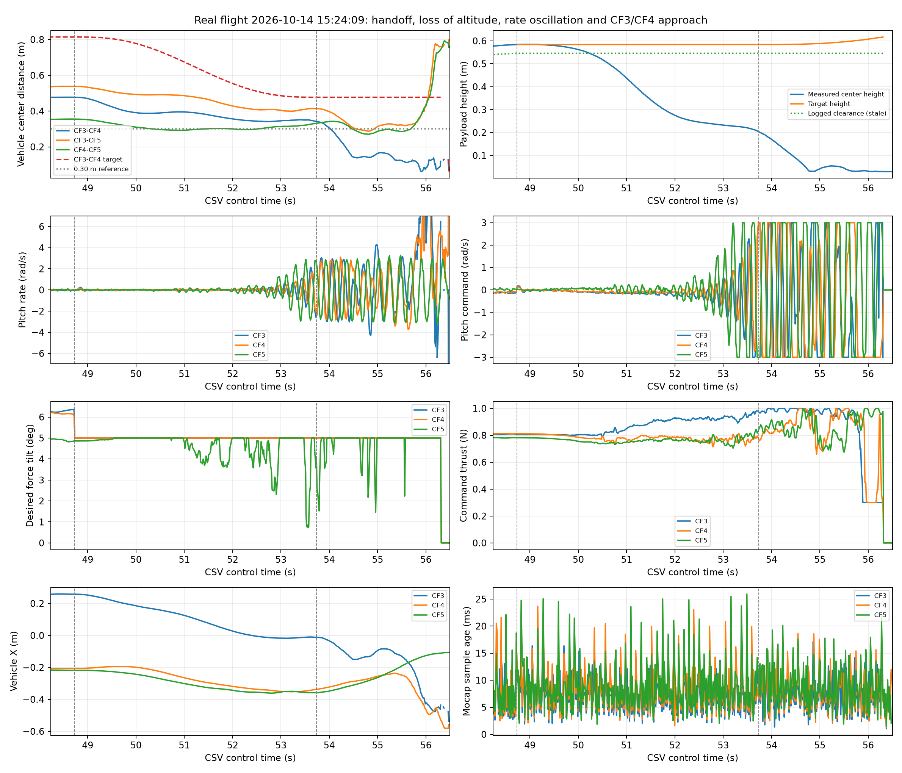

# 最新实飞碰撞分析：20261014_152409

源 CSV：[multi_ctbr_20261014_152409.csv](../multi_ctbr_20261014_152409.csv)。本文时间均为日志 `control_time_s`。

记录显示 CF3 与 CF4 在接管后逐渐靠近，中心距离最小为 0.0618 m。碰撞的准确接触时刻无法仅由 CSV 确定，但这一距离与用户观察到的碰撞一致。控制目标没有要求两机靠拢；在切换后的目标轨迹中，CF3/CF4 的目标距离最小仍为 0.4774 m。

问题不是单纯“运输姿态增益还和仿真不一致”。这次的角速度指令可用当前 `[12,12,6]` 姿态增益与 `[1,1,0.5]` 角速度反馈重构，最大差异为 4.44e-16。更早发生的是水平控制限制和负载高度丢失，接近完整接管时姿态/角速度振荡放大，最终间距迅速缩小。

## 关键时序

| 时间/s | 接管后/s | 观测 |
| --- | ---: | --- |
| 48.734 | 0.000 | 开始 tension_ramp；CF3/CF4 间距 0.477 m；负载中心 0.584 m |
| 50.618 | 1.884 | 负载中心比参考低超过 0.08 m；控制仍继续接管 |
| 51.733 | 2.998 | 负载中心已降至 0.306 m；CF3/CF4 间距 0.367 m；飞机角速度尚未反复饱和 |
| 53.287 | 4.553 | CF5 首次横向角速度命令达到 ±3 rad/s，blend=0.99376 |
| 53.610 | 4.876 | CF3 首次饱和，blend=0.99985 |
| 53.736 | 5.002 | 进入 height_correction；CF4 首次饱和；负载中心仅 0.204 m |
| 54.044 | 5.310 | CF3/CF4 中心距离低于 0.30 m |
| 54.333 | 5.598 | 间距低于 0.20 m，沿连线的闭合速度约 0.38 m/s |
| 54.462 | 5.727 | 间距低于 0.15 m |
| 54.804 | 6.070 | 负载中心约 0.032 m，已接近地面，仍继续吊运输出 |
| 55.904 | 7.170 | CF3/CF4 中心距离仅 0.0618 m：水平 0.0567 m、竖直差 0.0246 m |
| 56.318 | 7.584 | 日志首次记载全局中止 `NOKOV 状态失效：cf3`，发生在靠近和坠落之后 |

接管后 5–7 秒，三机横向角速度命令至少一轴饱和的比例为 CF3 62.4%、CF4 58.9%、CF5 74.5%。CF3/CF4 的巨大角速度突变出现在靠近末段，可能同时包含碰撞后的转动，因此不能把末段的所有角速度峰值都归因于控制器。

用户描述了手动停止；CSV 本身记录的是上述 NOKOV 中止原因，未单独记录手动停止事件。碰撞前状态标志均为有效：从接管到 55.9 秒，每架飞机 502 个记录的 `state_valid` 都为 1。NOKOV 样本年龄中位数约 6.7/7.2/7.6 ms，最大约 18.4/23.7/25.9 ms；没有证据表明最初的靠近由持续定位丢失触发。



## 已确认的问题

### 1. 吊运接管撤掉了所需的水平力

`MultiCtbrControllerNode._transport_overrides()` 没有显式提供 `max_tilt_rad`。合并目标后继续采用 `CircularFlightTrajectory._height_correction_target()` 的起飞倾角限制 5°，覆盖车辆 YAML 的 10°，同时替代预抬目标的 12°。

在切换瞬间，尽管混合权重仍为 0，冻结的预抬输出也再次经过新的 5° 限幅：

| 飞机 | 切换前期望倾角 | 切换后 | 水平期望力幅值变化 |
| --- | ---: | ---: | ---: |
| CF3 | 6.362° | 5.000° | 0.08953 N → 0.07024 N，下降约 21.5% |
| CF4 | 6.089° | 5.000° | 0.08621 N → 0.07071 N，下降约 18.0% |
| CF5 | 4.859° | 4.859° | 首帧基本不变 |

CF3/CF4 后续吊运段期望合力倾角一直精确停在 5°，说明水平输出持续受到限制。当前三机的间距保持项仍然存在；碰撞前它的增益约为 2，没有在 5 秒结束时突然清零。提高位置保持增益也无法突破同一个水平力上限。

这一限幅路径及水平力下降由代码和日志共同确认，会削弱抗绳向内拉的能力。它不能独立解释所有负载下落和姿态振荡，因此仍需同时处理后续问题。

### 2. 完成预抬的实际支撑量没有持续保留

预抬最后稳定输出的 z 期望力约为 0.803/0.808/0.779 N。切换后约 2 秒变为 0.821/0.757/0.745 N，CF4/CF5 的命令支撑量下降；此时负载已下降约 0.10 m，尚未出现后面的持续角速度饱和。

三个预抬 z 积分状态均已达到 -8。`handoff_force` 只通过 `(1-blend)` 权重保留预抬输出，最终完全交给模型力和位置保持项。运输输出没有继续使用预抬 z 积分形成的承载补偿。日志只有推力命令，未测得真实推力；上述事实证明支撑命令和补偿策略存在差异，不能仅据此确定电机推力标定误差的数值。

### 3. 相同角速度增益面对的是不同的反馈链路

实机的 `body_rate` 来自 `crazyswarm_server.cpp` 中 NOKOV 相邻姿态的差分，然后使用 `mocap_state_derivative_alpha: 0.2` 做一阶低通。相同参数也用于平移微分。当前外部运输控制直接使用该低通后的机体角速度。

之前 Udaan 独立示例使用物理真值角速度；实机控制器延迟测试脚本虽然加入了消息延迟，飞机角速度仍使用延迟真值，没有模拟上述差分/低通路径，也没有完整复现实际固件速率环。

对本次 52.8–55.4 秒数据，以姿态变化差分估计角速度，再与报告角速度比较，最佳相关性大多出现在报告角速度滞后约 2 个 70 Hz 控制周期的位置，约 28.6 ms。CF3 roll 约 1 个周期。这里只是采样数据的近似关联，包含姿态差分和采样误差，不能作为独立的精确延迟标定。主要振荡频率约 4.6–5.4 Hz。

这表明仿真中有用的小角速度反馈，在实机上的有效相位和阻尼仍需验证。不能由一份飞行记录证明 `[1,1,0.5]` 是唯一的失稳原因，也不能把它继续增大当作已验证的解决办法。

本次运行当前配置的实机控制器仿真，使用 20 ms 位姿延迟、10 ms 命令延迟，模型仍通过：角速度命令饱和 0，最小负载间隙 0.270 m，最终位置误差 0.0183 m。该结果保存于 [simulation_current_20ms/summary.json](simulation_current_20ms/summary.json)。它再次说明目前模型没有覆盖这次真实失效条件，不能用“仿真通过”替代碰撞防护。

加入实机角速度差分和 `alpha=0.2` 低通后，当前 `[12,12,6]` 与 `[1,1,0.5]` 配置的延迟仿真在接管后触发 `height_drop` 保护；触发时最小机间距约 0.443 m，尚未发生碰撞。该回归记录在 `fixed_filtered_20ms/summary.json`。这不是起升成功结果，而是验证保护能在负载掉高后停止继续接管。

### 4. 缺少物理状态接管保护，间隙诊断仍冻结

控制器主要检测数据有效性，没有根据机间距收缩、负载掉高、持续姿态饱和停止接管。负载 `payload_ground_clearance_m` 在接管后仍重复 0.546054 m，即使中心高度已约 0.032 m，`payload_prelift_ready` 也保持 1；这些字段不能作为当前离地状态。

预抬门槛也未要求负载角运动充分稳定。此次接管第一帧负载姿态误差范数约 0.373、角速度范数约 0.529 rad/s；若取接近水平的姿态分支，姿态偏离约 22°。需要避免承载接管和明显负载姿态纠正同时突然加强。

## 解决方案及处理顺序

1. **给吊运阶段明确的倾角限制，并保持切换时水平输出连续。** 在运输 overrides 中显式设置倾角上限；过渡阶段至少能容纳已在预抬中建立的 6.1–6.4° 支撑方向。可采用预抬 12° 平滑过渡到车辆配置 10°，而非继承起飞 5°。全过程继续受现有总推力和角速度限幅约束。这需要修改目标覆盖逻辑；只改 `ctbr_vehicle.yaml.max_tilt_deg` 无法解决继承覆盖。

2. **加入机间距离与接管失败保护。** 对所有飞机对同时监测水平距离、竖直差、距离变化率；尤其在同一高度附近，需要把桨盘包络纳入距离判断。建议以中心距离 0.30 m 作为首轮仿真的候选边界，并结合 0.3–0.5 秒预测闭合距离提前处理；该数值尚未实飞标定。距离保护应在 TAKEUP、tension_ramp、reference_lift 和稳态运输都有效。将分离力与构型参考用于保持间距，满足不了推力/倾角约束时停止继续接管并进入预先验证的受控降落。仅冻结 blend 而继续保持导致收拢的力还不够。

   同时实时计算负载间隙。可将持续掉高超过 0.05–0.08 m、持续姿态饱和等作为候选失败条件，并通过持续时间和有效状态判定排除单帧噪声。本次超过 8 cm 掉高发生在接管后 1.884 秒，明显早于两机进入危险近距；CF4/CF5 也在 50.360 秒首先低于 0.30 m，间距保护应检查全部飞机对。发生失败后不能仅因数据仍有效就继续增加协同权重。

3. **保留稳定承载补偿，按实际跟踪状况完成接管。** 检查实机推力映射，保留或转换预抬 z 积分形成的稳定补偿，设置积分限幅及饱和保护。承载补偿的衰减和协同接管进度必须同时受负载高度、竖直速度和飞机跟踪误差约束；不要到 5 秒就认为已接管成功。不要简单增加负载质量或添加一个未经标定的固定推力增量。

4. **补齐反馈模型后再整定角速度阻尼。** 把 NOKOV 姿态差分、alpha=0.2 的低通、70 Hz 采样、无线电延迟、真实固件速率环响应纳入仿真，并使用此次接管时的构型/高度/负载姿态作为初始条件。在该条件下比较零反馈、小于 1 的反馈和 `[1,1,0.5]`。若采用固件陀螺角速度作为外环反馈，要先核实机体系、符号、单位、时间戳和单 Crazyradio 带宽；直接增加额外低通通常会进一步增加相位滞后。

5. **给仿真加入真实间距验收。** 当前机体 geom 只有 50×50×14 mm，旋翼和保护罩均设置 `contype=0/conaffinity=0`，没有真实桨盘碰撞包络；现有测试没有最小机间距离门槛。应使用实际旋翼/保护罩尺寸加入碰撞或距离包络，并断言全阶段最小间距、预测闭合风险、高度误差和饱和持续时间。增大 TAKEUP 外张量或 `outward_bias_fraction` 只能改变名义构型，无法单独约束实际最小间距；构型和持续分离机制需要一起验证。

## 本次已实施的修改

已将上述第一阶段保护写入控制器和配置：

- `ctbr_controller.py` 在运输目标中显式设置倾角：预抬最大 12°，参考抬升期间平滑过渡到车辆配置 10°，不再继承普通起飞的 5° 限制。
- 新增 `slung_transport_guard.py`。所有接管/运输周期检查三架飞机的实际中心距离和预测最近距离，默认边界 0.30 m、预测时域 0.35 s；负载相对参考掉高超过 0.08 m 或横向角速度命令持续饱和也会触发保护，均需持续 0.20 s 才触发。触发时停止继续增加接管权重，清除吊运覆盖，并调用现有每架飞机受控降落轨迹。
- 每周期刷新负载实际离地间隙；负载状态过期时将间隙和 `payload_prelift_ready` 清为无效，避免重复记录已经过时的 0.546 m。
- 新增 `SlungSupportTrim`，只保留预抬输出与协同模型输出之间的竖直差额，限制为每架 0.25 N，并以 0.03 N/s 的速率缓慢积分调整，避免重复叠加负载重力。
- `simulate_slung_handoff.py` 现在模拟实机的姿态差分和 `alpha=0.2` 角速度低通，并从实际平衡构型开始，加入最小机间距验收。

当前实机增益 `[12,12,6]`、`[1,1,0.5]` 加入真实低通后，离线仿真会在掉高保护触发时进入 emergency landing；触发时最小机间距约 0.443 m，没有进入碰撞边界。这说明保护生效，但也说明当前参数/承载模型仍未达到“稳定完成吊运”，暂不应直接继续实飞。

当前最有依据的下一步是用这个保护版本继续仿真整定承载补偿和运输姿态环；保护本身只保证停止继续吊运并启动每机降落，不保证负载在降落过程中保持绷紧或安全着地。实飞前应先在仿真中达到：不触发 height_drop/rate_saturation、全程机间距超过 0.30 m、负载完成参考抬升。

## 2026-10-15 参数扫描与滤波结果

最新 `headless_run` 使用 `[6,6,3]`、`[2,2,1]`，无滤波时成功完成 0.6 m 起升，但悬停最后 5 s 的 CF5 推力标准差约 0.0112 N，CF5 俯仰角速度命令标准差约 0.814 rad/s。16 组姿态/角速度增益扫描中，没有发现比这组无滤波参数同时更稳定且不触发保护的组合。

直接对角速度命令使用 20 ms 一阶滤波会让姿态跟踪滞后，推力标准差升到约 0.20 N，因此没有采用该方案。

对运输阶段限幅后的整机期望力向量做一致的一阶滤波，并用滤波后力的前后差分计算 `desired_force_dot`，时间常数 5 ms 的回放结果为：不触发保护、最终负载高度约 0.600 m、CF5 推力标准差约 0.00082 N。候选文件 [slung_70hz_candidate.yaml](../../simulation_configs/slung_70hz_candidate.yaml) 已设为 `transport_force_filter_tau_s: 0.005`，实机 [ctbr_vehicle.yaml](../../config/ctbr_vehicle.yaml) 保持 0.0，避免未经实飞验证的滤波参数自动进入实机。

该滤波作用在期望力向量和姿态方向计算之前，推力仍由同一个滤波后期望力投影得到；因此没有把 collective thrust 单独滤波造成力方向与 `Omega_c` 不一致。后续实飞前应继续用包含实际延迟的回放确认该滤波不会降低承载能力。

## 可复现数据

[summary.json](summary.json) 保存间距极值、门槛穿越时刻、首个角速度饱和、命令重构误差及时间线；[analyze_collision.py](analyze_collision.py) 可从源 CSV 重新生成图表和摘要：

```bash
python ctbr_logs/analysis_20261014_152409/analyze_collision.py
```

实时显示离线回放的 MuJoCo 场景：

```bash
python simulate_slung_handoff.py \
  --render \
  --candidate simulation_configs/slung_70hz_candidate.yaml \
  --output ctbr_logs/visual_replay
```

保存回放视频时增加 `--record ctbr_logs/visual_replay.mp4`。回放产生的 `simulation_trace.csv` 可以绘图：

```bash
python plot_slung_handoff_trace.py \
  ctbr_logs/visual_replay/simulation_trace.csv \
  --save ctbr_logs/visual_replay/trace.png \
  --no-show
```

离线回放默认沿用 `ctbr_trajectory.yaml` 的 1.0 m 目标；如果要复现“预抬到约 0.2 m 后吊运到 0.6 m”，应显式指定：

```bash
python simulate_slung_handoff.py \
  --target-payload-height 0.60 \
  --output ctbr_logs/target_060_replay
```

`transport_fault_confirm_s` 只控制掉高、预测接近或持续角速度饱和需要保持多久才触发保护，不控制 CSV 的总时长。离线回放的接管后观察时长由 `slung_payload.yaml` 的 `post_handoff_s` 控制；当前默认 60 s。回放会暂时延长普通任务的 hover 时长，避免任务自身在 30 s 后提前进入 landing；因此正常情况下日志会从接管约 28.97 s 记录到约 88.97 s，除非先触发距离、掉高或负载掉落保护。
