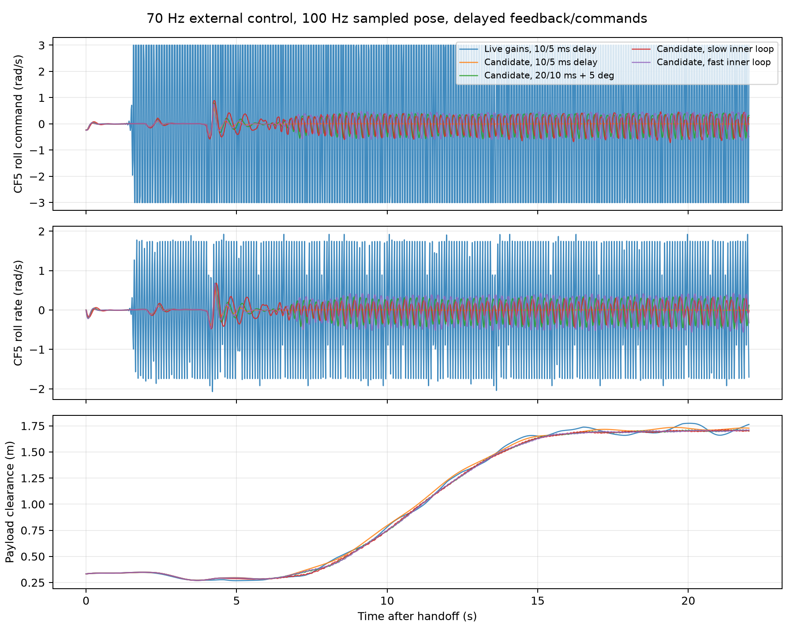

# 70 Hz 仿真对齐与接管参数验证

已将 Udaan 外部控制器从 500 Hz 改为严格 70 Hz，与当前实机 `ctbr_controller.control_rate_hz` 对齐。物理积分步长不超过 2 ms，推力/角速度指令在控制周期之间保持；电机、机载速率环及负载动力学持续按物理子步更新。负载位姿观测独立保持 100 Hz。

原实机控制器仿真测试每 7 个 2 ms 子步更新一次，实际频率为 71.43 Hz。新实现按 `1/70 s` 的控制时刻缩短末尾子步，CSV 校验得到 70.000000 Hz；70 次更新推进 1 秒，并获得包含初始样本的 101 个负载位姿样本。

最新实飞 `multi_ctbr_20261013_222956.csv` 的 CF3 共 3433 个控制样本，平均频率 69.9983 Hz，周期中位数 14.2861 ms，周期 5%–95% 分位为 13.34–15.19 ms。当前仿真对齐名义 70 Hz，暂未加入这部分控制周期抖动。

## 仿真候选参数

三架飞机的运输姿态增益均为 `[12, 12, 6]`，额外角速度反馈均为 `[0, 0, 0]`，保存在 [slung_70hz_candidate.yaml](../../simulation_configs/slung_70hz_candidate.yaml)。Udaan 默认参数同步采用这组值。实机运行的 `config/ctbr_vehicle.yaml` 与 `config/slung_payload.yaml` 本次未改动。

这组参数作用于外部角速度指令接口；MuJoCo 内部另有一阶机载速率环。原来的 `[240,240,120]` 和 `[35,35,20]` 在 70 Hz 采样、延迟反馈条件下产生持续角速度命令饱和。额外角速度反馈置零不会删除机载速率环自身的反馈。

## 测试条件与结果

离线脚本直接使用实机 `ctbr_controller.py` 的任务状态机、控制律、负载位姿观测器，替换 ROS 收发接口。飞机从接近收绳的构型开始，完成 PID 预抬、5 秒张力接管、12 秒参考抬升，再观察到接管后 22 秒。负载位姿以 100 Hz 采样后延迟到达；命令也经过独立延迟队列。飞机速度/加速度使用延迟的 MuJoCo 真值，未模拟完整固件 EKF。

MuJoCo 场景从当前实机 YAML 读取质量与挂点：飞机质量分别为 0.0434/0.0440/0.0424 kg，负载质量 0.054 kg，绳长 0.709/0.699/0.681 m。Udaan 独立示例原有的绳长和质量默认值保留，实机接管测试使用上述实际配置。

定位/命令延迟设置为 10/5 ms 或 20/10 ms。这些是测试假设，命令延迟和内环带宽尚未实测标定。内环一阶响应系数分别测试 roll/pitch/yaw = 35/35/20、20/20/12、50/50/30 s⁻¹。

| 条件 | 控制频率 | 接管后速率命令饱和周期占比 | 最小负载离地间隙 | 最终负载位置误差 |
| --- | ---: | ---: | ---: | ---: |
| 原实机增益，定位/命令延迟 10/5 ms | 70.000000 Hz | 92.80% | 0.267 m | 0.191 m |
| 候选参数，延迟 10/5 ms | 70.000000 Hz | 0.00% | 0.271 m | 0.010 m |
| 候选参数，延迟 20/10 ms，初始倾斜 ±5° | 70.000000 Hz | 0.00% | 0.271 m | 0.015 m |
| 候选参数，延迟 20/10 ms，较慢内环 20/20/12 | 70.000000 Hz | 0.00% | 0.271 m | 0.016 m |
| 候选参数，延迟 20/10 ms，较快内环 50/50/30 | 70.000000 Hz | 0.00% | 0.271 m | 0.010 m |

饱和周期定义为至少一架飞机任一机体轴的角速度命令达到该轴限幅。最终位置误差为三维位置误差范数。所有运行约在 28.97 秒接管、50.99 秒结束；最终参考为 `[-0.0373, 0, 1.7486] m`。原参数虽进入悬停阶段，但因持续饱和不满足验证标准；当前模型没有复现真实负载坠落的全过程，因此不能据此认为实机问题已全部解决。



每个子目录保存真实控制器 CSV、`simulation_trace.csv` 真值对比和 `summary.json`。频率与比较数据汇总在 [comparison.json](comparison.json)，[analyze_simulation.py](analyze_simulation.py) 可重新生成图表。新运行还会保存 `input_parameters.yaml`，固定当次输入配置。

Udaan 独立全流程也通过：负载最高中心高度 1.0006 m，约 74.16 秒完成起飞、起升、30 秒悬停及降落，最终负载与三架飞机均接地。对应 CSV 为 `simulate_uav/udaan/logs/slung_70hz_candidate.csv`。该示例未加入通信延迟，实机参数判断应参考上面的实际控制器延迟测试。

## 复现

在已安装 MuJoCo 的 `udaan` 环境中，进入 `crazyswarm/ros_ws/src/crazyswarm/scripts`：

```bash
python simulate_slung_handoff.py \
  --candidate simulation_configs/slung_70hz_candidate.yaml \
  --pose-delay 0.02 --command-delay 0.01 \
  --output ctbr_logs/slung_sim_candidate

python test_slung_prelift_mujoco.py
```

省略 `--candidate` 会读取当前实机增益，作为对照；当前原参数对照返回 `sustained_rate_saturation` 并退出码 1，这是验证门槛未通过。以候选 YAML 的 `input_parameters.yaml` 作为 `--candidate` 可复用记录的参数。

Udaan 独立全流程：

```bash
cd /home/csy/my_project/simulate_uav/udaan
udaan run crazyswarm-slung --no-render --csv logs/slung_70hz.csv
python -m unittest tests.test_crazyswarm_slung
```

验证结果：Udaan 19 项测试通过；CrazySwarm Python 回归 122 项通过、1 项因默认 Python 缺少 MuJoCo 跳过；该 MuJoCo 实机控制器接管测试已单独在 `udaan` 环境中运行并通过。频率/动力学/队列实现已独立代码审查。

`udaan` Conda 环境原先安装的包未指向工作区；已执行 `python -m pip install --no-deps -e .` 切换为当前源码的可编辑安装。`udaan run crazyswarm-slung --no-render --time 0.05` 已验证能加载新场景，并显示控制 70 Hz、物理步长不超过 2 ms。

本次结果支持在当前模型和测试条件下采用这组仿真候选参数。后续实机对齐仍需测量机载速率环的实际响应、命令延迟，检查接管阶段倾角限幅及负载状态监测；这些差异没有通过调低姿态增益自动消失。
